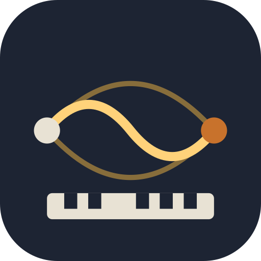

# Unsampled Piano



Physically modelled virtual piano, real-time from MIDI, in Rust. No samples are used to produce the sound (recordings are used only for analysis and calibration).


Physical chain: felt hammer (passive quadratised contact) → 1 to 3 stiff strings per key, two polarisations, coupled at the bridge (Weinreich modes) → modal soundboard (clamped orthotropic plate) → Rayleigh radiation to two microphones (optional lid) → room (image-source reflections, reverberation). The cast-iron frame (excited at the agraffes) and the rim (excited by the soundboard edges) also radiate. On top of this come the dampers, the pedals (half-pedal, sostenuto, una corda), sympathetic resonance through the bridge and impulse-driven mechanical noises.

## Usage

```bash
# play: the piano becomes a node in the PipeWire graph (JACK API) with stereo
# output, MIDI input (sample-accurate timing) and a MIDI output mirroring what it
# plays; it connects to the default output and to the first keyboard
# (--midi / --device to choose, --host pipewire for the old cpal mode;
# personal defaults in ~/.config/unsampled-piano/play.toml, e.g.
# device = "Stereo DJ X-Fade:In B")
cargo run --release -p piano-play -- --list
cargo run --release -p piano-play -- --buffer 128 [--preset presets/listening/Microphones/close.toml | …/concert.toml]
# presets: presets/instruments/<family>/*.toml (an instrument) and
# presets/listening/{Microphones,Room}/*.toml (microphones and lid, room);
# in the interface (--ui), loading a listening preset keeps the instrument
# and loading an instrument keeps the listening set-up
# the preset is watched: when edited during play, the instrument is
# rebuilt in the background (≈ 0.1 s) without cutting held notes
# play MIDI files in sequence (sample-accurate timing; --from skips the beginning)
cargo run --release -p piano-play -- --buffer 128 --file data/midi/*.mid

# offline rendering (stereo WAV)
cargo run --release -p piano-render -- midi piece.mid out/piece.wav
cargo run --release -p piano-render -- note out/c4.wav --note 60 --velocity 90
cargo run --release -p piano-render -- dump-preset presets/my_piano.toml

# calibration against a <note>v<layer> sample bank
tools/calibrate.sh data/salamander/Samples out/calib

cargo test --workspace
```

In the interface (`--ui`), the **Audio and MIDI** page chooses the backend, the output, the channel pair, the buffer size, the MIDI input and (graph node) the MIDI mirror while the piano plays: the node reconnects its ports, another backend or device restarts the audio with the instrument rebuilt at its sample rate (≈ 0.1 s), and a failed choice falls back to the previous set-up. The choices are saved to `play.toml`; options given on the command line still take precedence at the next start.

On Linux, `tools/install-app.sh` builds the player and installs it for the current user, with a menu entry (`installer/linux/unsampled-piano.desktop`, which opens the interface), its icon and the shipped presets, under `~/.local` (`PREFIX=/usr/local` for every user, as root). Saved presets go to `~/.config/unsampled-piano/presets`.

## Windows, macOS and Linux packages

The standalone player for each comes from the `Standalone` workflow of GitHub Actions (run it from the Actions tab, or push a `v*` tag). Opened from the Explorer or the Finder, it shows the interface and plays through the default output, with the first MIDI keyboard; from a terminal it takes the same options as on Linux, e.g. `--device`, `--output-channel` for a pair other than 1–2 on a multichannel interface.

- **Windows**: an installer, `unsampled-piano-setup-windows-x86_64.exe`, that offers the standalone application, the VST3 plugin and the CLAP plugin, each one optional, and the presets they share, for all users (`Program Files`, `Common Files\VST3` and `\CLAP`, `ProgramData\Unsampled Piano\presets`) or for the current user only, with a Start menu shortcut and an uninstaller (script: `installer/windows/unsampled-piano.iss`); or a zip with `unsampled-piano.exe`, which needs nothing else installed, and the presets beside it. Output through WASAPI, or `--host asio` (the buffer size is then the one set in the driver's control panel). Personal defaults go in `%APPDATA%\unsampled-piano\play.toml` (also `host = "asio"`).
- **macOS**: `Unsampled Piano.app`, universal (Intel and Apple silicon), output through CoreAudio, presets inside the bundle. It is not notarised: the first time, open it with a right click → Open (or `xattr -dr com.apple.quarantine "Unsampled Piano.app"`). Personal defaults go in `~/Library/Application Support/unsampled-piano/play.toml`; from a terminal, run `"Unsampled Piano.app/Contents/MacOS/unsampled-piano"`.
- **Linux**: an archive, `unsampled-piano-<version>-linux-x86_64.tar.gz` (built on Ubuntu 24.04: PipeWire and glibc 2.39 or later), with the player, the CLAP and VST3 plugins, the presets, the menu entry and `install.sh`: `./install.sh` for the current user (`~/.local`, `~/.clap`, `~/.vst3`), `sudo ./install.sh --system` for all users (`/usr/local`, `/usr/lib/clap`, `/usr/lib/vst3`), `--uninstall` to remove them. Arch Linux and derivatives: the AUR packages `unsampled-piano` (a release) and `unsampled-piano-git` (the latest commit), whose PKGBUILDs are in `installer/aur/`; `installer/linux/make-archive.sh` builds the archive locally.

Presets: the interface (standalone and plugins) lists the presets saved by the user, in `presets` of the configuration directory (where saving writes), then the shipped ones, read-only: beside the program or in the bundle, and where an installer puts them, `%PROGRAMDATA%` or `%LOCALAPPDATA%\Unsampled Piano\presets` on Windows, `/Library/Application Support/Unsampled Piano/presets` (or the user's own) on macOS, `/usr/share/unsampled-piano/presets` (`$XDG_DATA_DIRS`) on Linux. A saved preset of the same name hides the shipped one. Without the Windows installer, copying `presets` to one of those folders gives them to the plugins.

Building them locally: `cargo build --profile dist -p piano-play` on Windows (cross-compiling from Linux works with `--target x86_64-pc-windows-gnu`), `tools/macos-app.sh` on a Mac (the bundle, in `target/macos`). ASIO is the `asio` feature: it needs the Steinberg ASIO SDK (dual-licensed, GPLv3; `CPAL_ASIO_DIR`, else downloaded), libclang and MSVC, so cross-compiling it with MinGW does not work.

## Plugin

CLAP and VST3 instrument, "Unsampled Piano". The live parameters (output gain, pedal and damper behaviour, velocity curve, mechanical noises) are automatable host parameters; the rest of the instrument and the MIDI-learnt controllers are saved with the project, and editing them rebuilds the instrument in the background without cutting the notes.

Builds for Linux, Windows and macOS (universal) come from the `Plugin` workflow of GitHub Actions: run it from the Actions tab, or push a `v*` tag to attach the bundles to a release. Locally:

```bash
cargo xtask bundle piano-plugin --release   # target/bundled/Unsampled Piano.{clap,vst3}
tools/install-plugin.sh                      # Linux: into ~/.clap and ~/.vst3
cargo build -p piano-plugin && cargo test -p piano-plugin   # loads the .clap as a host would
```

## AI assistants (MCP)

`unsampled-piano --mcp` serves the playing instrument to AI assistants through the [Model Context Protocol](https://modelcontextprotocol.io) (HTTP, `http://127.0.0.1:7426/mcp`; `--mcp ADDR` for another address, `mcp = true` in `play.toml` to have it always on). The assistant changes the sound while you play, through the same controller as the interface: live parameters apply at once, the others rebuild the instrument in the background without cutting the notes. Tools:

| Tool | Does |
|---|---|
| `list_params` | parameters with their value, default, unit, range, live or rebuild (filter by word or group) |
| `get` | one parameter, with what it changes on the piano and how the model does it |
| `set` | changes one parameter; for a rebuild, answers once the new instrument plays |
| `load_preset` | loads an instrument (keeps the listening set-up) or a listening preset (keeps the instrument) from the preset folder, or a file |
| `status` | rebuild pending, last build time, voices, CPU load, last error |

The server listens on the loopback interface only by default and has no authentication: any program on the machine can reach it while it runs. With Claude Code:

```bash
claude mcp add --transport http unsampled-piano http://127.0.0.1:7426/mcp
```

## Reference performances

The files in `data/midi/` come from [MAESTRO v3](https://magenta.tensorflow.org/datasets/maestro) (Google Magenta, CC BY-NC-SA 4.0): Piano-e-Competition pianists recorded on a Disklavier, with the actual key velocities and pedals. `data/` is not under version control; to retrieve them:

```bash
curl -L -o data/maestro/maestro-v3.0.0-midi.zip https://storage.googleapis.com/magentadata/datasets/maestro/v3.0.0/maestro-v3.0.0-midi.zip
```

## Crates

| Crate | Role |
|---|---|
| `piano-core` | DSP engine, no dependencies (`serde` feature for presets) |
| `piano-host` | TOML presets, MIDI decoding |
| `piano-params` | parameter registry (paths, ranges, live or rebuild), MIDI learn, `PianoControl` trait |
| `piano-control` | control of a playing instrument: live parameters, background rebuild and engine swap without cutting notes (standalone player and plugin) |
| `piano-ui` | egui interface on top of `PianoControl` |
| `piano-plugin` | CLAP and VST3 instrument plugin (nice-plug), with the `piano-ui` editor |
| `piano-mcp` | MCP server of the standalone player (`--mcp`): parameters, presets and status for AI assistants |
| `xtask` | plugin bundles for the current platform (`cargo xtask bundle piano-plugin --release`) |
| `piano-play` | real-time application (`unsampled-piano` binary): PipeWire/JACK node (audio, MIDI in, MIDI mirror), or cpal + midir |
| `piano-render` | deterministic offline MIDI → WAV rendering (`unsampled-piano-render` binary) |
| `piano-analysis` | analysis: partials, B, decays, ESPRIT, spectral distances |
| `piano-eval` | comparison of the model with a reference bank |
| `piano-bench` | modal kernel throughput, f32 precision |

## Documentation

- State of the art and plan: [reports/piano_physical_synthesis.md](reports/piano_physical_synthesis.md)
- Phase 0 (tooling, CPU and precision measurements): [docs/phase0.md](docs/phase0.md)
- Analysis of Salamander Grand (Yamaha C5): [docs/salamander.md](docs/salamander.md)
- Phase 1 (string + hammer, calibration): [docs/phase1.md](docs/phase1.md)
- Phase 2 (coupled unisons, polarisations, bridge conductance): [docs/phase2.md](docs/phase2.md)
- Phase 4 (modal soundboard, radiation, stereo): [docs/phase4.md](docs/phase4.md)
- Phase 3 (dampers, pedals, sympathetic resonance): [docs/phase3.md](docs/phase3.md)
- Phase 5 (mechanical noises, presets, real time, calibration): [docs/phase5.md](docs/phase5.md)
- Cast-iron frame and rim: [docs/frame_rim.md](docs/frame_rim.md)
- Note sustain (bridge, soundboard thickness, string losses): [docs/sustain.md](docs/sustain.md)
- Dynamics, pedal and sympathetic resonance: [docs/dynamics_pedal.md](docs/dynamics_pedal.md)
- Comparison with Salamander, Iowa and a commercial modelled piano: [docs/comparison.md](docs/comparison.md)
- Bass string losses (unison detuning, cabinet piston mode): [docs/bass.md](docs/bass.md)
- Timbre change with dynamics (felt): [docs/timbre_dynamics.md](docs/timbre_dynamics.md)
- String nonlinearity (phantom partials): [docs/nonlinearity.md](docs/nonlinearity.md)
- Attack presence (two-layer hammer, microphone setups): [docs/presence.md](docs/presence.md)
- Sustain after the first second (unison detuning, piston, string losses): [docs/long_sustain.md](docs/long_sustain.md)
- Radiation of bass fundamentals (acceleration-driven radiation, soundboard crown): [docs/bass_radiation.md](docs/bass_radiation.md)
- Brightness of attack and sustain (soundboard damping, felt, hammer velocity): [docs/brightness.md](docs/brightness.md)
- Middle register: the 4–8 kHz highs (hammer pulse): [docs/middle_highs.md](docs/middle_highs.md)
- What rings on after the release (undamped top strings, damper range): [docs/release_ring.md](docs/release_ring.md)
- A range of instruments from one engine (hammer mass, strike point, preset fitting): [docs/instrument_range.md](docs/instrument_range.md)
- Room level (piano directivity, microphone patterns): [docs/room_level.md](docs/room_level.md)
- Uprights (half blow, practice mute, repetition, wall, case, placement in the room, directivity): [docs/upright.md](docs/upright.md)

## License

Copyright © 2026 Mathieu GRENET.

This program is free software: you can redistribute it and/or modify it under the terms of the GNU General Public License as published by the Free Software Foundation, either version 3 of the License, or (at your option) any later version. It is distributed WITHOUT ANY WARRANTY. See [LICENSE](LICENSE).
