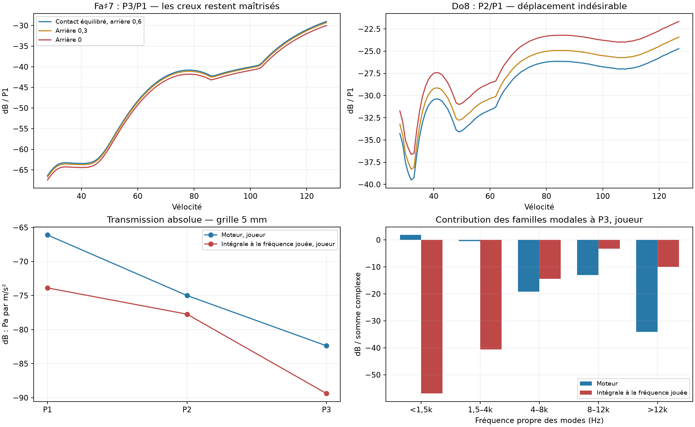

# Fa♯7 : transmission du chevalet aux oreilles

28 octobre 2026. Worktree `piano-main-revalidation`, branche `codex/piano-main-revalidation`, base `40afaf2` (main acoustique `c0c91ce`). **Défaut, DSP de production, UI et sélection des références inchangés.** Le contact expérimental « équilibré » de l’étude précédente reste le contrôle ; il n’est pas devenu le défaut. Géométrie actuelle conservée : contour réel pour les modes sous 1 500 Hz, modes rectangulaires au-dessus, surface rayonnante découpée au contour.

## Résultat et décision

Deux causes de sensibilité sont isolées dans le modèle : les interférences entre les deux faces de la table, et le rayonnement calculé à la fréquence propre des modes lorsqu’ils sont excités à une autre fréquence. La seconde approximation explique une contribution artificiellement importante des modes graves au P3 entendu à la position joueur. Elle ne fournit toutefois pas, à elle seule, une correction de P3/P1 : recalculer le rayonnement diminue aussi P1.

Les deux ablations de face arrière ont été comparées à couverture constante. Elles conservent la régularité de Fa♯7, mais assombrissent son P3 pianissimo et dégradent Do8. Elles sont rejetées. Aucun réglage n’est promu.

Le contrôle sur Plath impose aussi de **retirer l’interprétation de l’ancien écart d’environ 7 dB comme une cible de transfert identifiée**. Les chiffres de puissance de l’étude précédente restent reproductibles, mais ils comparent des pics et des attaques choisis séparément dans les deux capteurs. La bande appelée P3 dans ce piano ne permet pas cette identification scalaire avec assez de confiance.

## Ce que Plath permet réellement d’identifier

Les cinq prises PROD08 de Fa♯7 sont relues en unités physiques, accélération du chevalet et pressions des deux oreilles. Pas de normalisation par note, pas de somme mono. Conversion 50 → 48 kHz par filtre polyphasé, retrait du continu, départ temporel commun déterminé par la puissance stéréo. Le canal F n’est pas utilisé.

La sonde calcule H1 = spectre croisé accélération–pression / autospectre de l’accélération, séparément par oreille, puis rapporte leur puissance moyenne. Les deux capteurs utilisent **les mêmes bins fréquentiels**. Quatre fenêtres : 0–60, 30–120, 80–200 et 200–500 ms ; Welch 1 024 échantillons, pas 128. SNR et cohérence sont conservés, avec des indicateurs diagnostiques à 12 dB et 0,8. Ces indicateurs ne retirent aucune ligne du banc historique.

Pour Fa♯7, le survey Plath ne suit que P1 et P2. La fenêtre P3 est extrapolée à **9 054,90 Hz**, alors que le modèle a un P3 à **9 424,81 Hz**. Dans les cinq prises, les pics dominants de la bande considérée se situent vers 9 051 Hz aux oreilles et 9 093 Hz au chevalet ; une autre famille apparaît vers 9 670 Hz, particulièrement forte dans l’accélération. On ne peut pas choisir le pic le plus fort indépendamment de chaque côté et appeler leur quotient un transfert de la même composante.

Le contrôle de résolution utilise 1 024, 2 048 et 4 096 échantillons, avec les fenêtres 0–120, 30–200 et 0–300 ms. Sur 30–200 ms à 4 096 échantillons, la cohérence du pic de la bande P3 est seulement **0,07–0,41 à gauche**, malgré un SNR de pression de 11–17 dB. À droite : 0,33–0,80. Le problème ne disparaît donc pas en affinant la résolution. Il reste peu de segments indépendants, et la cohérence ainsi estimée n’est pas un intervalle de confiance. Les contrôles sur quatre touches voisines ne suffisent pas à attribuer la famille vers 9 670 Hz à P3 ; elle n’est pas substituée au P3 du banc.

Une faible cohérence ne signifie pas que la pression serait fausse : un seul accéléromètre ne décrit pas tout le champ de déplacement, les composantes proches ont des enveloppes différentes, et les transitoires limitent l’identification. **La mesure disponible ne sépare pas proprement ces effets.** La position joueur du modèle reste approximative et la réponse de la tête artificielle n’y est pas reproduite. Plath ne fournit ici qu’une dynamique et cinq répétitions : la garde pianissimo dépend des autres références et des balayages du modèle.

## Interférence entre les faces : un gain surtout dans le dénominateur

Contact, mécanique, micros joueur et modèle de table constants ; salle, couvercle et limiteur désactivés pour cette identification. La sonde `ear_transfer` calcule la réponse exacte des pôles discrets de la table, avec leurs deux parties conjuguées, leur terme direct et le différenciateur audio. Les fréquences sont les partiels physiques du modèle.

| Variante, position joueur | H(P1), dB | H(P3), dB | H(P3) − H(P1), dB |
|---|---:|---:|---:|
| Contribution arrière 0,6 ; grille 15 mm | −66,27 | −82,16 | −15,89 |
| Contribution arrière 0 | −61,45 | −84,45 | −23,01 |
| Contribution arrière 0,6 ; grille 5 mm | −66,10 | −82,38 | −16,27 |
| Contour propre étendu jusqu’à 3 kHz | −64,48 | −84,02 | −19,54 |

H est en Pa par m/s². Retirer la face arrière réduit P3 de **2,29 dB**, mais augmente P1 de **4,82 dB** : le changement relatif de 7,11 dB n’est donc pas une suppression de 7 dB du seul P3. Ce comportement provient de l’image arrière en opposition de phase, avec un détour fixe de 0,6 m et un gain fixe de 0,6.

L’intégration spatiale du moteur converge : passer de 15 à 5 mm change H3/H1 de seulement 0,38 dB. Cela écarte une erreur de grille de plusieurs dB **pour le calcul actuel, aux trois fréquences contrôlées**. La suppression simultanée du cadre, de la ceinture, de la sympathie et du bruit d’action ne produit qu’environ 1,2 dB de changement sur H1 relatif dans l’attaque. La position du micro a, elle, un effet fort : H3/H1 vaut −8,70 dB en écoute rapprochée, contre −15,89 au joueur. Remplacer le point de région par le point exact de la touche dans la sonde ne résout pas le problème : H3/H1 devient −13,38 dB. Ce dernier contrôle n’est pas une modification du couplage de production.

Les valeurs sur le signal d’attaque diffèrent des sinusoïdes stationnaires : le H1 relatif de l’attaque vaut −17,14 dB pour le joueur et −24,07 sans face arrière. Les transitoires et le fenêtrage empêchent de les confondre avec les valeurs analytiques.

## Rayonnement hors résonance : cause structurelle confirmée, correction non validée

`Soundboard::field` évalue le noyau spatial de Rayleigh à la fréquence propre de chaque mode. `to_acceleration_weights` corrige ensuite le facteur vitesse/accélération ; il ne recalcule pas les délais de propagation à la fréquence excitée. À P3, les contributions de modes sous 1,5 kHz et entre 1,5 et 4 kHz sont ainsi très grandes dans l’écoute joueur, alors que ces modes sont sollicités autour de 9,4 kHz.

La nouvelle sonde **hors ligne** `driven_rayleigh` garde les mêmes pôles mécaniques, le même point de région, le même différenciateur, le même contour et les mêmes chemins acoustiques. Elle intègre le champ d’accélération complexe à la fréquence effectivement excitée, puis applique le noyau acoustique à la réponse complète de chaque paire de pôles. Elle remplace donc à la fois l’évaluation à la fréquence propre et son incorporation dans les poids complexes des pôles. Elle ne constitue pas une ablation de la seule phase.

Le calcul est vérifié contre `Soundboard::radiation` à la fréquence propre de quatre modes, dont un mode du contour réel : erreur relative maximale inférieure à 6 × 10⁻¹² dans les six configurations. Salle, couvercle et mur sont exclus explicitement. Ce contrôle vérifie la quadrature et la convention spatiale, pas la validité acoustique de la table ou de l’image arrière.

| Grille 5 mm | H(P1) moteur | H(P1) intégrale excitée | H(P3) moteur | H(P3) intégrale excitée | H3/H1 moteur → intégrale |
|---|---:|---:|---:|---:|---:|
| Joueur | −66,10 | −73,87 | −82,38 | −89,39 | −16,27 → −15,51 |
| Micros rapprochés | −43,68 | −40,06 | −52,39 | −66,08 | −8,71 → −26,02 |

À la position joueur, le poids relatif des modes sous 1,5 kHz dans P3 passe de +1,8 dB à −56,9 dB par rapport à la somme ; ceux entre 1,5 et 4 kHz passent de −0,4 à −40,6 dB. Ce sont des contributions complexes : leurs puissances ne s’additionnent pas. Le P3 total baisse de 7,0 dB, mais P1 baisse de 7,8 dB. **Le ratio P3/P1 ne s’améliore pas.** Aux micros rapprochés, le ratio change beaucoup, de 17,3 dB : c’est une piste structurelle sérieuse pour expliquer une partie de l’excès entendu avec cette écoute, pas un réglage validé.

Cette intégrale exige une grille plus fine : au joueur, H(P3) vaut −91,14 / −89,62 / −89,39 dB pour 15 / 7,5 / 5 mm. Les deux dernières grilles diffèrent de 0,23 dB ; aucun énoncé de convergence générale au-delà de ces points. En écoute rapprochée, 15 → 5 mm change H(P3) de 0,11 dB.

Il ne s’agit pas d’un nouveau moteur audio : pas de WAV de cette intégrale ni de score de réalisme revendiqué. La transformation est linéaire ; une correction visant la même fréquence ne sait pas distinguer forte et pianissimo. Une implémentation temporelle devra être évaluée sur les deux dynamiques, les transitoires et Do8 avant toute promotion.

## Comparaison des réglages à couverture constante

Deux candidats rendent la contribution arrière 0,3 ou 0 au lieu de 0,6, globalement sur les touches mesurées. Tous les paramètres de contact sont conservés, dont le profil équilibré de Fa♯7, le profil protégé de Do8 et les réglages de main pour Do♯7/Ré♯7. Écoute du banc précédente inchangée : micros rapprochés et studio. Les mesures de transfert sans salle ci-dessus restent un diagnostic séparé.

**896 nouveaux WAV** de candidats : 96 attaques de 1,2 s et 800 frappes de balayage. Réemploi des 448 WAV du contrôle identique ; trois attaques de contrôle rerendues sont identiques bit à bit. Les mêmes 459 observations d’attaque sont conservées (349 C7–C8, 110 de transition), ainsi que les 71 tenues et les 100 vélocités entières 28–127 sur Do♯7, Ré♯7, Fa♯7 et Do8. Identités vérifiées contre la baseline ; aucun retrait SNR côté candidat. Une tenue faible demeure dans chaque variante. Pas de nouvelle campagne de score global sur 88 touches : les gardes ciblées échouent déjà.

| Mesure | Contrôle équilibré, arrière 0,6 | Arrière 0,3 | Arrière 0 |
|---|---:|---:|---:|
| Fa♯7 P3 forte : écart moyen aux références | +8,40 | +8,17 | +7,56 |
| Fa♯7 P3 pp : écart moyen aux références | −7,08 | −7,37 | −8,06 |
| Creux Fa♯7 P2, dB | 1,282 | 1,280 | 1,301 |
| Creux Fa♯7 P3, dB | 1,386 | 1,388 | 1,389 |
| MAE Fa♯7, 34 observations | 9,451 | 9,302 | 9,022 |
| MAE Do8, 15 observations | 6,022 | 6,916 | 8,219 |
| MAE attaques C7–C8, 349 observations | 9,013 | 9,104 | 9,269 |
| MAE transition, 110 observations | 7,723 | 7,806 | 7,858 |
| MAE tenues, 71 observations | 15,777 | 15,488 | 15,169 |

Les MAE sont d’abord calculées par piano puis moyennées entre pianos. Les écarts P3 par dynamique sont la moyenne des références présentes : quatre sources pp et sept forte, sans changer leur support.

Le candidat sans face arrière ne gagne que **0,84 dB sur P3 forte**, perd **0,98 dB de P3 pp**, et dégrade la MAE Do8 de **2,20 dB**. Do8 devient plus riche en P2/P1 d’environ 3 dB tout en perdant 3,07 dB de niveau d’attaque à forte ; cela ne démontre aucune amélioration du déficit d’énergie absolue, notamment de la bande 1–2 kHz, non évaluée séparément ici. Do♯7 P3 diminue d’environ 3 dB ; Ré♯7 P2 augmente d’environ 3,5 dB. Les touches protégées ne restent donc pas équivalentes. Aucun creux de niveau total n’apparaît, et les creux de Fa♯7 restent maîtrisés.

## Suite technique justifiée par ces résultats

Avant de modifier le feutre à nouveau, construire une représentation causale du rayonnement dépendant de la fréquence, capable de reproduire l’intégrale du champ excité. Vérifier d’abord des réponses sinusoïdales et impulsionnelles pour plusieurs modes et positions, puis les mêmes gardes pp/forte/Do8. Le noyau arrière à gain et détour constants devra être contrôlé séparément : son ablation ne valide pas une physique de diffraction de remplacement.

Côté Plath, identifier conjointement les fréquences et enveloppes dans les deux capteurs, sans sélectionner séparément leurs pics ; confronter plusieurs fenêtres, répétitions et points spatiaux lorsque les données le permettent. Conserver les anciennes observations de score pour comparer les candidats, et publier la nouvelle identification à part. Avec un seul accéléromètre, l’ambiguïté spatiale pourra subsister. L’excès relatif à forte et le déficit pp peuvent aussi rester en amont : cette étude ne démontre pas qu’une correction de rayonnement les résoudrait ensemble.

## Reproduction et traces

- Compiler `cargo build --offline --release -p piano-render --example bridge_signal --example ear_transfer --example driven_rayleigh`.
- Exécuter `bench/bridge-ear/probe.py`, `plath_resolution.py`, `rayleigh_check.py`, `validate.py`, puis `present.py` avec Python, depuis ce worktree. Les références brutes Plath et les presets/WAV de contrôle de `out/fsharp-contact/validation` sont nécessaires.
- `bench/bridge-ear/` archive les mesures, réponses complexes, plans, scripts et empreintes. `out/bridge-ear/` conserve les sondes, presets et WAV ; les binaires de contrôle proviennent du snapshot de revalidation.
- Les neuf tests Python du banc passent. Les deux nouvelles sondes compilent ; quadrature et contrôle WAV sont vérifiés. Aucun changement du DSP ne nécessite de relancer toute sa suite Rust pour cette étude.
