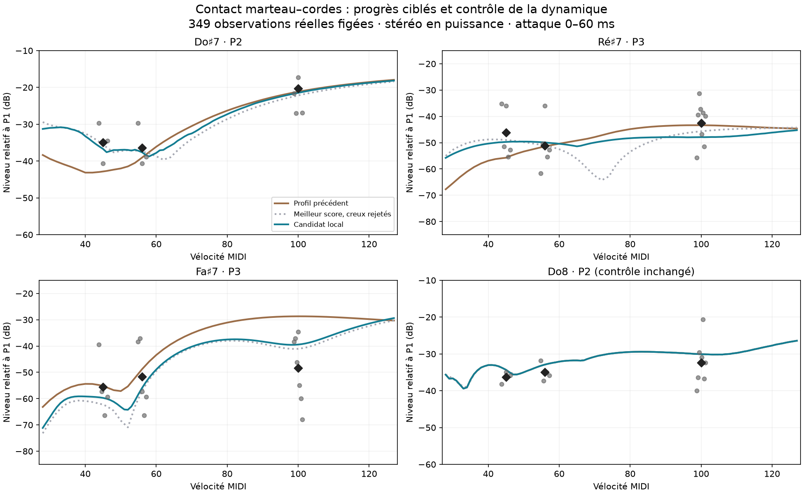

# Suraigu : trois résidus après le profil de contact

Branche `codex/piano-realism-audit`, 28 octobre 2026. Suite de
[contact_voicing.md](contact_voicing.md). **Le défaut reste inchangé.**

Le candidat `local` réduit les trois écarts demandés, préserve Do8 exactement,
et améliore légèrement les erreurs moyennes à couverture constante. Il n'est
pas promu : plusieurs P4 réels se dégradent et la continuité selon la vélocité
reste imparfaite. Les essais constituent des profils de recherche par touche ;
ils ne sont pas encore intégrés à un preset jouable unique du moteur.

## Interface ouverte

Application du worktree compilée avec `cargo build --offline --release -p piano-play`,
puis lancée avec `--ui` dans le service utilisateur `piano-realism-ui.service`.
Le clavier SL STUDIO est connecté, canal 1, audio à 48 kHz. La sortie enregistrée
`Stereo DJ X-Fade:In B` étant absente, le moteur utilise la sortie par défaut
`Omniphony Router`.

L'interface joue le **défaut témoin**, avec le preset effectif du banc
(close/studio et toucher de lecture). La configuration est isolée dans
`/tmp/piano-realism-ui/config`, le preset dans `/tmp/piano-realism-ui/default.toml`.
Les sauvegardes automatiques ne remplacent donc pas le dernier son habituel.
Les variantes ci-dessous s'écoutent dans les rendus A/B ; elles ne sont pas
chargées dans cette interface.

## Résultat ciblé

Niveaux en dB relativement au fondamental P1, fenêtre d'attaque 0–60 ms,
puissance stéréo. « Avant » désigne le profil expérimental `guarded`, et non
le défaut de production. Les cibles sont des moyennes de pianos différents,
avec une dispersion parfois importante, pas des vérités uniques.

| Partiel | Avant | Candidat local | Références : moyenne ± écart-type | Nombre |
|---|---:|---:|---:|---:|
| Fa♯7 forte, P3 | −28,70 | **−39,44** | −48,44 ± 11,86 | 7 |
| Ré♯7 pianissimo, P3 | −55,75 | **−49,73** | −46,15 ± 8,69 | 5 |
| Do♯7 pianissimo, P2 | −42,83 | **−36,71** | −34,95 ± 4,52 | 3 |
| Do8 pianissimo, P2 | −34,32 | −34,32 | −36,29 ± 1,36 | 3 |
| Do8 mezzo-forte, P2 | −32,89 | −32,89 | −34,97 ± 2,00 | 4 |
| Do8 forte, P2 | −30,08 | −30,08 | −32,39 ± 5,49 | 8 |

L'excès de Fa♯7 forte diminue de **10,74 dB**, avec seulement +0,06 dB
sur le niveau d'attaque global. Il reste environ 9 dB au-dessus de la moyenne.
Ré♯7 pianissimo gagne 6,02 dB de P3 relatif, mais aussi 2,00 dB de niveau global
par rapport à `guarded` : ce changement de niveau est conservé dans les comparaisons.
Do♯7 revient au contact original de cette seule touche, ce qui annule une
régression introduite par l'interpolation du profil précédent.



Points gris : chaque référence disponible ; losanges noirs : leur moyenne.
La courbe pointillée montre pourquoi le meilleur score sur trois vélocités
n'est pas le meilleur candidat musical : elle creuse notamment P3 de Ré♯7
entre les points de comparaison.

## Causes isolées

**Fa♯7 forte : excitation et position de frappe.** Le rendu sans rayonnement
de la table donne P3 à −26,25 dB, contre −28,70 dB avec rayonnement. La table
atténue donc déjà ce rapport d'environ 2,45 dB. Doubler le suréchantillonnage
du contact donne −28,55 dB : l'écart ciblé n'est pas expliqué par la résolution
temporelle du solveur. Supprimer le noyau dur donne −28,66 dB environ ;
supprimer la souplesse de tige aggrave P3 jusqu'à −22,4 dB.

Assouplir fortement le feutre seul atténue P3 forte mais coûte jusqu'à 8–10 dB
de niveau aux faibles vélocités dans les essais extrêmes. Déplacer le point
de frappe vers le chevalet fournit un levier distinct : `strike_ratio` passe
de 0,120 à 0,105 pour cette touche. Après la loi de registre existante,
la position effective est 0,0675 de la longueur, contre 0,0825. Le réglage agit
à la fois sur la participation modale et sur la réaction de la corde pendant
le contact ; il ne faut pas l'interpréter comme un simple filtre spectral.

**Ré♯7 pianissimo : désynchronisation des trois contacts.** En conservant la
loi de feutre de `guarded`, réduire `height_spread` de 100 à 50 µm fait passer
P3 de −55,75 à −49,73 dB. L'ablation à hauteur nulle donne −47,4 dB, mais
assombrit excessivement P2. Le compromis à 50 µm évite cette régression.
Changer seulement l'exposant du feutre donne un meilleur score ponctuel,
mais introduit un creux de P3 de 15,49 dB entre les vélocités 42 et 72.

**Do♯7 : interpolation entre deux touches, et annulations de contact.**
Le profil précédent n'avait pas d'ancre à 97. Réduire les hauteurs à 60 µm
corrige P2 à la vélocité 45 presque exactement, mais crée un creux de 11,87 dB
entre 28 et 54. Une variante sans hystérésis lisse mieux la courbe mais
rend P2 mezzo-forte trop fort (−27,18 dB pour une moyenne réelle d'environ
−36,4 dB). Le candidat local restaure donc le contact original sur Do♯7,
qui donne déjà −36,71 dB en pianissimo et −37,61 dB en mezzo-forte.

Les spectres de force cohérente, puissance des forces individuelles et
rendus avant/après rayonnement sont sauvegardés dans `diagnosis.json`.
Le spectre de la force seule n'est pas assimilé au son rayonné : les
participations modales et les phases des cordes interviennent ensuite.

## Paramètres du candidat local

`q` multiplie la force statique du feutre à 0,2 mm de compression ; `p`
est l'incrément d'exposant, avec compensation du coefficient de raideur à
ce pivot. `h` est la valeur absolue du multiplicateur d'hystérésis.

| MIDI | Touche | q | p | h | Hauteurs | strike_ratio |
|---:|---|---:|---:|---:|---:|---:|
| 97 | Do♯7 | 1,00 | 0 | 0,60 | 100 µm | 0,120 |
| 99 | Ré♯7 | 1,20 | +1 | 0,30 | 50 µm | 0,120 |
| 102 | Fa♯7 | 0,20 | 0 | 0,10 | 100 µm | 0,105 |
| 108 | Do8, inchangé | 0,45 | −1,25 | 0,30 | 40 µm | 0,120 |

Toutes les autres touches gardent exactement les paramètres interpolés du
profil `guarded`. La largeur de contact reste à 1. Le profil explicite des
88 touches est dans `bench/contact-residuals/profile-local.json`. Ces valeurs
ne doivent pas être appliquées globalement à tout le clavier.

## Comparaisons à couverture constante

Même liste de références calibrées et stéréo que l'étude précédente ; mêmes
fréquences physiques/suivies ; mêmes seuils d'éligibilité des références.
Aucune observation n'est supprimée parce qu'un candidat devient faible.
Les huit pianos ont le même poids dans la MAE. Les fichiers source et les
349 observations du suraigu sont figés. Do♯7, anciennement touche intermédiaire
de validation, est désormais une touche ajustée et ne compte plus comme
validation indépendante.

| Ensemble | Observations | Défaut original | Profil précédent | Candidat local |
|---|---:|---:|---:|---:|
| Attaque, tout le suraigu | 349 | 12,226 | 8,691 | **8,514** |
| Attaque, trois touches ciblées | 114 | 10,853 | 9,152 | **8,630** |
| Sources hors objectif : Iowa, Headroom | 56 | 11,387 | 8,036 | **7,309** |
| Pianissimo du suraigu | 86 | 10,891 | 7,602 | **7,085** |
| Son tenu 0,5–1 s, six touches × trois nuances disponibles | 71 | 16,223 | 14,976 | **14,593** |
| Son tenu, forte seulement | 39 | 13,343 | 12,133 | **11,565** |

Les sources hors objectif n'ont pas servi au coût des recherches, mais ont
déjà été consultées dans les études antérieures et les comparaisons de cette
session : ce n'est pas une validation aveugle. Le son tenu conserve une
observation modèle à faible SNR, explicitement signalée ; le sous-ensemble
P4 n'a que deux observations d'un seul piano et ne porte pas une conclusion
générale. L'attaque n'a aucune observation candidat à faible SNR sur son
support figé.

Le balayage final couvre **toutes les vélocités 28 à 127** sur 97, 99, 102
et 108. Aucun creux de niveau global. Do8 a été rerendu : différence maximale
mesurée sur P2 = **0,000 dB sur les 100 vélocités**, niveaux inchangés.
Les 100 fichiers WAV sont également identiques octet par octet aux rendus
du profil précédent.
Le plus grand recul de P3 de Ré♯7 est de 1,81 dB pour le candidat local,
contre 15,49 dB pour la variante ponctuellement mieux classée. Il reste un
recul de P2 de Do♯7 de 7,92 dB (hérité du défaut original), et des reculs de
P2/P3 de Fa♯7 de 6,19/5,10 dB. Les vélocités intermédiaires ont servi à
sélectionner les variantes : seule la grille finale complète non retouchée
constitue le dernier contrôle, pas un corpus réel indépendant.

## Pourquoi le défaut ne change pas

Le gain ciblé n'est pas une amélioration de tous les partiels. À support
constant, l'erreur absolue moyenne de P4 de Do♯7 forte augmente de 6,24 dB
(cinq pianos), celle de P4 de Ré♯7 forte de 4,53 dB (huit pianos), et celle de
P4 de Ré♯7 pianissimo de 6,96 dB (trois pianos). P3 de Ré♯7 forte se dégrade
également légèrement. Ces régressions réelles et les creux de vélocité
interdisent de conclure que le candidat est prêt à remplacer le défaut.

Le banc général a aussi été relancé sur **les mêmes 90 frappes**, 20 s + 0,5 s,
avec Do♯7 ajouté séparément aux trois nuances. Les 84 frappes non modifiées
sont réutilisées sans changement. Le candidat `local` et `regular` sont
identiques sur cette grille de 90, qui ne contient pas Do♯7 ; leur supplément
Do♯7 est différent. Le score historique global passe de 1,011 à 1,066.

Cette hausse contient toutefois une **fausse alerte de couverture** : la
mesure historique inclut désormais un « P4 » de Fa♯7 mezzo-forte à −115,57 dB,
alors que son vrai P4 est vers 13,02 kHz, hors du domaine de 12 kHz. Sa fenêtre
nominale capture un résidu sous la limite. La moyenne P4 passe alors de deux
touches à trois ; le score n'est donc pas une comparaison de partiels à
couverture constante, malgré les mêmes 90 fichiers. L'audit par touche
`legacy-coverage-audit.json` conserve les valeurs ; le verdict principal
utilise les fréquences physiques et les observations figées ci-dessus.
Le défaut et les résultats historiques ne sont pas réécrits pour masquer
cette alerte. Les déficits à 1–2 kHz ne sont pas résolus par ces réglages.

## Écoute et reproduction

`out/contact-residuals/listen-guarded.wav` et `listen-local.wav` : Do♯7,
Ré♯7, Fa♯7, Do8 ; pour chaque touche, vélocités 45, 56, 100 ; 1,2 s puis
0,3 s de silence. Même gain, aucun ajustement de niveau par note ni par fichier.

Les scripts et synthèses sont dans `bench/contact-residuals/`, les rendus
et forces brutes dans `out/contact-residuals/`. Les moteurs et presets
originaux restent intacts, contrôlés par SHA-256 dans `manifest.json`.

Depuis ce worktree, après construction des exemples `contact_batch` et
`top_probe` et de `piano-survey` :

```sh
python bench/contact-residuals/search.py ablate
python bench/contact-residuals/search.py
python bench/contact-residuals/diagnose.py
python bench/contact-residuals/rank.py
python bench/contact-residuals/geometry.py
python bench/contact-residuals/validate.py
python bench/contact-residuals/continuity.py
python bench/contact-residuals/refine.py
python bench/contact-residuals/final_candidate.py
python bench/contact-residuals/full.py geometry geometry_heights regular
python bench/contact-residuals/sustain.py
python bench/contact-residuals/local_restore.py
python bench/contact-residuals/evaluate.py
python bench/contact-residuals/plot.py
```

Ces commandes réutilisent le banc calibré et les résultats de l'étude de
contact précédente, présents dans le worktree. Elles ne changent pas le
preset par défaut. Les scripts de recherche ne constituent pas une nouvelle
API de preset de production. Vérification : 15 tests Python du banc passent ;
`git diff --check` est propre ; compilation de l'application avec UI réussie.

La prochaine mesure utile sur de vrais pianos est une grille dense de
vélocités répétées sur ces trois touches, en suivant **ensemble P1–P4** et
leur évolution temporelle. Elle permettrait de distinguer les annulations
réelles de contact des creux propres au modèle ; les trois nuances actuelles
et les bibliothèques à couches répétées ne permettent pas cette conclusion.
