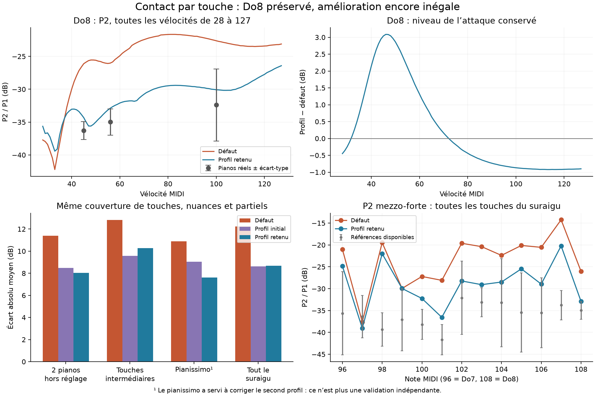

# Contact du suraigu : réglage par touche et par dynamique

28 octobre 2026 — `codex/piano-realism-audit`. Suite du [diagnostic des voies du suraigu](top_register_diagnosis.md).

Un profil de contact réduit les écarts spectraux **sans reproduire l’assombrissement excessif de Do8** observé avec la pente globale 0,10. Il associe une raideur par touche, une progression du feutre avec la compression, une hystérésis plus faible et un contact mieux réparti entre les cordes du haut. Le même modèle physique est utilisé à toutes les vélocités d’une touche : il n’y a pas de table de gains ou d’égalisation par nuance.

À couverture constante, l’écart absolu moyen des partiels passe de **12,23 à 8,69 dB** sur le suraigu, soit environ **29 %** de réduction. Le progrès se retrouve sur deux sources exclues de l’ajustement et sur les touches intermédiaires. Certaines régressions locales restent importantes : **le défaut de production n’est pas changé**.



## Profil candidat

Le facteur `q` exprime la force du feutre supérieur à **0,2 mm de compression**, relativement au défaut. L’exposant change simultanément selon :

`F_top(u) = q × F_top,défaut(u) × (u / 0,2 mm)^Δp`.

Cela évite de comparer directement des raideurs dont les unités changent avec l’exposant. Dans les presets de sonde : `hardness = 0.3 × q × 0.2^(−Δp)` et `p_offset = Δp`. Le noyau du marteau reste celui du modèle de départ.

| Touche | MIDI | q à 0,2 mm | Δp | Hystérésis | Écart de hauteur des cordes |
|---|---:|---:|---:|---:|---:|
| La6, raccord au défaut | 93 | 1,00 | 0 | 0,60 | 100 µm |
| Do7 | 96 | 0,25 | 0 | 0,30 | 100 µm |
| Ré♯7 | 99 | 1,20 | +1 | 0,30 | 100 µm |
| Fa♯7 | 102 | 0,10 | +1 | 0,20 | 25 µm |
| La7 | 105 | 0,20 | +1 | 0,20 | 50 µm |
| Do8 | 108 | 0,45 | −1,25 | 0,30 | 40 µm |

Entre ces points, `q` est interpolé logarithmiquement et les autres paramètres linéairement. Sous La6, le profil reste au défaut. La largeur de contact reste à 1 ; les essais de largeur ne justifiaient pas de la retenir.

Les 100 µm de décalage initiaux représentent une fraction importante des quelque 146 µm de compression du marteau à Do8 mf. Réduire ce décalage modifie la répartition des forces et l’énergie effectivement transférée aux cordes. Cela permet d’adoucir le feutre sans perdre autant de fondamentale. L’exposant inférieur sur Do8 réduit ensuite la variation excessive du timbre entre pp et mf.

Ce sont des **paramètres identifiés sur des enregistrements**, pas des mesures directes de marteaux réels. L’écart de hauteur sert ici à explorer la répartition du contact ; il ne prouve pas que le piano réel possède ces valeurs.

Le profil est enregistré sous `guarded` dans [profiles.json](../bench/contact-voicing/profiles.json). Les autres entrées conservent les contrôles et pistes rejetées. Les presets par touche de `out/contact-voicing/validation/guarded/` servent aux sondes isolées. L’application ne charge pas encore cette table comme un instrument complet : aucune interface de production ni loi du moteur n’a été modifiée pour l’activer.

## Pourquoi une correction par nuance était nécessaire

Une première recherche sur mf/ff trouvait un profil satisfaisant pour Do8 à ces deux nuances, mais P2 tombait à **−43,4 dB en pp**, contre environ −36,3 dB dans les références disponibles. Un autre candidat corrigeait pp/mf/ff mais introduisait un creux d’environ 11 dB autour de la vélocité 40. Il a été écarté.

La sélection finale combine les écarts aux références, une pénalité pour les variations excessives du niveau de l’attaque et un contrôle des creux de P2 entre nuances. Sur une grille de 52 vélocités, un creux supérieur à 4 dB exclut le candidat de Do8. Les 48 vélocités restantes ont ensuite été rendues sans nouvel ajustement.

Sur **toutes les vélocités MIDI 28–127**, le plus grand recul de P2 par rapport à une frappe plus douce est de **3,79 dB**, contre **4,50 dB au défaut**. Le minimum de P2 du candidat est −39,42 dB, contre −42,22 dB au défaut. Il subsiste une petite irrégularité dans les faibles vélocités ; elle n’est pas remplacée par un nouveau creux plus profond.

### Do8 aux nuances du banc

P2/P1 dans les 60 premières ms, énergie stéréo, fréquence physique du partiel. Les niveaux d’attaque ne sont pas normalisés entre candidats.

| Nuance / vélocité | Défaut | Candidat | Références : moyenne ± écart-type | Δ niveau de l’attaque |
|---|---:|---:|---:|---:|
| pp / 45 | −26,1 dB | **−34,3 dB** | −36,3 ± 1,4 dB, 3 sources | +3,0 dB |
| mf / 56 | −26,0 dB | **−32,9 dB** | −35,0 ± 2,0 dB, 4 sources | +1,9 dB |
| ff / 100 | −22,6 dB | **−30,1 dB** | −32,4 ± 5,5 dB, 8 sources | −0,9 dB |

Do8 reste légèrement plus riche en P2 que la moyenne réelle. Il n’est donc pas rendu trop sombre aux points observés. Le gain de niveau à faible vélocité est réel et doit être jugé à l’écoute ; ce n’est pas un gain ajouté après rendu. Les références pp/mf sont peu nombreuses, et la vélocité MIDI des bibliothèques n’identifie pas exactement la vitesse de marteau d’un piano à l’autre.

## Comparaison à couverture constante

La mesure cherche chaque partiel autour de sa fréquence suivie dans la référence ou de sa fréquence physique dans le modèle. Les fréquences ≥ 12 kHz sont exclues réellement, ce qui évite la fausse mesure de P4 de Fa♯7 identifiée précédemment. La fenêtre fait 60 ms ; les spectres des canaux sont additionnés en énergie.

Le masque est fixé à partir du défaut et des références, **avant** la comparaison. Une observation n’est pas retirée parce qu’un candidat l’atténue : sa valeur et son rapport signal/bruit restent enregistrés. Aucune des observations retenues n’est passée sous 12 dB de contraste dans les candidats comparés. Les prises sans suivi exploitable ou sans partiel de référence suffisamment distinct restent exclues, avec leurs comptes conservés.

Le tableau donne l’écart absolu moyen modèle–référence, un poids égal par piano, en dB. Il ne s’agit pas du score z du banc général.

| Ensemble | Observations fixes | Défaut | Raideur seule par touche | Profil initial mf/ff | Profil retenu |
|---|---:|---:|---:|---:|---:|
| Tout le suraigu, pp/mf/ff | 349 | 12,23 | 9,58 | 8,63 | **8,69** |
| Iowa + Headroom, exclus du réglage | 56 | 11,39 | 9,14 | 8,50 | **8,04** |
| Huit touches intermédiaires, non ajustées directement | 158 | 12,81 | 10,31 | 9,58 | **10,27** |
| Pianissimo | 86 | 10,89 | 8,91 | 9,04 | **7,60** |
| Raccord La6–Si6 | 110 | 8,18 | 8,06 | 8,20 | **8,20** |

Le profil initial gagne légèrement sur la moyenne générale et sur les touches intermédiaires, mais assombrit trop Do8 pp. Le profil retenu privilégie la réponse entre nuances et la préservation de Do8. Le pianissimo a servi à corriger le second profil : **ce n’est plus une validation indépendante**. Iowa et Headroom sont exclus de la fonction d’ajustement, mais étaient déjà connus des audits précédents ; ce n’est pas un test perceptif à l’aveugle ni une validation statistique externe.

Sur les observations constantes, l’excès moyen de P4 mf passe d’environ +19,6 à −0,2 dB ; P3 mf de +8,9 à −0,9 dB. En forte, P3 et P4 restent environ **6,6 et 6,9 dB au-dessus** des références. Le but n’est donc pas atteint uniformément sur tous les partiels.

## Banc complet et limites

Les trois profils ont été évalués sur les 90 notes du banc corrigé : 15 rendus nouveaux par profil dans le suraigu, les 75 rendus strictement inchangés étant réutilisés. Une mise à jour finale de Do8 a été remesurée. Le contrôle spécifique couvre également toutes les touches de La6 à Do8 et les vélocités intermédiaires.

| Profil | Score global, 191 composantes | Score attaque | Score suraigu | Alertes |
|---|---:|---:|---:|---:|
| Défaut | 1,064 | 1,083 | 1,633 | 15 |
| Raideur seule par touche | 1,026 | 0,874 | 1,522 | 10 |
| Profil initial mf/ff | 1,036 | 0,731 | 1,551 | 8 |
| Profil retenu | **1,011** | **0,763** | **1,477** | **9** |

Ce progrès global ne gomme pas les régressions locales :

- **Fa♯7, P3 ff :** −28,7 dB contre −48,4 dB en moyenne réelle ; le défaut était à −23,9 dB. Le gain est réel mais il reste presque 20 dB d’excès sur cette touche.
- **Ré♯7, P3 pp :** −55,7 dB contre −46,2 dB dans les références. Ce partiel devient environ 9 dB trop faible alors que le défaut était proche.
- **Do♯7, P2 pp :** l’interpolation produit −42,8 dB contre −34,9 dB. Le candidat s’éloigne d’environ 6 dB de plus que le défaut. Si7 mf reste trop riche : une courbe interpolée entre cinq points ne remplace pas une validation chromatique.
- Les déficits à **1–2 kHz** restent pratiquement inchangés. Ce travail ne répare pas le corps sonore sous la fondamentale.

Le banc historique signale aussi P4 en sustain plus faible. Le contrôle à fréquences physiques et couverture constante sur 500–1000 ms donne un écart moyen de **12,25 → 10,89 dB** sur 32 observations. Mais P4 n’a qu’une observation exploitable, sur une seule source : sa dégradation de 1,5 dB n’est pas une conclusion robuste sur tout le registre. Les durées de décroissance agrégées peuvent changer avec la répartition d’énergie entre modes, même lorsque les lois de pertes sont identiques.

**Décision : conserver le profil comme candidat expérimental et garder le défaut actuel.** Les prochaines corrections doivent cibler P3 ff de Fa♯7 et les creux pp de Ré♯7/Do♯7. La comparaison chromatique montre précisément où agir ; poursuivre une baisse globale du feutre masquerait ces différences. Une validation d’écoute et des accords reste nécessaire avant une intégration en production.

## Écoutes, contrôles et reproduction

Les deux extraits jouent Do7 mf, puis Do8 pp, mf et ff, avec exactement le même gain : [défaut](../out/contact-voicing/listen-base.wav) et [candidat](../out/contact-voicing/listen-guarded.wav). Aucun ajustement de volume par note n’a été appliqué. Ces extraits sont fournis pour écoute ; aucune évaluation auditive humaine n’est revendiquée ici.

Les **15 tests Python passent**, dont quatre nouveaux contrôles sur la puissance stéréo, la limite physique à 12 kHz, la couverture fixe et la loi de compression/interpolation. Dix attaques du rendu par lots sont identiques bit pour bit aux WAV du banc corrigé. Les empreintes des sources et des rendus sont enregistrées. Le moteur, les références, la baseline et le preset par défaut restent inchangés depuis le début de cette étape.

```sh
CARGO_TARGET_DIR=/tmp/piano-realism-target cargo build --offline --release -p piano-render --example contact_batch --example top_probe
python3 tools/contact_voicing.py references --out out/contact-voicing-repro
python3 tools/contact_voicing.py profile --profiles bench/contact-voicing/profiles.json --names base,guarded --fine --out out/contact-voicing-repro
python3 tools/contact_voicing.py score --names base,guarded --out out/contact-voicing-repro
python3 tools/contact_voicing.py bench --profiles bench/contact-voicing/profiles.json --names guarded --out out/contact-voicing-repro
```

Les commandes utilisent le preset effectif du banc précédent (`out/top-register/effective.toml`) et le lien `target` du worktree. `grid --grid … --directory … --velocities …` permet de reproduire les grilles de recherche enregistrées ; la grille globale utilise les cinq touches d’ancrage, les grilles suivantes portent la touche dans chaque entrée ou sont limitées à Do8 avec `--notes 108`. Les résultats initiaux ont été produits par des scripts de recherche ensuite regroupés dans cet outil ; le calcul regroupé reproduit les comparaisons à couverture constante.

- [Profil et contrôles](../bench/contact-voicing/profiles.json), [résultats à couverture constante](../bench/contact-voicing/summary.json), [continuité de Do8](../bench/contact-voicing/c8-continuity.json).
- [Scorecard du candidat](../bench/contact-voicing/full/guarded/scorecard.md), [contrôle du sustain](../bench/contact-voicing/sustain-check.json), [manifeste](../bench/contact-voicing/manifest.json).
- [Outil de comparaison](../tools/contact_voicing.py), [rendu par lots](../crates/piano-render/examples/contact_batch.rs).
- Grilles, mesures intermédiaires et presets : `bench/contact-voicing/` et `out/contact-voicing/` dans le worktree dédié.
