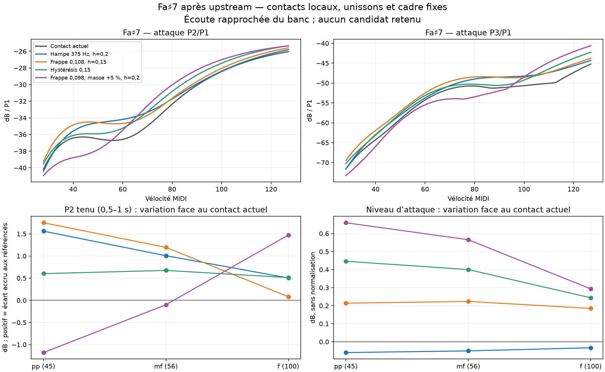

# Fa♯7 forte après upstream : correction d’attaque, compromis avec P2 tenu

29 octobre 2026, branche `codex/piano-main-revalidation`, moteur de `0dfd311` incluant upstream `4a00f00`. **Aucune nouvelle variante retenue. Le défaut, les contacts chargés dans l’UI et l’écoute en cours ne changent pas.**

P3 forte peut être remonté d’environ 2 dB avec le cadre et les unissons actuels, sans recréer de creux de vélocité. Mais les meilleures pistes d’attaque renforcent P2 tenu au pp/mf, déjà trop élevé face aux références. Une seconde famille préserve cette tenue, au prix d’une attaque pp moins bonne. Aucun des 118 candidats étudiés ne satisfait tous les garde-fous.

## Ce qui reste fixe

- Unissons upstream : `width_curve=4`, autres paramètres d’unisson inchangés.
- Cadre actuel, contour et longueur 1,9 m, admittance bidirectionnelle et pertes actuelles.
- Rayonnement intégral, mêmes filtres, même écoute que le banc : micros rapprochés + studio.
- Même calibration Plath, analyse en puissance stéréo, aucune normalisation audio.
- Seuls les paramètres de contact de la touche MIDI 102 sont modifiés dans des bundles séparés. Toutes les autres touches gardent leur contact. Aucun preset livré ni fichier du moteur n’est modifié.

Le témoin fraîchement rendu est **identique bit à bit aux 448 WAV** de la revalidation upstream : 48 attaques et 400 frappes de grille. L’empreinte physique reste `d2d9e13bb28f0f7d`.

## Exploration et sélection

Les 119 profils, témoin inclus, comprennent 36 essais initiaux (témoin et variations isolées), 34 combinaisons ciblées, un complément factoriel à 375 Hz et 48 compensations visant aussi la tenue. Les axes explorés sont la dureté, l’exposant du feutre à force conservée à 0,2 mm, l’hystérésis, la masse, la position de frappe, la fréquence/perte de hampe, la largeur de contact et le feutre interne.

Le premier filtrage exigeait une réduction d’au moins 0,5 dB de l’erreur moyenne signée de P3 forte, sans perte de plus de 0,25 dB du niveau ou de la bande 1–2 kHz au pp/mf, sans augmentation de plus de 0,05 dB de leurs MAE ni de la MAE globale Fa♯7. Douze profils, témoin inclus, ont ensuite été balayés sur les **100 vélocités entières 28–127**. Une hausse de creux supérieure à 0,1 dB éliminait le candidat.

La validation des tenues a révélé le compromis décrit ci-dessous. Le filtrage a alors été **resserré**, en ajoutant une hausse maximale de 0,05 dB de la MAE de tenue au pp/mf, avant les 48 essais de compensation. Ces seuils servent à sélectionner des pistes de recherche ; ils ne sont pas des seuils perceptifs calibrés. Aucun candidat ni aucune référence n’est exclu pour son SNR après coup.

## Comparaison finale à couverture constante

Cinq profils ont été comparés chacun sur **48 attaques** (MIDI 93–108, vélocités 45/56/100) et **400 frappes** (Do♯7, Ré♯7, Fa♯7, Do8, vélocités 28–127), soit **2 240 WAV**. Les identités des **459 observations d’attaque et 71 observations de tenue** sont conservées exactement.

Le creux est la baisse maximale de Pk/P1 après un maximum antérieur lorsque la vélocité augmente. Le biais P3 est l’écart moyen signé aux références forte, en dB de P3/P1. Il ne signifie pas qu’un candidat proche de zéro convient à tous les pianos : les sept références de ce partiel sont très dispersées.

| Contact Fa♯7 | Biais P3 forte | Creux P2 / P3 | Variation P2 tenu pp / mf | Verdict |
|---|---:|---:|---:|---|
| Actuel : hampe 300 Hz, h=0,3, frappe 0,105 | −2,227 dB | 0,408 / 0,536 dB | 0 / 0 dB | Témoin conservé |
| Hampe 375 Hz, h=0,2 | **+0,166 dB** | **0 / 0 dB** | **+1,560 / +1,007 dB** | Tenue pp/mf dégradée |
| Frappe 0,108, h=0,15 | **−0,127 dB** | 0,219 / 0,271 dB | **+1,751 / +1,195 dB** | Tenue pp/mf dégradée |
| Hystérésis seule h=0,15 | −0,831 dB | 0,014 / 0,331 dB | **+0,603 / +0,675 dB** | Tenue pp/mf dégradée |
| Frappe 0,098, masse +5 %, h=0,2 | **−0,027 dB** | 0 / 0,087 dB | −1,178 / −0,100 dB | Attaque pp dégradée |

**La cible moyenne demande aussi de la prudence.** Dans la couverture conservée, P3 forte du témoin est à −12,325 dB face à Iowa, mais à **+17,282 dB face à Plath**. La piste hampe rapproche le premier à −9,932 dB et éloigne le second à **+19,675 dB**. « P3 trop faible de 2,2 dB » décrit donc le biais moyen des sept références, pas un défaut partagé par tous les pianos. C’est une raison supplémentaire de ne pas présenter son annulation comme une correction générale de réalisme. Les erreurs par source restent intégralement disponibles dans `validation-summary.json`.

Pour la dernière piste, la MAE d’attaque pp de Fa♯7 passe de **6,774 à 6,960 dB**, la MAE globale de **7,611 à 7,781 dB**. Elle augmente aussi P2 tenu forte de **1,474 dB**. Elle n’est donc pas une solution au problème simplement parce que son biais P3 forte est presque nul.

La piste hampe 375 Hz conserve le niveau d’attaque pp/mf à **−0,060 / −0,051 dB** du témoin, et améliore légèrement leurs MAE d’attaque. Son rejet vient bien de la tenue, pas d’un assombrissement global. P2 tenu Fa♯7 est le seul partiel de cette note admis dans les 71 observations historiques ; nous ne prétendons pas valider P3 tenu sans référence admissible. Les SNR de P2 dans les rendus sont élevés : sa dégradation n’est pas un effet de plancher de bruit.

Pour chacun des quatre candidats finaux, les **45 WAV d’attaque et 300 WAV de grille hors Fa♯7 sont identiques bit à bit au témoin**. Do8, Do♯7 et Ré♯7 conservent donc exactement leurs résultats sur cette couverture, y compris pp/mf et creux. Le niveau total de Fa♯7 reste monotone sur les 100 vélocités dans les cinq profils.



## Causes et limites du diagnostic

L’étude upstream avait déjà isolé le déplacement initial de P3 : principalement la courbe d’unisson et la longueur du cadre. Ces paramètres restent fixes ici. Les nouvelles ablations montrent que le contact peut compenser ce déplacement, mais que cette compensation ne règle pas indépendamment le spectre de l’attaque et celui de la tenue.

L’effet forte n’est pas seulement un ratio amélioré en abaissant P1 : pour la piste hampe 375 Hz, P3 absolu augmente de **2,342 dB**, et pour la frappe 0,108 de **2,266 dB**. Les variations de P1 forte sont respectivement environ −0,051 et +0,166 dB.

Une nouvelle sonde utilise le **véritable instrument du bundle**, donc ses notes reconstruites avec l’admittance du cadre. Les anciens helpers `strike_stats_full` / `strike_forces` reconstruisent une note sans cette admittance ; ils ne sont pas employés pour ces chiffres. Au forte, le contact du témoin dure 0,500 ms, atteint 96,796 N et 0,2336 mm de compression. La piste hampe 375 Hz/h=0,2 donne 0,5125 ms, 98,881 N et 0,2346 mm. Au pp, la durée passe de 0,9667 à 1,0083 ms. Ces petites variations de force et de durée suffisent à modifier les partiels ; elles ne démontrent pas à elles seules un mécanisme unique d’interférence.

Le relevé `temporal.json` conserve les partiels sur 0–60, 60–120, 120–180, 250–350 et 500–1 000 ms après l’attaque. La suite utile est d’isoler l’excès **P2 tenu** entre excitation du contact, contributions des modes d’unisson et transmission mécanique/acoustique, avant de poursuivre un réglage centré uniquement sur P3 forte. Une loi choisie directement en fonction de quelques vélocités MIDI masquerait ce compromis sans en établir la cause physique.

Il n’y a pas de nouveau banc global de 90 frappes longues / 191 composantes pour ces candidats : tous sont déjà rejetés par les gardes ciblées. Les résultats globaux de la revalidation upstream restent les derniers résultats applicables au profil conservé. La comparaison présente n’établit pas de généralisation à d’autres positions d’écoute ou à la salle.

## Reproduction et vérifications

Les scripts et résultats sont sous `bench/fsharp7-upstream/`, les bundles/rendus/forces sous `out/fsharp7-upstream/`. Aucun bundle candidat n’est chargé dans l’UI.

```sh
OPENBLAS_NUM_THREADS=1 python bench/fsharp7-upstream/study.py
OPENBLAS_NUM_THREADS=1 python bench/fsharp7-upstream/study.py bench/fsharp7-upstream/refine-input.json refine
OPENBLAS_NUM_THREADS=1 python bench/fsharp7-upstream/study.py bench/fsharp7-upstream/factorial-input.json factorial
OPENBLAS_NUM_THREADS=1 python bench/fsharp7-upstream/dense.py
OPENBLAS_NUM_THREADS=1 python bench/fsharp7-upstream/study.py bench/fsharp7-upstream/held-input.json held
OPENBLAS_NUM_THREADS=1 python bench/fsharp7-upstream/select_held.py
OPENBLAS_NUM_THREADS=1 python bench/fsharp7-upstream/validate.py
cargo build --release --offline -p piano-render --features experimental-rayleigh --example experimental_contact_probe
OPENBLAS_NUM_THREADS=1 python bench/fsharp7-upstream/contact.py
OPENBLAS_NUM_THREADS=1 python bench/fsharp7-upstream/present.py
```

La sonde a compilé et exécuté 18 frappes sur six profils. Les contrôles de couverture, de valeurs finies, d’égalité des notes inchangées et de reproductibilité du témoin passent. Le sélecteur renforcé retourne **zéro candidat admissible** ; il ne transforme pas ce résultat négatif en succès de réalisme.
