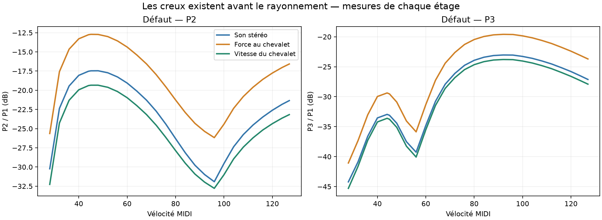
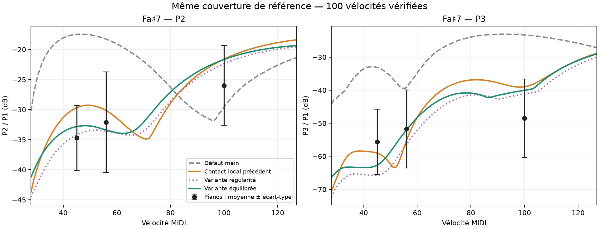

# Fa♯7 forte et creux de vélocité : contact, tige et transmission

28 octobre 2026. Base moteur : `d0d3fef` (main acoustique `c0c91ce` et banc corrigé). **Aucun changement du défaut, du DSP de production ou de la baseline.** Les nouvelles lois sont des expériences par touche rendues hors ligne ; elles ne sont pas chargées globalement dans l’UI.

## Décision

La tige du marteau fortement amortie apporte une réduction reproductible des creux. La variante équilibrée ramène les creux de Fa♯7 P2/P3 à 1,28/1,39 dB, contre 5,64/4,93 pour le précédent contact local et 14,48/6,55 pour le défaut de main (100 vélocités). P3 forte reste trop fort : +8,40 dB contre +9,49 pour le contact local, et +25,16 pour main. Ce progrès de P3 est modeste ; le progrès net est la régularité.

**Pas de promotion.** P3 pianissimo est davantage atténué qu’avec le contact local, la MAE des 349 attaques ne s’améliore pas, et un contrôle indépendant sur Plath montre un écart restant à la fois en amont et dans la transmission vers les oreilles. La cohérence au clavier s’améliore, mais abaisser encore le contact pour corriger tout l’écart acoustique risque d’assombrir le pp.

## Causes isolées avant recherche des réglages

La nouvelle sonde `contact_stages` produit, pour chaque vélocité, les forces individuelles des cordes, leurs états modaux à la fin du contact, et un WAV à quatre canaux : son gauche/droite, force au chevalet et vitesse du chevalet. Le WAV à quatre canaux n’est jamais passé au chargeur stéréo ; ses canaux sont analysés séparément. Les canaux audio sont identiques bit à bit aux rendus normaux aux trois vélocités de référence.

Sur le défaut, le premier balayage donne :

| Partiel | Creux du son | Creux de la force au chevalet | Creux de la vitesse du chevalet |
|---|---:|---:|---:|
| P2 | 14,46 dB | 13,46 dB | 13,44 dB |
| P3 | 6,31 dB | 6,49 dB | 6,47 dB |

La corrélation des courbes audio/force au chevalet dépasse 0,999. Les creux se forment donc avant le rayonnement. Les spectres des forces individuelles et de leur somme montrent aussi l’effet des phases et des durées de contact ; le creux de la somme des forces ne prédit toutefois pas à lui seul la position exacte de tous les creux acoustiques, car les cordes sont ensuite couplées.

Ablations séparées, sur le défaut, même couverture de vélocités :

- Cordes exactement à la même hauteur : P2 empire, 23,55 dB de creux. Supprimer l’écart de hauteur n’est pas la solution.
- Tige rigide : P2 descend à 10,85 dB de creux, mais P3 forte devient 5,21 dB plus fort. La souplesse contribue au compromis.
- Frappe répartie également : creux P2/P3 de 12,57/3,82 dB ; c’est un facteur secondaire, sans correction suffisante de P3 forte.
- Noyau dur du feutre retiré : effet négligeable ici (P3 forte varie de 0,006 dB). Bruit d’action et limiteur retirés : négligeables sur ces partiels. Sympathie retirée : P3 forte change de 0,25 dB, les creux demeurent.
- Désaccord des cordes retiré : creux de 13,12/9,37 dB ; le désaccord seul ne les explique pas.
- Calcul du contact à 5 puis 20 sous-pas : écart maximal de 0,13 dB pour P2 et 0,30 dB pour P3 aux cinq vélocités contrôlées dans le spectre de la force. Ce contrôle concerne le contact isolé ; le nombre de sous-pas de l’audio de la sonde n’est pas modifié.

Un essai de `bridge.g_1k` n’a rien changé : lecture du code confirmée, cette loi de secours n’est pas utilisée lorsque la table modale fournit l’admittance (`note_model.rs`). Ce résultat **ne démontre pas** que le couplage au chevalet serait sans effet.

## Réglages comparés

278 essais paramétriques, contrôles inclus, sur 27 vélocités ont testé la force du feutre à compression fixée, son exposant et son hystérésis, les hauteurs et la répartition de frappe, la position et la largeur du contact, la masse et la tige du marteau. Les essais qui déplacent simplement un zéro spectral sont conservés dans les résultats mais rejetés pour la validation finale. Les références ont servi à sélectionner les candidats : il ne s’agit pas d’un test aveugle.

Le **contrôle protégé** reprend le précédent profil local, avec Ré♯7 remis au défaut de main. Do♯7 est déjà au défaut, Do8 conserve le contact validé précédemment. Les deux nouveaux profils ne changent ensuite que Fa♯7, ce qui distingue le progrès de la restauration de Ré♯7.

| Paramètre Fa♯7 | Contrôle local | Régularité | Équilibrée |
|---|---:|---:|---:|
| Facteur de force à 0,2 mm `q` | 0,20 | 0,18 | 0,25 |
| Hystérésis | 0,10 | 0,30 | 0,30 |
| Part de masse dans la tige | 0,30 | 0,45 | 0,45 |
| Fréquence tête–tige | 300 Hz | 150 Hz | 150 Hz |
| Perte de la tige | 0,10 | 2,0 | 2,0 |

Exposant inchangé ; largeur du contact ×1 ; écart de hauteur 0,1 mm ; `strike_ratio=0.105`, soit une position effective de 0,0675 de la longueur à Fa♯7. Le `q` correspond ici à `hardness=0.3*q`. La perte 2,0 concerne l’oscillation relative tête–tige, pas un amortissement général du piano. Ces valeurs restent des hypothèses du modèle, sans mesure mécanique d’un marteau réel à l’appui.

Après sélection, on retire un changement à la fois de la variante équilibrée :

| Ablation de la variante équilibrée | P3 forte (dB/P1) | Creux P2 | Creux P3 |
|---|---:|---:|---:|
| Variante complète | −40,04 | 1,21 | 1,11 |
| Perte de la tige remise à 0,1 | −29,08 | 5,16 | 2,29 |
| Part de masse remise à 0,3 | −35,62 | 6,80 | 5,74 |
| Fréquence remise à 300 Hz | −35,23 | 0,00 | 0,00 |
| Hystérésis remise à 0,1 | −34,94 | 0,20 | 0,10 |

Ces chiffres sont ceux du balayage de diagnostic (27 vélocités) ; les critères finaux ci-dessous portent sur les 100 vélocités entières. L’amortissement, la répartition de masse et le feutre interagissent : un seul bouton ne résout pas à la fois le spectre et la régularité. La tentative de diminuer l’exposant du feutre après amortissement a réintroduit des creux dans plusieurs candidats ; elle n’est pas retenue.

## Validation à couverture constante

1 614 nouveaux WAV : 144 attaques longues de 1,2 s, 1 200 frappes pour les balayages 28–127 sur Do♯7/Ré♯7/Fa♯7/Do8, et 270 notes de 20,5 s (90 par profil). Les mêmes 459 observations d’attaque sont conservées : 349 C7–C8 et 110 de transition ; 71 observations de tenue, dont 12 pour Fa♯7. Huit pianos au total. Les identités des observations correspondent exactement à la validation précédente. Une tenue sous le seuil SNR reste incluse dans chaque profil, aucun candidat ne gagne de score en supprimant une observation.

| Mesure | Contrôle local protégé | Régularité | Équilibrée |
|---|---:|---:|---:|
| MAE Fa♯7, 34 observations (dB) | 9.648 | 9.283 | 9.451 |
| MAE tenue Fa♯7, 12 observations (dB) | 15.073 | 14.410 | 15.141 |
| MAE attaques C7–C8, 349 observations (dB) | 9.001 | 9.028 | 9.013 |
| MAE tenues, 71 observations (dB) | 15.782 | 15.662 | 15.777 |
| Creux maximal de P2, vélocités 28–127 (dB) | 5.64 | 0.84 | 1.28 |
| Creux maximal de P3, vélocités 28–127 (dB) | 4.93 | 1.36 | 1.39 |
| Score secondaire, 191 composantes (RMS z) | 1.085 | 1.086 | 1.057 |

La MAE est calculée par piano puis moyennée entre pianos. La pondération des sources diffère entre le sous-ensemble Fa♯7 et l’ensemble C7–C8 : une petite amélioration du premier n’implique pas mécaniquement une amélioration du second. Les trois scores globaux ont les mêmes 191 clés, mais restent secondaires car la sélection SNR interne du banc historique peut varier.

| Fa♯7 : écart à la moyenne des pianos | Contrôle local | Régularité | Équilibrée |
|---|---:|---:|---:|
| v45, P2 (dB) | +5.04 | +0.52 | +1.90 |
| v45, P3 (dB) | -3.38 | -10.10 | -7.08 |
| v56, P2 (dB) | +1.95 | -1.49 | -1.30 |
| v56, P3 (dB) | -3.49 | -4.69 | -0.30 |
| v100, P2 (dB) | +4.42 | +3.64 | +4.35 |
| v100, P3 (dB) | +9.49 | +7.33 | +8.40 |

La variante équilibrée fait passer l’écart P3 pp de −3,38 à −7,08 dB : c’est le coût principal restant. La variante régularité descend à −10,10 dB. À forte, les pianos disponibles ont eux-mêmes un écart-type de 11,86 dB sur P3 (sept sources), et au pp de 9,89 dB (quatre sources) : ces moyennes ne sont pas une consigne exacte de voicing.

Le niveau d’attaque de la variante équilibrée baisse de 0,14/0,41/0,87 dB face au contrôle aux vélocités 45/56/100 ; aucune normalisation ne masque ce changement. Le niveau total ne présente pas de creux sur 28–127. Les creux de partiels sous la vélocité 28 ne sont pas validés ici.

**Touches protégées :** 45 WAV d’attaque, 300 WAV de balayage et 87 WAV longs sont identiques bit à bit entre contrôle et candidats (tous ceux hors Fa♯7 dans ces lots). Do♯7 et Ré♯7 correspondent également aux rendus de main, et Do8 au profil local précédent. Les creux de Do8 (5,23 dB sur P2) et Do♯7 (7,53 dB sur P2) restent présents : ils ne sont ni aggravés ni corrigés par cette expérience limitée à Fa♯7.

## Ce qui reste de P3 forte : contrôle réel supplémentaire

**Précision issue de l’étude suivante :** le rapport de pics ci-dessous n’identifie pas un transfert scalaire fiable dans la bande P3 de Plath. Les mesures synchrones de cohérence et la séparation des pics sont détaillées dans [la suite chevalet–oreilles](bridge_ear_followup.md). L’écart de transmission de 7 dB ne doit pas servir de cible de calibration. Les valeurs historiques ci-dessous restent inchangées.

Les cinq prises de Fa♯7 de Plath permettent de séparer pression binaurale et accélération du chevalet, sans supposer la signification du canal `F` (non utilisé). Ce contrôle n’a pas servi à choisir les candidats. Même analyse de puissance sur 60 ms ; pression et accélération alignées sur leur propre attaque. P3 n’est pas suivi dans le survey tardif de cette note : sa fenêtre utilise le f0/B estimé à partir de P1/P2, avec SNR explicitement vérifié. Les cinq prises passent 12 dB : 17–21 dB dans la pression, 34–40 dB dans l’accélération.

| P3/P1 à forte | Plath, cinq prises | Modèle main, position joueur | Variante équilibrée, position joueur |
|---|---:|---:|---:|
| Pression | −67,4 à −69,3 dB | −31,96 | −47,62 |
| Accélération du chevalet | −41,6 à −45,1 dB | −14,63 | −30,27 |
| Différence pression − accélération | −23,3 à −25,8 dB | −17,33 | −17,36 |

Le modèle est alors entendu aux micros joueur, sans salle ni couvercle et sans limiteur. Avec les micros rapprochés du banc, la dernière ligne vaut environ −9 dB : comparer directement cette écoute à Plath aurait attribué à tort l’effet de position au moteur.

Même après ce rapprochement du dispositif, **l’excès n’est pas seulement un problème de contact** : l’accélération relative de P3 reste plus forte, et sa transmission relative vers les oreilles reste moins atténuée. Le nouveau réglage ne change pratiquement pas l’accélération P3/P1 forte par rapport au précédent contact local (−30,27 contre −30,33 dB), ni la pression à la position joueur (−47,62 contre −47,66). Son petit gain forte aux micros rapprochés n’est donc pas une correction générale de l’excitation P3. Les creux, eux, sont nettement réduits.

Ceci est un diagnostic sur un piano et une fenêtre d’attaque, pas une identification exacte de transfert : positions approximatives, réponse de tête artificielle inconnue, inharmonicités différentes et dynamique réelle non appariée. Plath est aussi beaucoup plus sombre en P3 que la moyenne des sept pianos. Il faut mesurer la transmission sur plusieurs fenêtres et confronter l’écoute avant de transformer ce diagnostic en cible de calibration.

## Fichiers et reproduction

`bench/fsharp-contact/` conserve les plans de recherche, tous les essais, les ablations, les mesures et les observations fixes. `out/fsharp-contact/` conserve les WAV, CSV, presets par frappe et la sonde utilisée. Le manifeste donne les empreintes des binaires et des références.

Ordre : compiler `cargo build --offline --release -p piano-render --example contact_stages`, puis exécuter `diagnose.py`, `search.py`, `refine.py`, `mechanics.py`, `damping.py`, `damped_law.py`, `validate.py`, `ablate_selected.py`, `unison_check.py`, `plath_check.py`, `player_check.py` et `present.py`. Les essais supplémentaires de désaccord et de loi de chevalet sont conservés dans `unison-diagnostics.json` et leur plan ; les fichiers de référence et de contrôle du worktree restent nécessaires.

Les neuf tests Python du banc passent ; la nouvelle sonde compile et son audio de contrôle est identique au moteur normal. Le DSP de production n’a pas changé, donc la suite Rust déjà passée lors de la revalidation n’a pas été relancée intégralement.

Une écoute comparative est dans `out/fsharp-contact/fsharp-comparison.wav` : main, contrôle local, variante équilibrée ; chaque groupe joue 45, 56 puis 100. Un seul gain commun est appliqué à tout le fichier pour l’écoute, sans normalisation par note et sans réutilisation dans les scores. Le défaut et l’UI demeurent ceux de la revalidation précédente.
