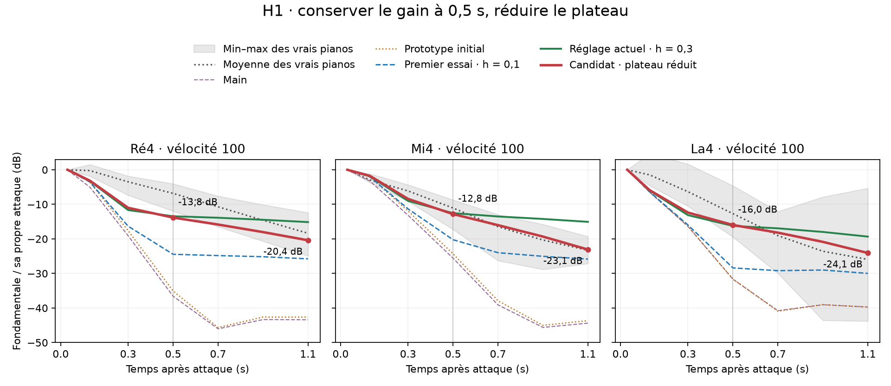
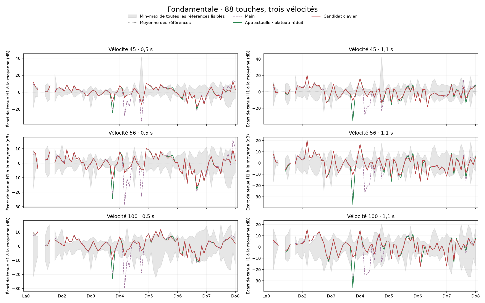
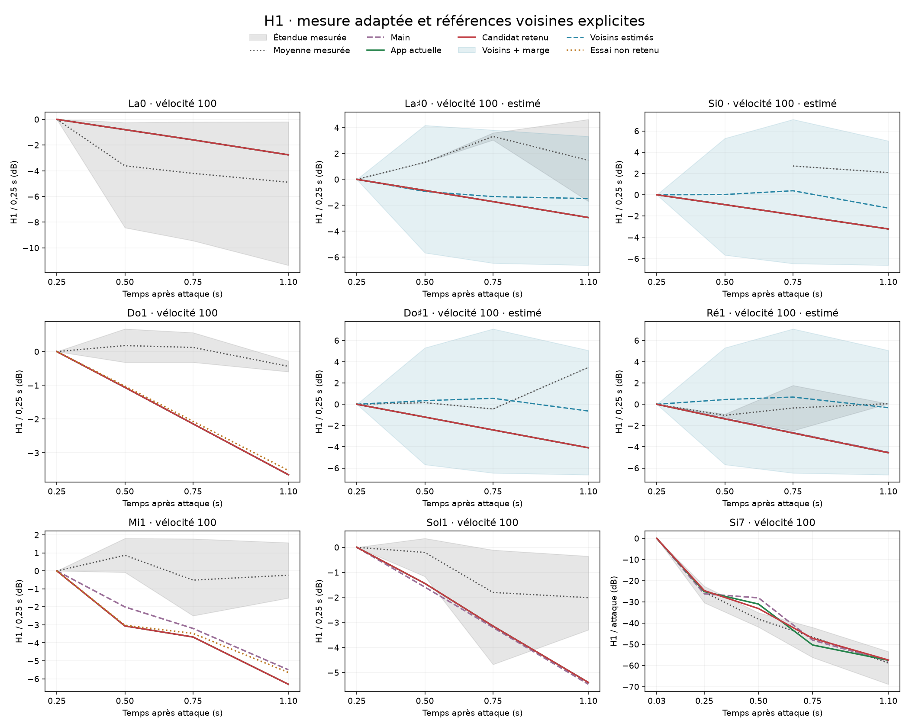

# Tenue de la fondamentale : résultats de la recherche

Étude du 29 octobre 2026 sur `main` (`4a00f00`) et le prototype Rayleigh
intégral (`b3b2808`). Les résultats ci-dessous sont historiques : ils ne
certifient pas le réalisme perceptif et ne changent pas le son par défaut.

## Périmètre livré et archive

Le banc autonome de `tools/bench.py`, le diagnostic
`tools/harmonic_diagnostic.py` et les exemples Rust `fundamental_probe` et
`fundamental_modes` fonctionnent avec le moteur de ce dépôt. Le banc v3
corrige la grille FFT des attaques graves ; voir [le protocole](bench.md).

La recherche de candidats, ses JSON détaillés, ses graphes interactifs et le
renderer MIDI expérimental sont conservés sur la branche
[`codex/archive-fundamental-sustain`](https://github.com/mgth/unsampled-piano/tree/codex/archive-fundamental-sustain).
Le [code archivé](https://github.com/mgth/unsampled-piano/tree/0d4991b1c0e9a6ad45e712096ad753177c332444/bench/fundamental-sustain)
et le [protocole complet](https://github.com/mgth/unsampled-piano/blob/0d4991b1c0e9a6ad45e712096ad753177c332444/docs/fundamental_sustain.md)
sont figés au commit `0d4991b`. Ils nécessitent un checkout expérimental,
les corpus et des exports locaux ; ils ne sont pas présentés comme
reproductibles depuis un clone de `main` seul. Les corpus et les rendus
volumineux ne sont pas distribués avec le dépôt.

## Diagnostic et premiers candidats

Une perte rapide de H1 rend les rapports H2–H8/H1 élevés sans exiger une
augmentation des harmoniques. L'analyse moyenne les puissances des canaux,
puis rapporte chaque partiel à sa propre attaque. La chute de H1 est aussi
visible dans la force primaire au chevalet : elle n'est pas seulement due
au rayonnement ou à une annulation stéréo.

Les essais locaux sur Ré4, Ré♯4, Mi4, Fa♯4 et La4 augmentent la contribution
de modes plus lents, en conservant `cross² ≤ h_coupling`. Après un premier
gain vers 0,5 s, un plateau excessif est apparu notamment sur Mi4. Séparer
le couplage horizontal de son terme croisé conserve le gain précoce tout
en réduisant la tenue tardive. Les coefficients restent constants dans le
modèle : aucune enveloppe de gain n'est ajoutée au signal.

| À vélocité 100, H1 / sa propre attaque | Avant, 0,4–0,6 s | Candidat, 0,4–0,6 s | Avant, 1–1,2 s | Candidat, 1–1,2 s |
|---|---:|---:|---:|---:|
| Ré4 | −13,44 dB | −13,83 dB | −15,14 dB | −20,40 dB |
| Mi4 | −12,54 dB | −12,82 dB | −15,07 dB | −23,08 dB |
| La4 | −16,25 dB | −15,98 dB | −19,34 dB | −24,07 dB |

## Extension au clavier et cas insuffisants

Le balayage couvre 88 touches × 3 vélocités (45/56/100), quatre secondes
par note, en close/studio. La décision demande deux références exploitables
et un dépassement de 3 dB de leur étendue à 0,5 ou 1,1 s. Les essais sont
contrôlés sur l'attaque H1, H2–H8, les zones déjà correctes, le relâchement
et les touches non modifiées.

| Étape | Résultat archivé |
|---|---|
| Recherche clavier | 18 réglages supplémentaires retenus ; alertes de 76 à 66 sur 264 couples touche–vélocité |
| Témoins de cette étape | 210 rendus gardent leur diagnostic ; déplacement maximal des partiels contrôlés : 0,209 dB |
| Mesure adaptée | 8 des 22 cas insuffisants deviennent exploitables ; 14 restent insuffisants |
| Dernier ajustement | Si7, largeur d'unisson aigu de 5 à 5,6 ; H1 relatif baisse de 2,12 à 3,85 dB vers 0,5 s |
| Témoins de Si7 | 261 rendus gardent leur diagnostic ; déplacement maximal contrôlé : 0,122 dB |

Dans le grave, la mesure adaptée utilise au moins 12 périodes et une
fenêtre Blackman–Harris. L'ancrage est à 0,25 s, pas à 30 ms ; H2–H5 servent
à estimer l'accord de H1. Les références manquantes peuvent être estimées
entre deux touches du même piano et de la même vélocité, sans extrapolation,
avec au plus six demi-tons d'écart et une marge issue de validation croisée.
Deux voisines ne comptent que pour un piano. Les voisins doivent partager
le même ancrage et la même grille temporelle ; les variantes dont le niveau
H1 initial est illisible sont rejetées explicitement.

Les chiffres et figures historiques conservent leur extracteur spectral
initial. Ils ne doivent pas être comparés directement aux rapports v3 du
banc autonome. La mesure H1 adaptative avait déjà son propre padding FFT ×8.
Les cas sans références fiables restent insuffisants, jamais réussis. Les
essais sur Do1/Mi1 n'ont pas été retenus ; Si7 reste partiellement trop
soutenu au jeu doux/moyen. Aucun corpus indépendant ni test perceptif ne
permet ici de conclure à la disparition du caractère nasillard.

## Écoute concert archivée

Les six MIDI retenus (Bach, Chopin, Debussy, Liszt, Rachmaninov, Schubert)
ont été rendus avec le dernier candidat, les micros `concert` et la salle
`concert_hall`. Les filtres Rayleigh ont été recalculés pour les micros.
Le renderer travaille à 48 kHz, qualité Full, blocs de 128, un thread, et
conserve cinq secondes après le dernier événement. Un Mi4/v56 donne un
signal identique au renderer du banc, échantillon par échantillon.

Les WAV flottants ne saturent pas. Les MP3 ont une atténuation commune de
−1,103 dB et ont été vérifiés après décodage ; aucune normalisation
individuelle ne change leurs dynamiques relatives. Les fichiers d'écoute
et leurs manifestes restent dans le workspace local sous
`out/bench/fundamental-sustain/concert-midi/` ; les scripts de préparation
et de rendu sont sur la branche d'archive.
