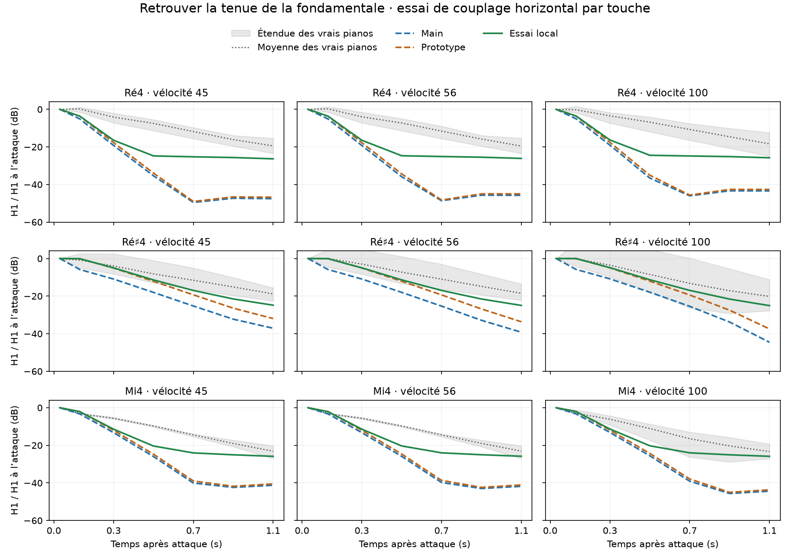
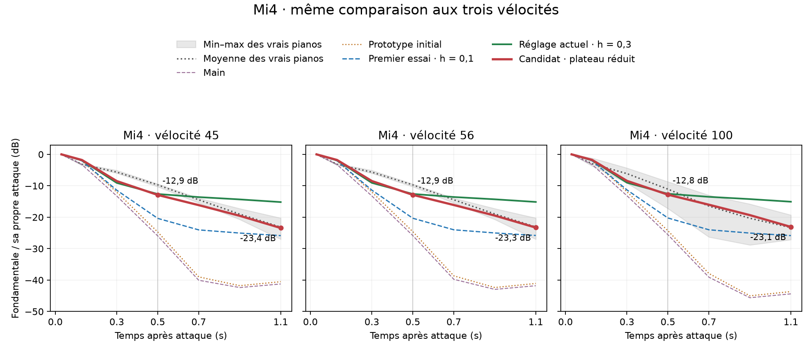
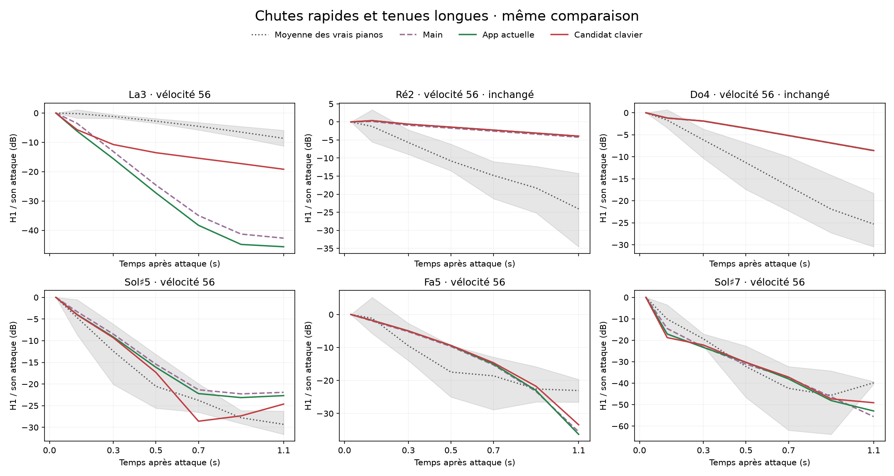

# Tenue de la fondamentale : diagnostic et essai local

29 octobre 2026. Étude sur `main` (`4a00f00`) et le prototype Rayleigh intégral de `codex/piano-main-revalidation` (`b3b2808`). Aucun défaut ni application en cours modifié.

## Ce qui manque

La chute de H1 est très irrégulière entre touches voisines. À vélocité 100, entre les fenêtres 0–60 ms et 1–1,2 s, main perd 8,6 dB sur Do4, 17,3 sur Do♯4, mais 43,4 sur Ré4, 44,5 sur Ré♯4 et 44,4 sur Mi4. Ce n'est pas une annulation entre canaux : les mesures moyennent les puissances stéréo.

Le budget des modes indique une forte conductance de la table au voisinage des fondamentales qui chutent. Sur H1 de Ré4, elle est environ onze fois celle de Do4. Le mode le plus amorti a un T60 théorique de 0,79 s sur Ré4, 1,72 s sur Ré♯4 et 1,06 s sur Mi4, contre 8,07 s sur Do4. Les modes lents restent présents, avec des T60 de plusieurs dizaines de secondes, mais de faibles poids de sortie. Ces T60 sont ceux des modes calculés, pas une estimation de durée audible du son complet.

La capture de la force primaire au chevalet retrouve une forte chute sur les mêmes touches : le rayonnement seul n'explique donc pas le problème. Le nouvel exemple `fundamental_probe` reproduit exactement les 1,4 premières secondes du rendu main de Ré♯4 forte tout en enregistrant séparément cette force. Les autres contributions du moteur restent actives.

## Pistes testées

Dix touches chromatiques Do4–La4, à vélocité 100, ont servi à explorer 19 configurations au total. Les pistes retenues ont ensuite été rendues sur 18 touches, aux vélocités 45, 56 et 100 : 216 rendus de validation pour le témoin et trois variantes. L'écoute et la loi de vélocité sont celles des graphes : micros proches, studio, Disklavier playback, 48 kHz, qualité Full.

- Réduire de moitié les pertes intrinsèques ne récupère qu'environ 1 dB après une seconde. Cela ne traite pas le déficit principal.
- Supprimer le retour mécanique du cadre, les pertes de bord, la sympathie ou la salle ne récupère pas les dizaines de dB manquantes.
- Élargir l'unisson de 1 à 4 cents récupère jusqu'à 24 dB sur Ré♯4, mais déplace fortement d'autres harmoniques et dégrade certaines touches témoins. Ce réglage global n'est pas retenu.
- Augmenter le poids de rayonnement horizontal de 0,1 à 0,5 récupère également H1, mais modifie davantage certains témoins et n'est pas une calibration physique validée.
- Augmenter le couplage horizontal de 0,03 à 0,10, avec le terme croisé de 0,173 à 0,316, est le meilleur compromis exploré ici. La contrainte de passivité est conservée : `cross² <= h_coupling`. Le mode rapide ne devient pas plus long ; la contribution des modes lents devient plus audible. Cela reste un réglage expérimental, pas une mesure de la mobilité horizontale d'un vrai chevalet.

Le changement global touche aussi le suraigu. L'essai final est donc appliqué **uniquement à Ré4, Ré♯4, Mi4, Fa♯4 et La4**, via les modèles par touche déjà disponibles dans le prototype. Les contacts historiques du suraigu, la géométrie et les réponses de rayonnement restent identiques.

## Résultat sur le prototype

Niveau de H1 dans la fenêtre 1–1,2 s, rapporté à **sa propre attaque**, vélocité 100. Plus la valeur est négative, plus la fondamentale a chuté. Les bornes sont celles des enregistrements disponibles à cette note et cette couche ; ce ne sont pas des limites universelles de réalisme.

| Touche | Prototype initial | Essai local | Étendue des vrais pianos |
|---|---:|---:|---:|
| Ré4 | −42,6 dB | −25,8 dB | −24,9 à −12,4 dB |
| Ré♯4 | −37,5 dB | −25,1 dB | −27,7 à −11,2 dB |
| Mi4 | −43,7 dB | −25,8 dB | −27,1 à −19,3 dB |
| Fa♯4 | −35,3 dB | −30,2 dB | −43,4 à −11,5 dB |
| La4 | −39,7 dB | −30,0 dB | −43,8 à −5,3 dB |

Les gains de niveau absolu à une seconde sont de 16,8–20,4 dB sur Ré4, 7,1–12,4 dB sur Ré♯4 et 14,7–17,8 dB sur Mi4 selon la vélocité. Ils ne résultent pas d'une réduction artificielle de l'attaque : H1 à l'attaque change de moins de 0,018 dB.



Le contrôle final comprend 84 rendus de quatre secondes tenues : deux configurations × 14 touches × trois vélocités. Les **27 rendus des neuf touches non modifiées sont identiques octet pour octet** : Do3, Do4, Do♯4, Fa4, Sol4, Sol♯4, La5, Fa♯7 et Do8. Sur les cinq touches modifiées, le changement absolu maximal de H2–H8 dans la fenêtre 0,5–1 s est de 1,724 dB. Tous les échantillons sont finis et le pic maximal de l'essai est 0,229. Après relâchement à 4 s, le niveau RMS baisse de 7,7 à 18,9 dB dans la fenêtre 4,3–4,5 s, relativement à 3,8–4 s ; ce dernier contrôle ne constitue pas une validation comparative complète du relâchement.

## Limites et suite

La récupération est nette mais incomplète : Ré4 reste sous les références, surtout au jeu doux, et Ré♯4 reste un peu court au doux/moyen. Les battements et la décroissance tardive doivent être jugés à l'écoute. Les mesures ne prouvent pas que le caractère nasillard est corrigé. Les réglages ont été explorés sur ces notes et ces références, sans corpus de validation indépendant ; aucun score global de réalisme n'est revendiqué.

La piste à poursuivre est une loi de polarisation/couplage adaptée aux notes à forte mobilité, validée avec les profils H1–H8, les trois vélocités, la tenue longue et les témoins. La variante par touche constitue un essai d'écoute concret avant de généraliser cette loi.

## Reproduction

### Complément : chute autour de 0,5 seconde

L'écoute de l'essai a conduit à vérifier séparément la fenêtre 0,4–0,6 s. Le trou de tenue subsiste principalement sur Ré4, Mi4 et La4. Le diagnostic `fundamental_modes` projette l'état réel à la fin du contact du marteau sur les modes de H1, puis compare leur somme cohérente à leur puissance sans termes d'interférence. Il exclut les entrées sympathiques ultérieures et n'est donc pas un remplacement du rendu complet. À 0,5 s, les interférences du premier essai sont constructives sur Ré4 (+4,0 dB) et Mi4 (+3,8 dB), presque neutres sur La4 (−0,5 dB). Le déficit apparaît aussi dans la somme des puissances : une annulation entre modes n'est pas l'explication dominante à cet instant.

Sept configurations ont été explorées sur sept notes à deux vélocités, dans le moteur main : couplage horizontal 0,1/0,2/0,3, amortissement de table doublé, masses de chevalet 0,1/0,3 kg et étalement de force accru. Les modifications de chevalet/table sont des diagnostics globaux ; elles nécessiteraient de régénérer les filtres Rayleigh avant un test avec le prototype. La masse de chevalet de 0,3 kg améliore Mi4 mais fait chuter Do♯4 vers −30 dB à 0,5 s, contre −9,6 dB pour le témoin : cette piste globale déplace le défaut.

Un nouvel essai du prototype passe seulement Ré4, Mi4 et La4 à `h_coupling=0.3`, `cross=sqrt(0.3)*0.999`. Il garde le premier réglage sur Ré♯4 et Fa♯4. Les 21 rendus couvrent sept notes et les trois vélocités, avec quatre secondes tenues. Les douze témoins non modifiés sont identiques octet pour octet au premier essai. Aucun changement de l'application en cours.

| À vélocité 100, H1 / sa propre attaque | Premier essai, 0,4–0,6 s | Nouvel essai, 0,4–0,6 s | Nouvel essai, 1–1,2 s |
|---|---:|---:|---:|
| Ré4 | −24,5 dB | −13,4 dB | −15,1 dB |
| Mi4 | −20,2 dB | −12,5 dB | −15,1 dB |
| La4 | −28,4 dB | −16,2 dB | −19,3 dB |

Le gain dans la première demi-seconde est confirmé, sans diminuer l'attaque (variation de H1 inférieure à 0,02 dB). Mais le compromis n'est pas résolu : Mi4 devient ensuite trop soutenu, de 4 à 5 dB au-dessus du haut de l'étendue des références à 1–1,2 s. Sur les neuf rendus modifiés, le déplacement maximal de H2–H8 dans la fenêtre 0,5–1 s atteint 4,3 dB. Le relevé A4 pp contient par ailleurs une référence Iowa avec une attaque H1 très faible et un rapport tardif positif ; cette borne n'est pas utilisée pour revendiquer la validité du candidat.

La suite pertinente est de travailler la vitesse de chute du mode rapide et l'équilibre avec les modes lents séparément. Renforcer encore ces derniers comble le passage, mais peut créer un plateau excessif ensuite. Les scripts `early_drop.py` et `early_prototype.py` reproduisent ces essais ; `early_results.json` en conserve les mesures. Le nouveau bundle est isolé sous `out/bench/fundamental-sustain/prototype_early_h03/` et n'a pas remplacé le bundle écouté.

### Complément : préserver 0,5 s et réduire le plateau

L'essai suivant sépare davantage le couplage horizontal de son terme croisé. Jusqu'ici `cross` était presque égal à `sqrt(h_coupling)`, donc près de la limite de passivité : certains modes lents perdaient très peu d'énergie. On augmente le couplage horizontal pour conserver leur niveau initial, mais on réduit la fraction croisée pour que leur tenue décroisse ensuite. Ce sont des paramètres constants du modèle mécanique, sans enveloppe de gain ajoutée dans le temps.

Vingt combinaisons ont été explorées sur Ré4, Mi4 et La4 aux vélocités 56/100, puis huit variantes ont affiné Mi4 aux vélocités 45/56/100. L'essai retenu utilise :

| Notes | `h_coupling` | `cross / sqrt(h_coupling)` |
|---|---:|---:|
| Ré4, La4 | 0,50 | 0,85 |
| Mi4 | 0,70 | 0,75 |

Les coefficients satisfont toujours la passivité. La table, les micros, la salle, les filtres Rayleigh et les autres contacts restent ceux du prototype précédent. Ces valeurs constituent un réglage expérimental local, sans prétendre être une mesure physique de ces paramètres sur un piano réel.

À vélocité 100, les niveaux ci-dessous sont toujours rapportés à la propre attaque de H1 :

| Touche | Essai h=0,3 à 0,4–0,6 s | Candidat à 0,4–0,6 s | Essai h=0,3 à 1–1,2 s | Candidat à 1–1,2 s |
|---|---:|---:|---:|---:|
| Ré4 | −13,44 dB | −13,83 dB | −15,14 dB | −20,40 dB |
| Mi4 | −12,54 dB | −12,82 dB | −15,07 dB | −23,08 dB |
| La4 | −16,25 dB | −15,98 dB | −19,34 dB | −24,07 dB |




Sur les neuf couples note/vélocité, le niveau vers 0,5 s varie de −0,39 à +0,27 dB ; vers 1,1 s, il baisse de 4,74 à 8,24 dB. L'attaque H1 change de moins de 0,005 dB. Le changement maximal de niveau absolu H2–H8 dans la fenêtre 0,5–1 s est de 1,161 dB. Mi4 à 1–1,2 s se rapproche de la moyenne des enregistrements aux trois vélocités ; son début de tenue au doux/moyen reste un peu sous leur étendue.

Une vérification du relâchement a révélé sur Ré4 une hausse de queue de 4,2 à 5,4 dB dans la fenêtre 0,3–0,5 s après note-off. L'étouffement horizontal de **Ré4 seulement** passe donc de 0,03 à 0,12. Les trois rendus sont identiques échantillon par échantillon pendant les quatre secondes tenues avant/après cet ajustement ; après relâchement, cette queue se retrouve de 2,6 à 3,6 dB sous celle de l'essai h=0,3. Cela protège le relâchement sans expliquer artificiellement la baisse du plateau tenu.

La validation finale compare 14 notes × trois vélocités × deux configurations, soit 84 rendus de quatre secondes tenues, avec la même écoute. Les 21 rendus disponibles de l'essai h=0,3 sont reproduits exactement ; les 33 rendus des onze touches témoins sont restés identiques octet pour octet. Les contrôles exécutables de `plateau_report.py` vérifient aussi le maintien de H1 vers 0,5 s à moins de 0,75 dB, une réduction tardive d'au moins 4 dB, une attaque à moins de 0,1 dB et H2–H8 tenus à moins de 2 dB. Les références ne changent pas et les candidats ne participent jamais à leur moyenne ou à leur étendue.

Les fenêtres tardives à 1,5–1,7 s, 2–2,2 s et 3–3,2 s sont conservées dans les mesures. À forte vélocité, H1 vers 3,1 s est à −37,2 dB sur Ré4, −33,6 sur Mi4 et −33,8 sur La4. Ces valeurs documentent la queue ; elles ne constituent pas une validation indépendante de réalisme ni une preuve que le timbre nasillard a disparu. Une écoute reste nécessaire.

Le bundle candidat prêt à tester est `out/bench/fundamental-sustain/prototype_plateau/bundle.toml`. L'application est restée sur le réglage h=0,3 pendant l'étude, puis a été relancée à la demande de l'utilisateur avec ce candidat : même écoute close/studio, qualité full à 48 kHz, buffer 128, gain 0 dB, clavier SL STUDIO et sortie Stereo DJ X-Fade:In B. Le journal de lancement est `out/bench/fundamental-sustain/app-plateau-test.log`. Les paramètres, empreintes et résultats synthétiques sont dans `bench/fundamental-sustain/plateau_results.json`.

```sh
OPENBLAS_NUM_THREADS=1 python3 bench/fundamental-sustain/plateau_search.py
OPENBLAS_NUM_THREADS=1 python3 bench/fundamental-sustain/plateau_refine.py
OPENBLAS_NUM_THREADS=1 python3 bench/fundamental-sustain/plateau_validate.py
MPLCONFIGDIR=/tmp/piano-matplotlib OPENBLAS_NUM_THREADS=1 python3 bench/fundamental-sustain/plateau_report.py
```

`plateau_release.py` conserve l'essai séparé des trois forces d'étouffement. Il doit être lancé sur le bundle sans cette correction pour reproduire exactement ce diagnostic historique ; la validation finale applique déjà la valeur retenue.

### Commandes de l'étude initiale

Les scripts et les résultats synthétiques sont dans `bench/fundamental-sustain/`. Les WAV, presets et budgets modaux restent dans `out/bench/fundamental-sustain/`. Le bundle prêt pour le moteur expérimental est `out/bench/fundamental-sustain/prototype_local/bundle.toml` ; il conserve le noyau de rayonnement du bundle source, dont le fichier `responses.f64` est référencé par lien symbolique.

```sh
cargo build --release --locked --offline -p piano-render --example fundamental_probe
OPENBLAS_NUM_THREADS=1 python3 bench/fundamental-sustain/study.py
OPENBLAS_NUM_THREADS=1 python3 bench/fundamental-sustain/refine.py
OPENBLAS_NUM_THREADS=1 python3 bench/fundamental-sustain/validate.py
OPENBLAS_NUM_THREADS=1 python3 bench/fundamental-sustain/prototype.py \
  /home/user/.codex/worktrees/piano-main-revalidation/piano \
  out/bench/experimental_b3b2808/build/release/examples/rayleigh_live
OPENBLAS_NUM_THREADS=1 python3 bench/fundamental-sustain/summarize.py
```

Ces scripts réutilisent le preset effectif et les références de `out/bench/harmonic_local/`. Le rendu du prototype exige le bundle `upstream-4a00f00/close` déjà généré dans son worktree, et le renderer expérimental compilé au même état physique. `results.json` conserve les mesures par note/vélocité et les empreintes des témoins.

### Extension aux 88 touches : détection et recherche locale

Le balayage part du bundle `prototype_plateau` effectivement écouté dans
l'application. Il mesure les 88 touches de La0 à Do8 aux vélocités 45, 56 et
100, avec la même écoute close/studio, le même moteur expérimental, un bloc
de 128 échantillons et quatre secondes de tenue. `main` reste une courbe
séparée. Les huit collections de vrais pianos déjà présentes dans le banc
sont comparées à la touche exacte, sans interpolation entre touches.
Les vélocités des collections sont les couches correspondantes du banc :
seule une partie des collections a exactement les trois valeurs MIDI.

Les graphes conservent la mesure stéréo de H1 rapportée à sa propre attaque,
la moyenne et le min–max de toutes les références dont la valeur est lisible.
Une référence atypique n'est pas retirée silencieusement de ces graphes.
La décision automatique est plus prudente : elle nécessite deux références
exploitables et un dépassement de 3 dB de leur étendue à 0,5 s ou à 1,1 s.
Les références avec H1 absent, plus de 40 dB sous le partiel dominant à
l'ancrage, ou une croissance de plus de 12 dB sont exclues de cette seule
décision, avec un motif conservé dans les résultats. Une mesure insuffisante
n'est jamais comptée comme réussie. Dans le grave, sous quatre périodes dans
les 60 ms de l'attaque (La0 à Do2), la décision utilise plutôt la fenêtre
0,2–0,4 s comme ancrage. Les graphes bruts restent normalisés à l'attaque.

Douze couples de couplage horizontal et de corrélation ont été testés sur
les 37 touches signalées, aux trois vélocités : 1 332 rendus de recherche.
L'objectif pénalise les écarts hors de l'étendue des références ; une faible
pondération de l'écart à leur moyenne départage les candidats. Un candidat
doit réduire cet objectif d'au moins 30 %, sans nouvelle alerte sur une
fenêtre précédemment correcte, avec moins de 3 dB de déplacement dans ces
fenêtres, moins de 1 dB sur l'attaque H1 et moins de 3 dB sur H2–H8 tenus
lorsqu'ils se trouvent à moins de 45 dB du partiel d'attaque dominant.
Tous les candidats restent passifs (`cross² ≤ h_coupling`).

Le test final réunit les corrections dans un seul bundle et remesure les
264 couples touche–vélocité. Il vérifie aussi les touches non réglées :
leur statut doit rester le même et les partiels suffisamment forts doivent
varier de moins de 0,3 dB. Ils ne sont pas identiques échantillon par
échantillon ; les effets secondaires faibles du modèle complet sont donc
mesurés. Sol♯5 a nécessité un candidat plus modéré après cette validation
combinée (H2 dépassait 3 dB avec le premier choix).

Les étouffoirs horizontaux de Fa1, Fa♯1, Si2, La3, Do♯4 et Fa5 ont aussi été
vérifiés, sans aucune modification du signal pendant les quatre secondes
tenues dans leur comparaison avant/après étouffoir. Le contrôle de relâchement
compare la chute RMS entre 3,8–4 s et 4,3–4,5 s. La tolérance est de 4 dB par
rapport à la chute précédente ; les queues déjà sous −90 dBFS sont signalées
séparément. Ce seuil dépend du gain fixe du banc et ne constitue pas un seuil
d'audibilité universel. Dans le grave, une queue résiduelle un peu plus
présente reste à juger à l'écoute.

Résultat final : 37 touches ont au moins une alerte avant recherche. Les
18 réglages retenus réduisent l'écart mesuré, sans nécessairement lever
l'alerte. Sur les 264 couples touche–vélocité, les alertes passent de 76 à 66,
les cas dans l'étendue tolérée de 166 à 176, et les 22 cas insuffisants restent
insuffisants. Il reste 34 touches avec au moins une alerte. Les 210 rendus
des touches non réglées conservent leur diagnostic ; leur plus grande
variation de partiel suffisamment fort est de 0,209 dB. Le pic audio maximal
du candidat est de 0,462, sans écrêtage numérique.

Le bundle d'essai est
`out/bench/fundamental-sustain/keyboard/prototype_keyboard/bundle.toml`.
Il n'est pas appliqué à l'app par cette étude. Les résultats détaillés et les
empreintes des entrées sont dans `bench/fundamental-sustain/keyboard_results.json`.
Les rendus, essais rejetés et motifs sont conservés sous
`out/bench/fundamental-sustain/keyboard/`. Ces réglages sont exploratoires,
ajustés sur le corpus déjà utilisé ; aucun gain de réalisme hors corpus
ni disparition du caractère nasillard n'est établi par ces seules mesures.




Reproduction, depuis la racine du dépôt :

```sh
OPENBLAS_NUM_THREADS=1 python3 bench/fundamental-sustain/keyboard_scan.py
OPENBLAS_NUM_THREADS=1 python3 bench/fundamental-sustain/keyboard_diagnose.py
OPENBLAS_NUM_THREADS=1 python3 bench/fundamental-sustain/keyboard_search.py
OPENBLAS_NUM_THREADS=1 python3 bench/fundamental-sustain/keyboard_select.py
OPENBLAS_NUM_THREADS=1 python3 bench/fundamental-sustain/keyboard_validate.py
OPENBLAS_NUM_THREADS=1 python3 bench/fundamental-sustain/keyboard_release.py
OPENBLAS_NUM_THREADS=1 python3 bench/fundamental-sustain/keyboard_validate.py
MPLCONFIGDIR=/tmp/piano-matplotlib OPENBLAS_NUM_THREADS=1 python3 bench/fundamental-sustain/keyboard_report.py
python3 -m unittest discover -s bench/fundamental-sustain -p test_keyboard.py
```

### Cas insuffisants : fenêtres adaptées et références voisines

L'étude `adaptive_*` reprend les neuf touches auparavant insuffisantes. Elle
ne remplace pas les autres mesures du clavier. Un défaut de résolution a été
identifié sur La0 : à 27,5 Hz, la bande de recherche pouvait tomber entre deux
raies FFT, produisant une valeur absente même lorsque le signal était présent.

La nouvelle mesure utilise une fenêtre Blackman–Harris contenant au moins
12 périodes, avec un minimum de 120 ms et un FFT complété de zéros pour
affiner l'échantillonnage fréquentiel. Dans le grave, la fréquence de H1 est
calée sur H2–H5, avec un terme d'inharmonicité : elle ne suit donc pas un pic de
bruit voisin. La détection nécessite 10 dB au-dessus du bruit spectral local
et respecte un plancher conservateur de fuite, 85 dB sous le pic spectral.
Elle ne rejette plus une fondamentale simplement parce que H2 est beaucoup
plus fort. Les tests synthétiques vérifient notamment une H1 60 dB sous H2,
le cas H1 absent, le bruit, le gain et l'opposition de phase des canaux.

Dans le grave, les fenêtres sont centrées à 0,25 / 0,5 / 0,75 / 1,1 s et la
courbe est rapportée à la première fenêtre. Pour La0, celle-ci dure environ
436 ms : ce n'est pas une mesure de l'attaque à 30 ms. Sur Si7, suffisamment de
cycles sont disponibles pour conserver une première fenêtre de 60 ms,
centrée à 0,03 s ; les autres fenêtres durent 120 ms. L'ancrage et la durée
sont affichés pour éviter de confondre changement de mesure et changement de
son. L'ancien rendu, `main` et le candidat utilisent toujours la même méthode
pour une touche donnée.

Si moins de deux références exactes complètes restent exploitables, le banc
estime la décroissance manquante **dans chaque piano et à la même vélocité**,
avec les notes fiables les plus proches avant et après. Il interpole les
courbes relatives en dB selon la distance en demi-tons ; il ne mélange pas
les fichiers audio. Les deux notes doivent encadrer la cible, avec un écart
total maximal de six demi-tons. Aucun emprunt à une autre vélocité, aucune
extrapolation à une extrémité, aucune interpolation d'une interpolation.
Une paire de notes fournit une référence estimée, pas deux nouveaux pianos.

L'incertitude inclut l'étendue des deux courbes voisines et une marge
empirique. Cette marge est le 90e percentile de l'erreur obtenue en masquant
successivement une note connue, calculé séparément pour chaque registre et
méthode d'ancrage, avec un minimum de 3 dB. Dans le grave, 46 courbes tenues à
l'écart donnent une marge de **3,50 dB**. Ce n'est pas un intervalle de confiance
statistique ni un corpus indépendant de validation. Les estimations sont
marquées « ≈ » et leur bande reste distincte du min–max réellement mesuré.

Résultat : les courbes du modèle deviennent lisibles sur les neuf touches,
et **8 des 22 cas insuffisants deviennent évaluables**. Les 14 cas restants
concernent les vélocités 45 et 56 de La0, La♯0, Si0, Do1, Do♯1, Ré1 et Mi1 :
les références exactes ou les deux côtés nécessaires restent trop bruités,
ou ne représentent qu'un seul piano. Ces cas gardent leur statut insuffisant.

La recherche explore le couplage passif, les pertes, le filage, l'écart
entre les cordes et le désaccord de polarisation. Sur Do1 et Mi1, les meilleurs
essais améliorent trop peu l'objectif pour être retenus ; ils apparaissent
comme **essais non retenus** sur les graphes. Sur Si7, le candidat retenu passe
`unison.width_treble` de 5 à **5,6**, uniquement pour cette touche. Il diminue
le niveau relatif de H1 vers 0,5 s d'environ 3,85 / 2,89 / 2,12 dB aux vélocités
45 / 56 / 100. Le changement d'attaque reste sous 1 dB. La correction est
partielle aux deux vélocités faibles ; le jeu fort rentre dans l'étendue
considérée. Les paramètres du candidat précédent restent présents.

La validation finale remesure les 264 couples touche–vélocité. Les 261
rendus des autres touches conservent leur diagnostic précédent et les
partiels suffisamment forts varient au maximum de **0,122 dB** par rapport au
candidat précédent. Le nouveau bundle isolé est
`out/bench/fundamental-sustain/keyboard/adaptive/prototype_adaptive/bundle.toml`.
L'application n'est pas relancée par cette recherche. Les mesures, exclusions,
voisins, poids, erreurs de validation et paramètres sont conservés dans
`bench/fundamental-sustain/adaptive_results.json`.


Reproduction après l'étude des 88 touches :

```sh
OPENBLAS_NUM_THREADS=1 python3 bench/fundamental-sustain/adaptive_scan.py
OPENBLAS_NUM_THREADS=1 python3 bench/fundamental-sustain/adaptive_references.py
OPENBLAS_NUM_THREADS=1 python3 bench/fundamental-sustain/adaptive_search.py
OPENBLAS_NUM_THREADS=1 python3 bench/fundamental-sustain/adaptive_extra.py
OPENBLAS_NUM_THREADS=1 python3 bench/fundamental-sustain/adaptive_validate.py
MPLCONFIGDIR=/tmp/piano-matplotlib OPENBLAS_NUM_THREADS=1 python3 bench/fundamental-sustain/adaptive_report.py
OPENBLAS_NUM_THREADS=1 python3 -m unittest discover -s bench/fundamental-sustain -p 'test_adaptive*.py'
```

### Écoute des six MIDI en concert

Le dernier candidat `prototype_adaptive` a aussi été rendu sur les six MIDI
retenus de `data/midi/` : Bach, Chopin, Debussy, Liszt, Rachmaninov et Schubert.
Les presets d'écoute sont `Microphones/concert.toml` et `Room/concert_hall.toml`.
Les réponses Rayleigh ont été recalculées pour cette géométrie ; les filtres
close/studio ne sont pas réutilisés avec les nouveaux micros.

Le rendu utilise le moteur expérimental de même empreinte physique
`d2d9e13bb28f0f7d`, à 48 kHz, qualité Full, blocs de 128 et un thread. Il lit
la carte de tempo, les vélocités et les contrôleurs via le lecteur MIDI
habituel du projet, retire la latence fixe du prototype et conserve cinq
secondes après le dernier événement. Un contrôle Mi4/v56, quatre secondes
tenues, donne un signal identique échantillon par échantillon au renderer
de notes du banc.

```sh
# Checkout expérimental contenant les sources, les outils figés et filters.py.
OPENBLAS_NUM_THREADS=2 python3 bench/fundamental-sustain/prepare_concert_midi.py \
  /chemin/vers/le/checkout-experimental
python3 bench/fundamental-sustain/render_concert_midi.py
```

La préparation nécessite le candidat issu des études précédentes et les
dépendances Cargo déjà disponibles pour une compilation hors ligne.
Le checkout expérimental est une dépendance explicite : cette PR n'intègre
pas son moteur Rayleigh dans `main`. Les mesures et paramètres retenus sont
archivés dans les JSON de cette étude ; les corpus audio, MIDI, binaires et
filtres volumineux restent dans les dossiers ignorés `data/` et `out/`.

Les WAV flottants et MP3 à 256 kbit/s sont écrits sous
`out/bench/fundamental-sustain/concert-midi/`. `manifest.json` conserve les
empreintes du renderer, du bundle, des MIDI et des rendus. Aucun WAV ne
sature : le pic le plus élevé est celui de Liszt, à −0,897 dBFS. Les lecteurs
MP3 reçoivent tous la même atténuation de −1,103 dB pour réserver une marge
de 2 dB avant encodage ; aucune normalisation individuelle ne modifie les
dynamiques relatives. Les six MP3 décodés ont été vérifiés sans écrêtage.
