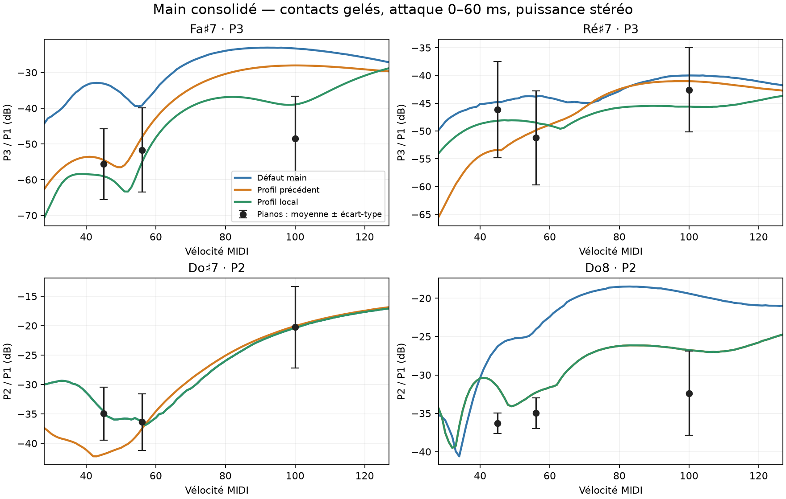

# Revalidation du main consolidé — 28 octobre 2026

Base : `c0c91ce1d2f7477f6ed89e150adb7777a3ba225e`, branche `codex/piano-main-revalidation`. Les réglages et le code de synthèse restent ceux de main. Aucun candidat n’est promu. La vue 3D est intégrée dans cette base.

## Défaut effectivement mesuré

Le défaut compilé utilise le contour du piano à queue, ρh 8,4, rigidités 4590/2040 et pentes d’impédance 0,0024/0,0076. **Le fichier `presets/default.toml` est en retard : contour nul (rectangle), ρh 7, rigidités 3825/1700 et pentes 0,02/0.** Il n’a pas été modifié. Le contour réel ne s’applique toujours qu’aux modes sous 1,5 kHz ; au-dessus, le moteur conserve les modes du rectangle. Le banc sans `--preset` mesure bien le défaut compilé. Les exports complets sont conservés dans `bench/main-revalidation/`; les six différences dans `default-differences.json`.

La base inclut le contact indépendant par corde, l’hystérésis 0,6, les nouvelles pertes, les charges des cordes libres et la sympathie à 0,6. Les anciens presets complets d’expérience auraient écrasé certaines de ces corrections : ils n’ont pas été réutilisés. Seuls leurs paramètres de contact sont reportés sur l’export neuf.

## Protocole et couverture

- Banc `channel-power-v2` rétabli : moyenne des puissances des canaux, tracker et décroissances compris ; aucune sommation L/R avant mesure.
- Plath : 88 WAV flottants stéréo vérifiés, gain unique 0,01/Pa, erreur maximale du gain 3,85×10⁻⁸. Les prises et leur calibration sont inchangées.
- Les références réelles et leurs surveys corrigés sont réutilisés, avec identité du code d’analyse et empreintes des surveys vérifiées. Les attaques des références sont remesurées et reproduisent exactement le cache précédent. Les mesures globales des références ne sont pas recalculées : aucun moteur n’intervient dans ces enregistrements.
- Tous les rendus du modèle sont neufs : 3 profils × 48 attaques de 1,2 s ; 3 × 400 frappes de 0,25 s (Do♯7, Ré♯7, Fa♯7, Do8, vélocités 28 à 127) ; 3 × 90 notes longues (20 s + 0,5 s). Soit **1 614 WAV** hors contrôles.
- Attaques : fenêtre 0–60 ms, fréquences physiques/tracées, limite 12 kHz, admissibilité SNR des références gelée. 349 observations C7–C8 et 110 de transition, huit pianos, mêmes identités qu’avant. Aucun candidat n’est éliminé pour faible SNR.
- Tenues : mêmes 71 observations à 0,5–1 s, huit pianos ; une observation sous 12 dB de SNR dans chaque profil reste incluse.
- Erreurs absolues moyennées d’abord par piano, puis entre pianos ; ratios des partiels à P1, sans normalisation des fichiers. Les profils sont gelés, sans nouvel ajustement. Les sources déjà consultées ne constituent pas une validation aveugle.
- Les 191 composantes du score global ont les mêmes clés pour les trois profils. Ce score garde néanmoins les fenêtres nominales et la sélection SNR du banc historique : il reste secondaire par rapport aux observations de partiels figées, car ses notes internes admissibles peuvent varier.

## Résultats

| Mesure, plus petit = mieux | Défaut main | Profil précédent | Profil local |
|---|---:|---:|---:|
| Erreur absolue des attaques, 349 observations (dB) | 12.75 | 8.75 | 8.82 |
| Erreur absolue des tenues, 71 observations (dB) | 17.52 | 15.95 | 15.27 |
| Transition 93–95, 110 observations (dB) | 7.71 | 7.72 | 7.72 |
| Score global, 191 composantes (RMS z) | 1.107 | 1.032 | 1.076 |

Le profil précédent (`guarded`) reste meilleur sur les attaques et le score global ; le profil local gagne davantage en tenue. Leur différence d’attaque (0,07 dB) ne suffit pas à proclamer un gagnant robuste. La transition et les creux entre dynamiques restent à surveiller.

Écart signé à la moyenne des pianos réels, en dB de partiel/P1 (positif = partiel trop fort) :

| Note, dynamique, partiel | Défaut main | Profil précédent | Profil local | Pianos disponibles |
|---|---:|---:|---:|---:|
| Fa♯7 forte P3 | +25.16 | +20.42 | +9.49 | 7 |
| Ré♯7 pianissimo P3 | +1.37 | -7.24 | -2.00 | 5 |
| Do♯7 pianissimo P2 | +0.42 | -6.90 | +0.42 | 3 |
| Do8 pianissimo P2 | +10.00 | +4.75 | +4.75 | 3 |
| Do8 mezzo-forte P2 | +10.90 | +2.68 | +2.68 | 4 |
| Do8 forte P2 | +12.98 | +5.61 | +5.61 | 8 |

Do♯7 pp et Ré♯7 pp sont déjà proches des références avec le défaut actuel ; il faut donc cesser de les traiter comme deux défauts à corriger systématiquement. Le profil précédent les assombrit trop. Le profil local restaure Do♯7 et rapproche Ré♯7, mais reste moins proche que le défaut sur ce dernier point. Fa♯7 forte reste le problème net : +25,2 dB dans le défaut, +9,5 dB avec le profil local. La dispersion inter-pianos sur ce point est de 11,9 dB (7 pianos), à conserver dans l’interprétation. Do♯7 pp ne dispose que de trois pianos.

Le progrès sur Do8 tient aux trois dynamiques, sans différence entre candidats ; P2 demeure toutefois trop fort de 2,7 à 5,6 dB. Cela ne valide pas toute la couleur de Do8 ni une promotion du contact.

Les 100 vélocités montrent encore des creux : à Fa♯7, la chute maximale de P2 par rapport à une frappe plus douce est de 14,5 dB pour le défaut contre 5,6 dB pour les candidats. À Do8, P2 garde un creux de 5,4 / 5,2 / 5,2 dB. À Do♯7, le retour au contact du défaut restaure aussi un creux de 7,5 dB, contre 4,8 pour le profil précédent. Un meilleur résultat sur les trois dynamiques de référence ne garantit donc pas une meilleure continuité au clavier.

## Écarts qui restent

Sur le défaut nouveau, le banc stéréo mesure dans le suraigu : bande 1 kHz de l’attaque −46,6 dB contre −24,2 dB pour la cible (déficit de 22,4 dB) ; 2 kHz de l’attaque −23,5 contre −12,0 (11,4 dB) ; 2 kHz de la tenue −43,2 contre −29,4 (13,8 dB). Ce sont des niveaux relatifs à la bande la plus forte, pas des pressions absolues. Les contacts ne résolvent pas ce déficit. Le rayonnement de la table, les composantes non harmoniques et la position d’écoute restent des axes distincts à examiner, comme le suggèrent les échanges d’étages intégrés à main ; cette campagne n’en réétablit pas la causalité.

Priorité suivante : cibler Fa♯7 et les creux de vélocité en conservant le contact du défaut là où il fonctionne ; mesurer séparément la transmission chevalet–oreilles et l’énergie inter-partiels à 1–2 kHz, avec les deux canaux. Les outils nouvellement fusionnés `axes_pilot.py` et `fixed_lines.py` utilisent encore un chargement mono : leurs anciens chiffres ne doivent pas être mélangés à cette validation sans adapter leur protocole.

## Vérifications et reproduction

146 tests Rust et 9 tests Python passent. Trois frappes du rendu expérimental sont identiques bit à bit au CLI normal sans preset explicite. Les 72 notes longues sous MIDI 93 sont identiques bit à bit entre profils. Aucun fichier de DSP, de paramètres de production ou de preset par défaut n’a changé.

Un analyseur obsolète dans le cache Cargo a été refusé par l’option `--channel-power`. Il a été recompilé après rafraîchissement des dates des sources restaurées ; les rendus ont été analysés avec ce binaire vérifié. Le script vérifie maintenant cette option avant tout rendu. Les binaires employés sont copiés et hachés dans le manifeste ; le cache de compilation partagé n’est pas la provenance des résultats.

`bench/baseline.json` est désormais la mesure du **défaut actuel avec le banc corrigé**, score 1,107. L’ancienne baseline de main est archivée sous `bench/main-revalidation/legacy-main-baseline.json`. Son score n’est pas directement comparable : le protocole a changé. Les fichiers `full-*.json`, `summary.json`, `coverage.json` et `manifest.json` conservent mesures, observations, couverture et provenance.

Reproduction après compilation de `piano-render` (binaires et exemples) et `piano-analysis` : `python3 bench/main-revalidation/run.py`. Les chemins des références pointent vers les corpus locaux existants et le cache corrigé de l’ancien worktree doit rester accessible. Les gros WAV ne sont pas versionnés.

UI lancée sous `piano-main-revalidation-ui.service`, titre « Piano — main revalidé (3D) », avec l’export du défaut compilé, le clavier SL STUDIO canal 1, et Omniphony Router. Configuration isolée dans `/tmp/piano-main-ui/config`. L’UI garde l’écoute et le toucher du défaut ; le banc utilise les micros rapprochés, le studio et le toucher Disklavier pour correspondre aux références. L’audition live n’est donc pas le même protocole d’écoute que les tableaux.
