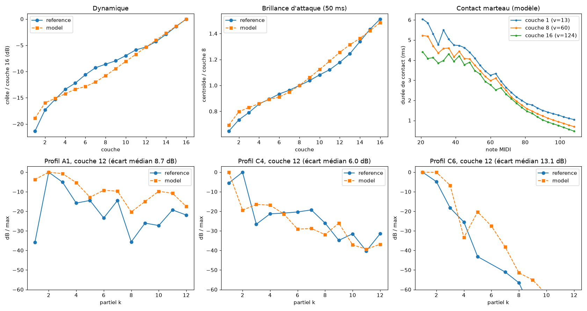

# Phase 1 — corde et marteau

État au 2026-10-21. Une corde modale par touche, frappée par un marteau en feutre à travers un contact physique explicite et passif. Les unissons, le couplage au chevalet et la table d'harmonie viennent en phase 2.

## Modèle

**Corde** (`params.rs`, `engine.rs`).
- Modes transverses jusqu'à 0,45·fs : f_k = k·f0·√(1+B·k²).
- f0, B et l'accord étiré suivent les lois ajustées sur Salamander (Yamaha C5).
- Pertes : σ_k = b1(note) + b2·f_k², loi de la décroissance précoce Salamander. Une seule corde ne peut pas produire la double décroissance, d'où la phase 2.
- Masse linéique déduite d'une échelle de cordes générique (longueurs de 5,2 cm à C8 jusqu'à 1,45 m à A0, tension de 750 N). Cette échelle n'est pas mesurée.
- Mode de vibration au point de frappe moyenné sur la largeur du feutre (8 mm dans le grave, 4 mm dans l'aigu).
- Point de frappe à 0,12·L jusqu'à C6, puis 0,07·L à C8.
- Sortie : force au chevalet T·∂y/∂x(0).

**Marteau** (`hammer.rs`).
- Masse et loi du feutre F = Q0·[u^p + α·d(u^p)/dt] de Stulov, par touche.
- Le contact est intégré par quadratisation de l'énergie (Ducceschi et al. 2021, van Walstijn et al. 2023). Chaque mode utilise la même récursion exacte que le banc SIMD.
- Chaque pas se résout en une seule division, sans itération, pour un coût de O(modes).
- Énergie discrète démontrée non croissante (preuve en tête de `hammer.rs`). Les deux garde-fous (pas de force de traction, ψ remis à zéro hors contact) ne font que retirer de l'énergie.
- Le solveur prend la main pendant le contact, y compris sur une corde qui vibre déjà (refrappe), puis rend l'état au banc modal sans perte.
- Il gère aussi les re-contacts du marteau dans les 4 ms qui suivent la séparation.
- Garde de passivité : l'hystérésis est forcée à α ≥ 0. La formule publiée de Stulov (via [JOS PASP](https://ccrma.stanford.edu/~jos/pasp/Including_Hysteresis.html)) devient négative au-delà de la touche ~85. Elle est bornée à 30 µs.

**Suréchantillonnage local.** Pendant le contact seulement, le solveur fait plusieurs sous-pas par échantillon : ×1 sous C6, ×2 de C6 à B6, ×5 au-dessus à 48 kHz.

## Vérifications (tests)

| Test | Résultat |
|---|---|
| Énergie sans pertes pendant le contact | constante à < 1e-10 près |
| Énergie avec pertes, 6 notes × 4 vitesses | jamais croissante |
| Corde très lourde ≈ mur rigide | durée de contact = formule fermée de Stulov à 2 % près |
| Vitesse croissante | contact plus court, force plus grande |
| Tout le clavier × 4 vélocités, refrappes pendant le contact et sur corde vibrante | sortie finie et bornée |
| Chemin audio | aucune allocation, rendu bit-exact |

**Convergence du contact** (`cargo run --release -p piano-core --example contact_convergence`). C'est l'écart de force maximale par rapport à un pas 16 fois plus fin, sans suréchantillonnage puis avec le réglage automatique. Il est inférieur à 1,1 % jusqu'à C6 sans suréchantillonnage. À C8 fortissimo, il atteint +13 % sans et +0,2 % avec. Le contact dure de 5,9 ms (A0, pp) à 0,47 ms (C8, ff).

**Coût CPU.** Balayage de tout le clavier à vélocité 127, une note toutes les 30 ms, pédale enfoncée, 64 voix simultanées : rendu 62 fois plus vite que le temps réel sur un seul thread, soit environ 1,6 % d'un cœur. Polyphonie par défaut portée à 128 voix.

## Comparaison avec Salamander

`piano-eval` rend les 30 notes × 16 couches de Salamander avec le modèle et les mesure avec les mêmes outils d'analyse. `tools/eval_compare.py` produit la figure et les tableaux (`out/salamander/eval_phase1.md`).



**Calibrage** (`tools/grid_hammer.py`, recherche sur 36 réglages de l'exposant du feutre, de la dureté et de la vitesse maximale du marteau).
- Brillance : avec les valeurs de Stulov, la brillance de l'attaque (centroïde sur 50 ms) monte trop vite avec la vélocité (×1,86 contre ×1,51). Un feutre moins non linéaire, p diminué de 1 (≈ 2,7 à 4, la plage dynamique de Russell), avec Q0 ×2, divise l'erreur sur cette courbe par 2,6. **Pour ce piano, les mesures tranchent la contradiction p de Russell contre p de Stulov relevée dans le rapport.**
- Dynamique : une vitesse de marteau de 0,4 à 4 m/s (vélocités MIDI 1 à 127, loi exponentielle) reproduit la courbe crête/vélocité à 1,4 dB rms près. La plage est de 18,9 dB pour le modèle contre 21,4 dB pour la référence.
- Résultat : centroïde relatif en couche 16 ×1,50 (référence ×1,51), en couche 1 ×0,69 (référence ×0,65).

**Ce qui ne colle pas encore** : le profil des partiels (niveaux relatifs, k ≤ 12).
- L'écart médian est de 8,5 dB : 3,5 à 12 dB du grave au médium, jusqu'à 22 dB à certaines notes de l'aigu (D#5 à A7).
- La recherche sur grille ne l'améliore pas (7,7 à 8,9 dB pour tous les réglages) : il ne vient pas du marteau.
- Il vient de ce qui manque :
  - la table d'harmonie et le rayonnement, qui filtrent fortement les partiels (le partiel 2 de C4 domine dans l'enregistrement) ;
  - les micros ;
  - les 2 ou 3 cordes de l'unisson ;
  - l'échelle de cordes générique (longueurs, points de frappe), non mesurée.
- C'est l'objectif mesurable des phases 2 et 4.

## Reste à faire en phase 1

1. Modes longitudinaux et partiels fantômes dans le grave (Bank & Sujbert), et modulation de tension (glissement de hauteur en fortissimo).
2. Échelle de cordes réelle : longueurs, points de frappe et tensions d'un grand piano, à numériser depuis Conklin ou à mesurer.
3. Écoute comparative en aveugle note par note contre Salamander.

## Commandes

```bash
cargo test --workspace
cargo run --release -p piano-core --example contact_convergence
cargo run --release -p piano-eval -- data/salamander/Samples --out out/salamander/eval_phase1.csv
python3 -I tools/eval_compare.py out/salamander/eval_phase1.csv
python3 -I tools/grid_hammer.py
cargo run --release -p piano-render -- sweep out/sweep.wav --velocity 100
```

> Note (phase 2) : la métrique de profil a été corrigée. L'ancienne était sensible à la perte du partiel le plus fort par le suivi de partiels. Avec la métrique robuste, cette configuration de phase 1 donne 5,8 dB, et non 8,5 dB. Voir [phase2.md](phase2.md).
