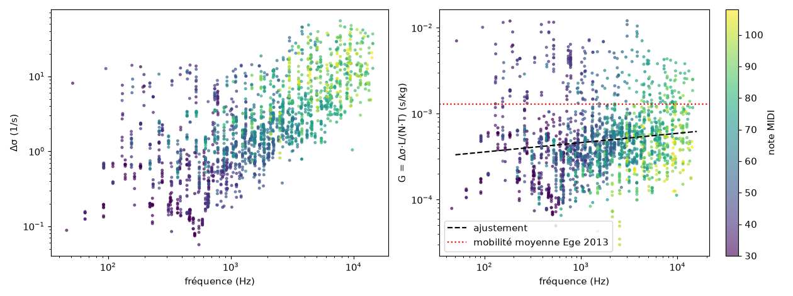
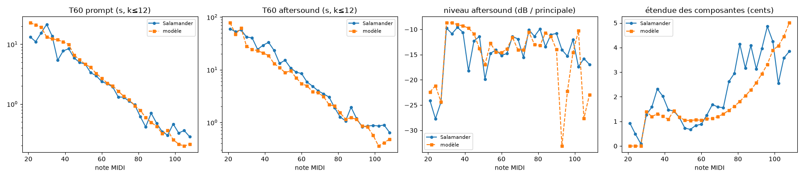
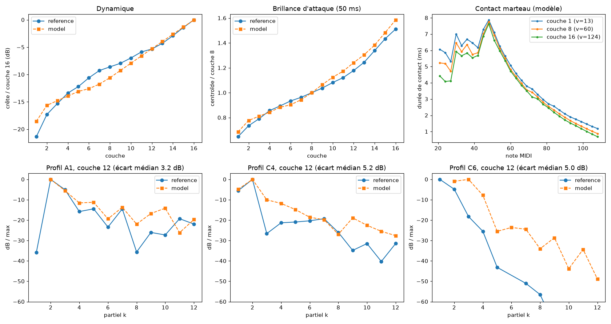

# Phase 2 — unisons coupled at the bridge

Status as of 2026-10-21. Each key has 1 to 3 strings, each with its two polarisations, coupled through the bridge admittance. This gives the double decay (prompt sound / aftersound) and the beats, matched to Salamander.

## Model

**Weinreich coupling** (`unison.rs`). For a partial k, each oscillator (string j, vertical or horizontal polarisation) follows ζ̇ = d·ζ with d = −σ0 + iω. The bridge, which moves under the sum of the string forces, feeds the same excitation back to all of them:

```text
A = diag(d) − ε_V·1_V·1_Vᵀ − ε_H·1_H·1_Hᵀ − ε_X·(1_V·1_Hᵀ + 1_H·1_Vᵀ),   ε_V = (T/L)·Y(f)
```

- Re ε_V is the loss of one string at the bridge; Im ε_V spreads the frequencies apart.
- ε_H and ε_X equal 0.1·ε_V and 0.5·ε_V. The horizontal part of the bridge is much stiffer, and the cross term (bridge rocking) transfers energy between polarisations.
- A is complex symmetric. Its eigenvectors are normalised so that Vᵀ·V = I, hence V⁻¹ = Vᵀ.
- General solver up to 6×6, allocation-free: characteristic polynomial of the centred matrix (Faddeev–LeVerrier), Durand–Kerner roots, refinement by inverse iteration and Rayleigh quotient.
- Centring is essential: the eigenvalues are ~10⁴ rad/s but differ only by ~10⁻².
- The complete table (88 notes, ≤ 768 coupled modes each) is precomputed in 33 ms when the engine is created (`note_model.rs`). A strike only copies.
- Over the whole piano: |V_jm| ≤ 1.13, so no exceptional point and no catastrophic cancellation in f32.

**Rendering** (`voice.rs`, `modal.rs`).
- The SIMD bank runs the coupled modes, with complex output weights: bridge force = Re(w·z).
- During hammer contact (a few ms), the solver evolves the uncoupled physical oscillators: the coupling acts over 1/|ε| ≈ 0.1–1 s.
- At the end of contact, the state is handed back to the bank via c = Vᵀ·ζ.
- A restrike does the reverse: ζ = V·c.

## A physical measurement drawn from the recordings: the bridge conductance

If the model is right, the difference in decay between prompt sound and aftersound measured by ESPRIT, Δσ = N·(T/L)·G(f), must give a conductance G = Δσ·L/(N·T) that depends only on frequency (`tools/bridge_conductance.py`).



- Δσ varies from 0.1 to 30 s⁻¹. G, on the other hand, is almost flat: G(f) ≈ 4.6·10⁻⁴·(f/1 kHz)^0.11 s/kg.
- This is the same order of magnitude as the mean mobility measured on a soundboard by Ege et al. (2013), 1.3·10⁻³ s/kg.
- The residual scatter, a factor ≈ 2.5, is the expected signature of the soundboard modes (phase 4).
- This measured G is used directly as a model parameter.

## Calibration on the ESPRIT statistics

The model renders go through exactly the same analysis chain as the recordings (`tools/unison_trial.sh`: `piano-eval --write-wav`, then `piano-survey --esprit`, then `esprit_summary.py`). The grid searches (`tools/unison_grid.py`, `tools/pol_grid.py`) set:

| Parameter | Value | Remark |
|---|---|---|
| Unison width (spread between outermost strings) | 1 cent up to C4 → 5 cents at C8 | irregular distribution per note |
| Im Y / Re Y | 1.5 | the frequency spread within the unison requires an imaginary part |
| G (conductance) | measured, uncorrected | a factor of ×0.7 or ×1.6 degrades the score |
| Horizontal polarisation | coupling 0.1·ε, transfer 0.5·ε, +0.3 cent, radiation 10 %, hammer tilted 5 % | |
| Intrinsic string losses | ESPRIT aftersound law | `LossLaw::SALAMANDER_STRING` |



**Median deviations from the model (layers ≥ 8, partials k ≤ 12).**

| Quantity | Median deviation |
|---|---|
| Prompt T60 | 21 % |
| Aftersound T60 | 27 % |
| Aftersound level | 2.1 dB |
| Spread in cents | 0.5 cent |
| Single-string notes (A0–D#1): aftersound T60 | 11 % |
| Single-string notes (A0–D#1): aftersound level | 1.7 dB |

Without the horizontal polarisation, these notes have no aftersound at all and the overall score goes from 2.41 to 5.85.

**What remains.**
- In the treble, the measured spread in cents is irregular (real tuning), the model's is smooth.
- In the treble, the aftersound of a few notes (A6, C7, A7) drops too low.
- The prompt T60 of single-string notes is 1.7× too long: the bridge losses of the wound bass strings do not follow the generic T/L law.

## Spectral comparison



- **Profile metric corrected.** The old one normalised each profile to its strongest partial. When the partial tracker lost that partial, the whole profile shifted, hence an unreliable 8.5 dB in phase 1. The new one compares the levels of the common partials up to a constant.
- **Partial tracking corrected.** The floor of the outlier rejection was 0.05 cent. It is raised to 0.5 cent: the bridge coupling slightly shifts the low partials, as on a real piano.
- With these two corrections, the median profile deviation is **5.5 dB**. The configuration equivalent to phase 1 gives 5.8 dB.
- Per note, the deviation ranges from 2.9 to 7 dB in the bass and middle, and from 6 to 14 dB in the treble (A7: 14.3 dB).
- The rest is expected from the soundboard, radiation and a real string scale.
- Dynamics and brightness remain matched: centroid ×1.59 in fortissimo versus ×1.51 for the reference, ×0.69 versus ×0.65 in pianissimo. The hammer did not need to be recalibrated.

## Cost

Whole keyboard at velocity 127, one note every 30 ms, pedal down: 88 voices (256 to 768 coupled modes each) rendered 15.9 times faster than real time on a single thread, i.e. ≈ 6 % of a Zen 5 core. The output gain is lowered by 6 dB: peak −1.2 dBFS in this worst case.

## Next steps

1. **Phase 3**: physical dampers, half-pedal, sostenuto, una corda (the hammer strikes only 2 of the 3 strings: already provided for by the solver's `hit` field), sympathetic resonance through the bridge.
2. **Phase 4**: modal soundboard. It will replace the smooth law G(f) with a real admittance with its peaks and dips. This is the main remaining source of deviation, in spectrum as in decay.
3. Losses specific to the wound bass strings, and a real string scale.

## Commands

```bash
cargo test --workspace
tools/unison_trial.sh trial --unison-mid=1.0 --bridge-b-over-g=1.5
python3 -I tools/unison_grid.py
python3 -I tools/pol_grid.py
python3 -I tools/bridge_conductance.py out/salamander/components.csv
cargo run --release -p piano-render -- note out/c4.wav --note 60 --velocity 90 --hold 10
```
