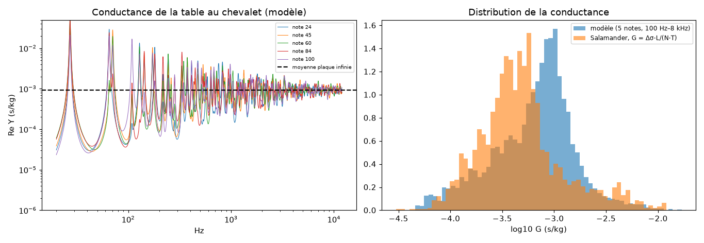
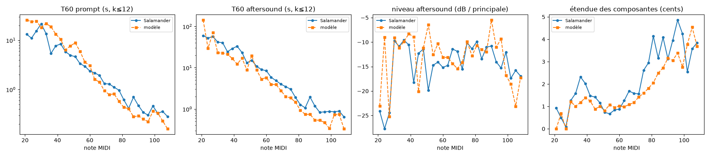
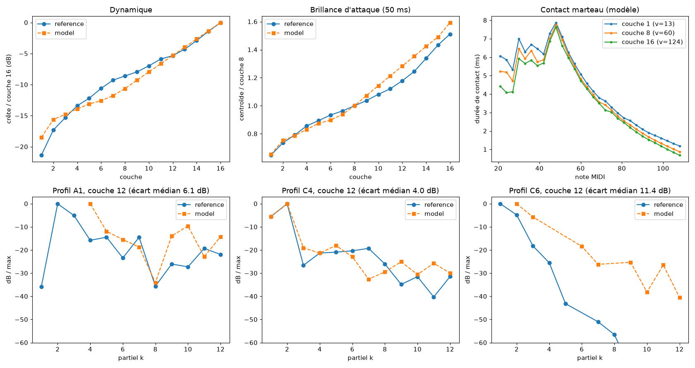

# Phase 4 — soundboard, radiation, microphones

Status as of 2026-10-21. The bridge force of each key excites a modal soundboard. Its modes radiate to two microphones (stereo output), and the same soundboard provides the admittance that couples the strings of each unison.

## Model

**Plate** (`soundboard.rs`).
- Orthotropic plate (spruce and ribs) of 1.7 × 1.3 m, clamped in the rim.
- Frequencies from Warburton's approximation for clamped edges (m → m + ½), mode shapes approximated by mass-normalised sines.
- Loss factor η = 2 % (Ege et al. 2013).
- 1,083 modes below 20 kHz, first mode at 61 Hz, one mode every 21.6 Hz (Ege: 19.5 Hz).
- Simply supported edges put the first mode at 27 Hz, right on the fundamental of A0: A0 then stood out 57 dB above C4.
- ρh/D sets the modal density; ρh·D sets the mobility level, matched to the Salamander decays (see below). Result: ρh = 7 kg/m², Dx = 3,825 N·m, Dy = 1,700 N·m, mean mobility 9.4·10⁻⁴ s/kg, the same order as the 1.3·10⁻³ measured by Ege.

**Admittance seen by the strings.**
- Y(x, ω) = Σ iω·Φ_n²/(ω_n² − ω² + iη·ω_n·ω), evaluated at the exact point of each key on the bridge (main bridge as a broken line, separate bass bridge).
- A series stiffness of 2·10⁷ N/m (bridge pins, bridge cap) adds iω/k. This is what provides the reactive “spring” part that phase 2 had to introduce as Im Y = 1.5·Re Y.
- A local bridge mass, Y/(1 + iω·m·Y), is available; the calibration sets it to 0.
- The coupling ε = (T/L)·Y of each partial now carries the peaks and dips of the soundboard.

**Radiation** (`instrument.rs`).
- For each mode and each microphone, the Rayleigh integral (baffled plate) is computed once, at the mode frequency, on a 1.5 cm grid: p = iωρ₀/(2π)·∫Φ·e^{−ikR}/R dS.
- Two microphones 1.5 m above the soundboard, adjustable (`SoundboardParams::mics`).

**Rendering** (`engine.rs`, `modal.rs`).
- The keys are grouped into 16 bridge zones. Each zone drives a SIMD bank of the soundboard modes: input gain Φ_n(x_zone)·T, and two complex outputs, one per microphone.
- The modal kernel now computes two outputs in the same pass (`process2`).
- A zone bank with no input that has gone silent is put to sleep.
- The instrument (note table and soundboard data) is precomputed in ≈ 0.35 s and shared via `Arc` (`Engine::with_instrument`). This is also the basis for rebuilding off the audio thread when a parameter changes.
- Stereo output (`process_stereo`), and mono = average of the two microphones.

## Performance

- **Pitfall found.** With the complex output weights added in phase 2, a *driven* bank (with input) processed in groups of 4 blocks of 16 modes overflows the registers: it becomes about 20 times slower on all ISAs (1.05 ns/mode·sample instead of 0.06). Driven banks are now limited to groups of 2, and dual-output driven banks to groups of 1 in AVX2.
- **Worst case** (whole keyboard at velocity 127, one note every 30 ms, pedal down, 88 voices plus 16 soundboard banks of 1,083 modes): 4.64 s of sound rendered in 0.85 s, including 0.35 s of instrument construction. That is ≈ 9× real time on a single thread, ≈ 11 % of a Zen 5 core.

## Validation

**An unfitted prediction that turns out right.** The soundboard was constrained only by its modal density and its mean mobility level. Yet the *distribution* of its conductance at the bridge reproduces the one extracted from the Salamander decays.



**Decays**: ESPRIT statistics measured on the radiated sound, exactly as on the recording (calibration with `tools/coupling_grid.py`).

| | Smooth law, phase 2 (bridge force) | Modal soundboard, phase 4 (radiated sound) |
|---|---|---|
| Prompt T60 (median deviation) | 21 % | 49 % |
| Aftersound T60 | 27 % | 52 % |
| Aftersound level | 2.1 dB | 2.0 dB |
| Single-string notes: aftersound level | 1.7 dB | 1.1 dB |
| Aftersound detection rate (deviation) | 0.26 | 0.14 |
| Overall score | 2.41 | 2.93 |



- The T60s are slightly less accurate than with the smooth law: the latter had been fitted directly to these statistics, whereas the soundboard imposes its peaks and dips.
- Aftersound detection and levels are better.
- The analysed sound now includes the soundboard's own reverberation.

**Spectrum** (`tools/spectral_stats.py`). We compare statistics, not partials one by one: a realistic modal soundboard places its resonances elsewhere than those of another piano, and a partial-by-partial comparison penalises it mechanically.

| Band (Hz) | 0–100 | 100–200 | 200–400 | 400–800 | 800–1.6 k | 1.6–3.2 k | 3.2–6.4 k | > 6.4 k | Fluctuation |
|---|---|---|---|---|---|---|---|---|---|
| Salamander | +11.8 | +14.0 | +5.3 | +1.0 | +0.7 | −0.6 | −12.2 | −23.4 | 5.3 dB |
| Without soundboard (phase 2) | +6.0 | +9.9 | +2.0 | +0.5 | −1.0 | +0.2 | −1.3 | −9.9 | 3.8 dB |
| With soundboard (phase 4) | +13.3 | +8.3 | +2.5 | +1.5 | −0.4 | +0.7 | −1.8 | −10.0 | 6.7 dB |

Levels in dB, relative to the median of the partials of each note.
- The soundboard corrects the deficit in the extreme bass.
- It brings the spectral roughness of a real piano: without it, the spectrum is too smooth.
- Dynamics and brightness as a function of velocity remain matched: centroid ×0.65 / ×1.59 versus ×0.65 / ×1.51 for the reference.



## Open problem: too much treble above 3 kHz

Between 3.2 and 6.4 kHz, the reference is 10 dB below the model; above that, 13 dB. Per note, the slope deviation grows from +4 dB/octave at C4 to +8–20 dB/octave in the treble. What was tested and ruled out:

| Mechanism | Tool | Effect |
|---|---|---|
| Bridge mass | `tools/board_grid.py` | improves slightly above 6.4 kHz, but degrades the decays |
| Soundboard losses increasing with frequency | `tools/board_grid.py` | negligible |
| Felt hysteresis ×3 | `tools/board_grid.py` | negligible |
| Contact width ×2 | `tools/board_grid.py` | negligible |
| Microphone height | `tools/board_grid.py` | negligible |
| Much softer felt in the treble (Q0 ÷50 at C8) | `tools/voicing_grid.py` | the deviation barely moves |
| Decays of the high partials | — | the model actually decays *faster* than the reference |

Remaining leads, in order of likelihood:
1. Localisation of the vibration between the ribs above ~1 kHz (Ege 2013). The homogeneous plate does not represent it, and it reduces the mobility and radiation of the treble bridge.
2. A real string scale: lengths, striking points and tensions in the treble, currently generic.
3. Stulov's complete hereditary felt law, rather than the linearised hysteresis.
4. The Salamander recording chain (microphones, room, possible equalisation). A second reference piano (Iowa MIS) would tell what belongs to the model and what belongs to this recording.

## Commands

```bash
cargo run --release -p piano-core --example soundboard_admittance > out/admittance.csv
cargo run --release -p piano-core --example build_time
cargo run --release -p piano-render -- note out/c4.wav --note 60 --velocity 90 --hold 8   # stereo WAV
tools/unison_trial.sh trial --series-stiffness=2e7
python3 -I tools/coupling_grid.py
python3 -I tools/spectral_stats.py ref_and_model=out/salamander/eval_phase4.csv
```

> Note (phase 3): the 16 zone banks have been replaced by a single multi-input / multi-output bank that also provides the bridge velocity. A direct term corrects the impulse invariance: without it, the rendered off-resonance conductance was wrong in the bass. The polarisation has been made passive. See [phase3.md](phase3.md).
