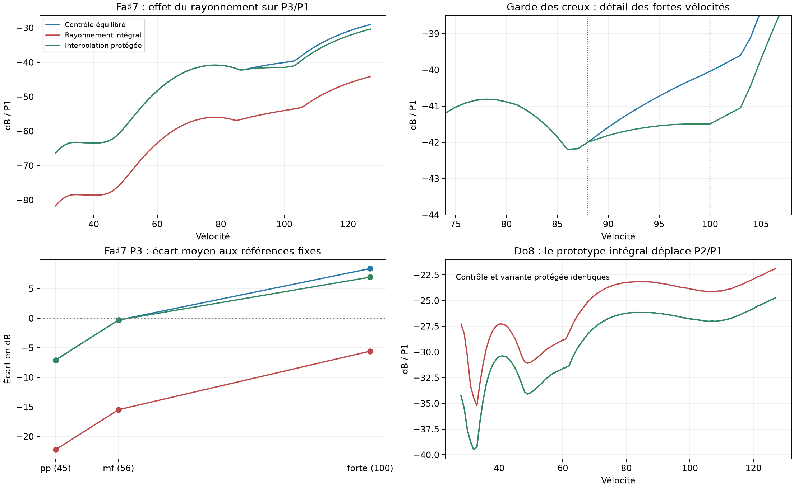

# Prototype audio du rayonnement à la fréquence excitée

> Précision du 29 octobre : le contrôle « joueur » de cette étude utilisait une sonde aux coordonnées du pianiste, sans couvercle ni salle. Il ne reproduisait pas tout le preset pianiste livré (couvercle 35°). Les valeurs historiques sont conservées ; voir [le contrôle spatial et binaural corrigé](rayleigh_c8_player.md).

28 octobre 2026, branche `codex/piano-main-revalidation`, base `aac9cb1`. **Défaut et rendu courant de l’application inchangés.** Le prototype fonctionne hors ligne dans ce worktree. Le contrôle reste le contact expérimental équilibré de l’étude précédente ; il n’est pas devenu le défaut.

## Décision

Le remplacement complet du rayonnement a maintenant un rendu audio causal, vérifié contre la sonde fréquentielle indépendante. Il réduit fortement P3 forte aux micros rapprochés, mais assombrit beaucoup trop le pianissimo et dégrade Do8. Il est rejeté comme substitution immédiate.

Une **interpolation ciblée** conserve le pp, les autres touches et les creux : seulement Fa♯7, au-dessus de la vélocité 88, au-dessus de 7,5 kHz, avec au plus 13 % du nouveau rayonnement. Elle réduit P3 forte de **1,45 dB** dans l’écoute du banc et de **0,85 dB** à la position joueur. L’écart moyen restant à forte est encore **+6,95 dB**. C’est un réglage de timbre expérimental dépendant de la dynamique, pas une loi physique de rayonnement validée. Aucun défaut n’est modifié.

## Prototype et isolation des causes

`rayleigh_capture` laisse tourner le moteur habituel : même contact, cordes, couplage, mouvements du chevalet, forces primaires et sympathiques. Il relève les 16 forces de région et reconstruit séparément le son de la table. Le cadre, la ceinture et l’action restent dans le signal résiduel. La substitution porte sur le rayonnement des forces primaires **et** sympathiques ; elle ne modifie pas le retour mécanique vers les cordes.

`rayleigh_kernel` projette les formes modales sur les cellules de la surface rayonnante et cumule leurs chemins de propagation : face avant, face arrière en opposition, réflexion du couvercle et, si présente, du mur. Les chemins sont fournis par la géométrie existante du moteur. Le banc conserve ses micros rapprochés, son couvercle à 35°, son gain micro et sa salle studio. Les modes du contour réel restent limités à 1,5 kHz ; les modes supérieurs et la répartition des forces sur le chevalet ne sont pas recalibrés.

Le calcul utilise une grille de 5 mm et des délais tabulés à 32 fois 48 kHz, puis un rééchantillonnage à fenêtre Kaiser. Le noyau acoustique réel s’applique à l’accélération modale complète, après la paire de pôles mécaniques. Il suit donc la fréquence excitée, avec ses délais, plutôt qu’un poids complexe figé à la fréquence propre. Il n’y a ni inversion d’un spectre mesuré, ni remplacement du seul module spectral.

La réponse impulsionnelle est conservée sur 65 536 échantillons (1,365 s). La borne de queue donnée par les pôles est inférieure à 2 × 10⁻²² ; les queues numériques mesurées sont de l’ordre de 10⁻¹⁵ du pic. Les trajets physiques sont plus longs que le support négatif du filtre d’interpolation : aucun délai négatif n’est introduit. La salle du moteur est appliquée après substitution, avec les mêmes paramètres et le même gain. Les WAV de mesure ne sont pas normalisés.

Les seules additions dans le cœur sont deux accès de diagnostic en lecture : les chemins acoustiques et les forces sympathiques du dernier sous-bloc. Le chemin de rendu courant et les presets de défaut sont inchangés. Le prototype exige actuellement `case_open=1`, `exact_below=0`, une charge de cordes constante et des chemins assez longs pour l’interpolation ; il refuse les configurations non prises en charge. Ce n’est pas encore un moteur temps réel ni une validation de la polyphonie ou des pédales.

## Vérifications numériques

- **448 contrôles audio identiques bit à bit** au renderer précédent après reconstruction de la chaîne sèche + salle : 48 attaques et 400 frappes de balayage.
- Reconstruction indépendante de l’ancien son de la table à partir des forces : erreur RMS au pire **−107,3 dB par rapport au signal reconstruit** sur ces 448 cas. Le résidu structurel n’est donc pas obtenu par une soustraction grossière.
- Prototype causal contre intégrale fréquentielle indépendante, position joueur, P1/P2/P3 de Fa♯7 : écart maximal **0,0016 dB et 0,0092°** par oreille.
- Grilles 7,5 et 5 mm : écart maximal **0,030 dB** sur les partiels sous 12 kHz des quatre touches surveillées aux micros du banc. Cela contrôle ces points, pas toutes les fréquences ni toutes les géométries.
- Interpolation avant ou après la salle : écart RMS **−146 dB** sur Fa♯7 forte, hors les 64 derniers échantillons de continuation de salle. Cette équivalence linéaire permet de sélectionner les variantes sur les captures existantes.
- 74 tests du cœur et neuf tests Python du banc réussis. Les deux nouveaux exemples compilent.

## Comparaison à couverture constante

Les mêmes **459 observations d’attaque** sont conservées : 349 C7–C8 et 110 de transition, avec **71 observations de tenue**. Huit pianos de référence ; aucune observation éliminée en fonction du candidat. Une tenue faible reste incluse dans chaque variante. Les identités sont vérifiées contre la baseline.

Les quatre touches Do♯7, Ré♯7, Fa♯7 et Do8 sont balayées sur les **100 vélocités entières 28–127**. Les deux variantes finales fournissent chacune 48 WAV d’attaque et 400 WAV de balayage ; le contrôle précédent est réutilisé et son identité est vérifiée par un nouveau rendu. Une campagne de score global sur tout le clavier n’est pas engagée : la substitution intégrale échoue déjà aux gardes ciblées.

| Mesure | Contrôle équilibré | Rayonnement intégral | Interpolation protégée |
|---|---:|---:|---:|
| Écart P3 Fa♯7 pp, dB | −7,08 | −22,24 | −7,08 |
| Écart P3 Fa♯7 mf, dB | −0,30 | −15,46 | −0,30 |
| Écart P3 Fa♯7 forte, dB | +8,40 | −5,56 | +6,95 |
| Creux Fa♯7 P2, dB | 1,282 | 1,635 | 1,282 |
| Creux Fa♯7 P3, dB | 1,386 | 0,921 | 1,386 |
| Creux Do8 P2, dB | 5,232 | 7,915 | 5,232 |
| MAE Fa♯7, 34 observations | 9,451 | 10,040 | 9,315 |
| MAE Do8, 15 observations | 6,022 | 8,115 | 6,022 |
| MAE C7–C8, 349 observations | 9,013 | 9,502 | 9,006 |
| MAE transition, 110 observations | 7,723 | 8,055 | 7,723 |
| MAE tenue, 71 observations | 15,777 | 12,631 | 15,777 |

Les MAE sont calculées par piano puis moyennées entre pianos. Les écarts P3 par dynamique utilisent les mêmes sources qu’auparavant : quatre au pp, cinq au mf, sept au forte. L’amélioration moyenne de l’interpolation reste petite et calibrée sur ces mêmes données ; il ne s’agit pas d’un test indépendant.

Le rayonnement intégral fait baisser P3 forte de 13,97 dB aux micros rapprochés, mais de 15,16 dB au pp. Son meilleur score de tenue ne compense pas les régressions de timbre et de régularité. Le contact équilibré était déjà trop sombre en P3 pp : son écart est préservé, pas corrigé, dans la variante protégée.



## Interpolation protégée et garde des creux

Pour Fa♯7 seulement, le coefficient vaut 0 jusqu’à v88, puis augmente linéairement jusqu’à 0,13 à v100 et reste constant au-delà. Un FIR passe-haut de 129 coefficients, coupure 7,5 kHz, mélange la différence entre le nouveau et l’ancien rayonnement. Le reste du signal reste celui du contrôle. La branche traitée ajoute **64 échantillons de latence, soit 1,33 ms**. La protection n’est pas un changement de mécanique ni une transmission physique qui dépendrait spontanément de la vélocité.

La sélection a testé successivement les amplitudes de mélange et les rampes de dynamique. Une variante à −2,07 dB semblait passer le critère du creux global, mais créait une nouvelle vallée locale à forte. Elle a été rejetée. Le critère final exige aussi que la décroissance cumulée entre v88 et v127 reste sous 0,01 dB : **0,0026 dB** pour la variante finale, contre 0 pour le contrôle. Le maximum historique à v86 reste exactement inchangé. P2 forte change de moins de 0,00001 dB.

**47 WAV d’attaque et 361 WAV de balayage sont identiques bit à bit** au contrôle dans la variante protégée : toutes les autres touches et Fa♯7 jusqu’à v88. Do8 conserve donc aussi son niveau et sa bande 1–2 kHz, sans substitution ni normalisation. Seules une attaque forte et 39 frappes de Fa♯7 sont effectivement transformées.

### Piège de mesure du niveau avec la latence

Le niveau d’attaque historique utilise des tranches de 10 ms et borne le début de sa fenêtre à zéro. Ajouter seulement 64 échantillons de silence au contrôle modifie sa mesure d’environ **−0,586 dB**, alors que le son est identique. La transition entre notes traitées et contournées produisait ainsi un faux creux de niveau de 0,325 dB dans la métrique brute.

Les valeurs historiques brutes restent archivées. La garde de niveau supplémentaire ajoute **le même préambule de 1 024 échantillons à chaque WAV de chaque variante**, avant la même mesure, sans toucher aux amplitudes ni supprimer le début des signaux. Le contrôle de délai devient alors exactement invariant et **aucun creux de niveau total n’apparaît** sur les quatre touches, dans les trois variantes. Les scores de partiels et leurs supports ne changent pas. Le précurseur de filtrage de la variante protégée avant son délai nominal représente au pire −78,5 dB de son énergie totale ; il n’a pas été supprimé pour gagner un score. Voir `latency-level-check.json`.

## Position joueur et Plath

Une capture audio indépendante est produite aux micros joueur, sans salle ni couvercle, avec la même mécanique et une grille de 5 mm.

| Fa♯7 forte, P3/P1 | Contrôle | Rayonnement intégral | Interpolation protégée |
|---|---:|---:|---:|
| Micros rapprochés du banc | −40,04 | −54,01 | −41,49 |
| Micros joueur | −47,99 | −46,75 | −48,84 |

Le rayonnement intégral **augmente** ici P3/P1 de 1,24 dB : la baisse de P1 est plus forte que celle de P3. Cela confirme en audio que la correction de propagation ne résout pas partout l’excès relatif. L’interpolation donne une réduction plus faible mais de même sens au joueur, 0,85 dB ; le pp reste inchangé par construction et par vérification.

Plath reste dans les observations fixes du banc. Son P3 de pression d’attaque, mesuré dans la bande historique, vaut −67,95 dB/P1 ; l’écart au joueur demeure important. Comme établi dans [l’étude précédente](bridge_ear_followup.md), la faible cohérence avec l’accéléromètre et les familles spectrales voisines empêchent d’utiliser cette bande comme une cible de transfert scalaire identifiée. L’ancien écart de 7 dB n’a pas servi à recalibrer le prototype.

## Écoute et reproduction

`out/rayleigh-audio/comparison.wav` contient trois groupes : Fa♯7 pp, Fa♯7 forte, Do8 forte. **Dans chaque groupe : contrôle, interpolation protégée, rayonnement intégral.** Un seul gain commun est utilisé ; une courte fermeture identique de 20 ms évite les clics de fin dans ce montage uniquement. Les WAV de mesure restent intacts.

Pour produire une frappe avec la variante protégée :

```sh
python bench/rayleigh-audio/prototype.py --note 102 --velocity 100 \
  --variant guarded --out out/rayleigh-audio/fsharp-forte-guarded.wav
```

Le renderer accepte aussi `control` et `driven`, les notes 93–108 et les vélocités 28–127. Il charge les presets expérimentaux gelés de `out/fsharp-contact/validation/presets/balanced`, pas le défaut de l’application.

Pour reconstruire l’expérience : compiler `rayleigh_kernel` et `rayleigh_capture` avec Cargo en release/offline, les copier dans `out/rayleigh-audio/bin`, puis exporter les noyaux avec le preset équilibré de Fa♯7, pas spatial 0,005 et suréchantillonnage de délai 32, dans `kernel5`. Répéter avec 0,0075 dans `kernel75` ; pour `kernel-player`, utiliser `out/bridge-ear/presets/grid5.toml` et 0,005. Exécuter `filters.py` sur chacun de ces trois dossiers.

Ordre des scripts de recherche : `audio.py`, `guard_search.py` (option `--refresh` pour refaire ses captures), `guard_late.py`, `guard_monotone.py`, `validate.py`, `player_check.py`, `check.py`, `latency_check.py`, `present.py`. `validate.py --reuse` recalcule seulement l’interpolation et les scores sur les captures déjà validées. Les sondes, noyaux, captures et WAV restent dans `out/rayleigh-audio`; les mesures, scripts, sélection et empreintes sont archivés dans `bench/rayleigh-audio`.

Une intégration temps réel demanderait encore une représentation moins coûteuse des noyaux, une latence commune, des tests polyphoniques/pédales et une calibration cohérente du contact avec ce rayonnement. La petite amélioration ciblée présente est disponible à l’écoute ; elle ne justifie pas de remplacer le défaut ni de généraliser la correction au clavier.
