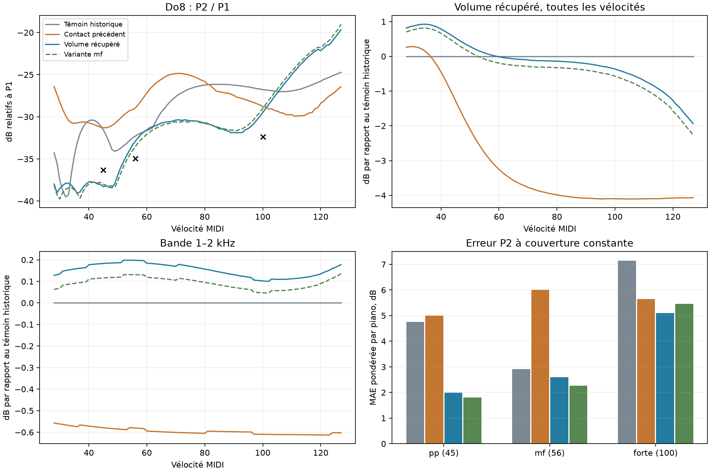

# Do8 : récupération du volume et de la bande 1–2 kHz

Étude du 28 octobre 2026, après `1ba30c6`, dans `codex/piano-main-revalidation`. **Les défauts et le moteur de production sont inchangés.** Le prototype audio reste hors ligne et sur notes isolées. Le contact de Fa♯7 et tous les autres sons hors Do8 sont conservés à l’identique.

Le candidat `recovered` récupère l’énergie de Do8, améliore le mf et réduit les creux dans le banc à micros rapprochés. Ce résultat tient également avec dix sous-pas de contact. Il ne valide pas encore le réalisme à toutes les positions d’écoute ni aux vélocités extrêmes.

## Cause et ablations

Le précédent contact Do8 combinait un feutre assoupli et une hampe fortement amortie (`shank_loss=2`). Les essais à un seul paramètre identifient les pertes de hampe comme le principal levier de récupération : passer à 0,1 restaure presque toute la bande 1–2 kHz et remonte le volume de 1,67/2,69/3,22 dB au pp/mf/forte. Il améliore aussi la MAE du mf de 6,00 à 3,79 dB, mais augmente le creux P2/P1 de 5,08 à **5,78 dB**. Ce changement seul est donc rejeté.

La décomposition acoustique confirme un effet réel. Par rapport au contact plus ancien utilisé avant la compensation du rayonnement, le contact précédent perd environ 1,4–1,5 dB dans la composante table à 1–2 kHz sur 60 ms. Sur le signal total, la perte est plus faible, car le son d’action masque une partie du déficit. Elle demeure environ 1,3–1,4 dB en énergie filtrée sur les 200 premières millisecondes. Les fenêtres ancrées au déclenchement ou au même échantillon 80 confirment la tendance : ce n’est pas seulement un déplacement de la détection d’attaque.

Couper le bruit d’action rend la différence plus visible ; couper le choc du clavier ne la supprime pas. Le candidat conserve ces deux sources inchangées. Il ne récupère pas l’énergie en ajoutant du bruit, une égalisation ou un gain de sortie.

L’exposant et la force du feutre règlent ensuite le compromis entre partiels et dynamique. Avec `shank_loss=0,1`, abaisser seulement q à 0,3 avec l’exposant précédent donne déjà plus de 9 dB de creux sur la grille courte : rejet. Associer **q=0,3 et p=−1** ramène le creux mesuré sur les 100 vélocités à 1,32 dB, avec une MAE mf de 2,08 dB. Réduire ensuite les pertes de 0,1 à 0,05 récupère davantage de volume, avec un mf encore meilleur que celui du contact précédent et du témoin historique.

| Paramètre Do8 | Contact précédent | `recovered` | `recovered_mf` |
|---|---:|---:|---:|
| q, force relative du feutre à 0,2 mm | 0,4 | 0,3 | 0,3 |
| Décalage de l’exposant p | −1,5 | −1 | −1 |
| Pertes de hampe | 2 | 0,05 | 0,075 |
| Hystérésis | 0,6 | 0,6 | 0,6 |
| Hauteurs des cordes | 15 µm | 15 µm | 15 µm |
| Part / fréquence de hampe | 0,45 / 300 Hz | identiques | identiques |

La masse, la largeur du contact, la position de frappe, le rayonnement, la salle et les bruits restent fixes. Ces paramètres sont constants pour la touche ; la réponse dynamique vient de la simulation du contact. Aucun réglage n’est interpolé à partir des erreurs mesurées selon la vélocité.

## Couverture et comparaison

Le banc garde la puissance stéréo, la calibration Plath et l’absence de normalisation par note. Les **459 identités d’attaque** sont identiques (349 sur C7–Do8 et 110 de transition), ainsi que les **71 identités de tenue**, avec la même pondération par piano. Tous les partiels modèles restent mesurés, même faibles. Les nouvelles attaques Do8 sont rendues sur 1,2 s ; les **100 vélocités entières 28–127** sont vérifiées pour les creux. Le niveau utilise le même pré-silence de 1024 échantillons pour tous les fichiers.

Le « témoin historique » ci-dessous désigne le contact équilibré avec l’ancien rayonnement. Le « contact précédent » désigne le rayonnement intégral et le contact de l’étude précédente. Les deux nouveaux candidats gardent ce même rayonnement intégral.

| MAE P2, dB | Témoin historique | Contact précédent | `recovered` | `recovered_mf` |
|---|---:|---:|---:|---:|
| Do8 pp, 3 observations | 4,75 | 5,00 | **1,99** | 1,81 |
| Do8 mf, 4 observations | 2,91 | 6,00 | **2,60** | 2,26 |
| Do8 forte, 8 observations | 7,14 | 5,64 | **5,11** | 5,47 |
| Do8, pondération par piano | 6,02 | 5,74 | **4,45** | 4,59 |
| C7–Do8, 349 observations | 9,01 | 9,00 | **8,91** | 8,92 |

Les quatre comparaisons individuelles du mf s’améliorent par rapport au contact précédent. Face au témoin historique, la MAE mf s’améliore, mais pas chaque piano séparément : l’erreur Iowa passe de 0,45 à 1,06 dB. Les pianos réels n’ont pas tous le même objectif spectral.

| Mesure, dB | Contact précédent | `recovered` | `recovered_mf` |
|---|---:|---:|---:|
| Volume pp relatif au témoin historique | −1,28 | **+0,53** | +0,38 |
| Volume mf relatif au témoin historique | −2,88 | **+0,07** | −0,11 |
| Volume forte relatif au témoin historique | −4,10 | **−0,36** | −0,57 |
| Bande 1–2 kHz, pp / mf / forte, même témoin | −0,58 / −0,58 / −0,61 | **+0,18 / +0,20 / +0,10** | +0,12 / +0,13 / +0,05 |
| Creux maximal P2/P1 sur 28–127 | 5,08 | **1,54** | 1,64 |
| Creux de niveau global sur 28–127 | 0 | **0** | 0 |

La fondamentale remonte de 4,04/4,64/3,97 dB par rapport au contact précédent ; la réduction de P2/P1 ne vient donc plus d’une perte globale de niveau. Les différentes bandes ne remontent pas uniformément : ce n’est pas une compensation de gain.

Sur **toutes** les vélocités testées, `recovered` améliore le volume par rapport au contact précédent de 0,55 à 3,89 dB et la bande 1–2 kHz de 0,69 à 0,79 dB. Cette bande dépasse aussi le témoin historique de 0,10 à 0,20 dB sur toute la grille.

La récupération du volume n’est pas complète aux extrêmes : à v127 il reste **−1,94 dB** par rapport au témoin historique, contre environ −4,1 dB auparavant. Le rapport P2/P1 monte plus fortement au-dessus de v100 ; les références figées ne couvrent que v45/56/100. La grille dense contrôle les irrégularités du modèle, pas le réalisme spectral absolu à v127.

Le contrôle de volume par rapport aux mêmes touches voisines, au sein de chaque piano réel, passe d’un biais −2,15/−3,29/−5,44 dB à **−0,34/−0,33/−1,71 dB** au pp/mf/forte. Couverture exploratoire limitée à 2/1/5 pianos : ce contrôle ne remplace pas le score spectral.



## Fa♯7 et tenue préservés

Pour chaque candidat, **45 WAV d’attaque et 300 WAV de grille dense hors Do8 sont identiques bit à bit** à ceux du contact précédent. Fa♯7 conserve notamment sa MAE de 7,64 dB, P3 forte à −0,02 dB de la moyenne des références, ses creux P2/P3 de 0,76/0,50 dB et sa bande 1–2 kHz.

Les 71 mesures de tenue restent identiques (MAE 13,14 dB). **Le corpus ne contient aucune observation admissible de tenue Do8** : on ne peut pas déduire de cette égalité que sa tenue est validée. Les régressions déjà connues du rayonnement intégral sur les autres touches ne sont pas résolues par ce travail local.

## Vérification numérique et position d’écoute

Les contacts moins amortis sont plus sensibles au pas d’intégration : le rapport des puissances modales P2/P1 à la sortie du contact diffère jusqu’à 1,12 dB entre 5 et 20 sous-pas sur les six vélocités examinées. Cela justifie une vérification audio supplémentaire au lieu de traiter ce diagnostic comme une validation suffisante.

L’outil de recherche `rayleigh_capture` accepte maintenant un argument optionnel `audit10`. Il conserve le même instrument Full, double les sous-pas de contact et désactive les raccourcis de silence du moteur. Ce dernier point signifie que ce n’est pas une ablation exclusivement numérique du contact. Sans cet argument, son comportement reste identique : **12 captures WAV et 12 captures de force sont identiques bit à bit** au binaire figé précédent. Aucun défaut de qualité ou moteur de production n’est changé.

Le contrôle audio reprend les **15 références Do8 et 100 vélocités**, avec les mêmes critères :

| Contrôle audio à dix sous-pas | Témoin historique | Contact précédent | `recovered` | `recovered_mf` |
|---|---:|---:|---:|---:|
| MAE Do8, dB | 6,08 | 5,74 | **4,04** | 4,17 |
| MAE mf, dB | 3,01 | 5,94 | **2,78** | 2,52 |
| Creux P2/P1, dB | 5,36 | 5,23 | **1,94** | 1,60 |
| Creux de niveau, dB | 0 | 0 | 0 | 0 |

Le volume et la bande 1–2 kHz restent récupérés. Les valeurs précises changent, mais le sens du résultat et le garde-fou mf tiennent. Les 459/71 scores principaux restent ceux du mode de rendu habituel ; ils ne sont pas mélangés avec cet audit Do8.

Au point d’écoute du pianiste, `recovered` augmente le volume de 0,92/1,10/2,10 dB par rapport au contact précédent, mais ne récupère pas la bande 1–2 kHz : elle varie d’environ −0,06 à −0,08 dB. P2/P1 s’abaisse notamment d’environ 7 dB au pp. Sans enregistrements réels appariés à cette position, on ne peut pas qualifier cette différence de progrès. **La récupération annoncée concerne le banc à micros rapprochés.**

Ces paramètres ont été choisis et évalués sur les mêmes références ; pas de nouveau jeu indépendant. `recovered` est le compromis principal pour la comparaison audio, `recovered_mf` une variante un peu moins sonore favorisant le mf. Aucun n’est promu au défaut.

## Reproduction et fichiers

Les scripts, candidats rejetés, mesures et empreintes sont dans `bench/rayleigh-c8-energy/`. Audio et captures dans `out/rayleigh-c8-energy/`. Les noyaux et le binaire principal restent ceux de `out/rayleigh-audio/`, utilisés par [l’étude précédente](rayleigh_contact_followup.md). Pour l’audit supplémentaire, compiler `rayleigh_capture` en release/offline avec un `CARGO_TARGET_DIR` isolé, puis copier le binaire dans `out/rayleigh-c8-energy/bin/` : le cache `target` partagé entre worktrees peut contenir des objets d’une autre révision.

Ordre : `isolate.py`, `diagnose.py`, `refine.py`, `finalists.py`, puis `dense.py refine r006 r014 r040` et `dense.py finalists f003 f004 f005`. Ensuite `validate.py`, `contact_check.py`, `audio_check.py`, `player.py`, `guards.py`, `present.py`, `audit.py`. Les neuf tests Python du banc passent ; `audit.json` contrôle les identités de référence, les garde-fous, les fichiers inchangés et les empreintes. Le mode normal et le mode d’audit du binaire ont été exercés ; les échantillons audio sont finis et sans dépassement de 1.

```sh
python bench/rayleigh-c8-energy/prototype.py --velocity 56 --out out/rayleigh-c8-energy/do8-mf.wav
```

Pour la variante, ajouter `--profile recovered_mf`. Le script rend une note isolée ; les presets exportés ne sont pas des profils globaux à charger dans l’UI. Le contact Fa♯7 est inclus dans le profil expérimental sans modification.

`out/rayleigh-c8-energy/comparison.wav` contient trois groupes : **Do8 pp, mf, forte**. Dans chaque groupe : **témoin historique → contact précédent avec rayonnement intégral → nouveau contact avec rayonnement intégral**. Un seul gain commun est appliqué au montage, avec un fondu final identique de 20 ms. Les fichiers de mesure restent intacts.
