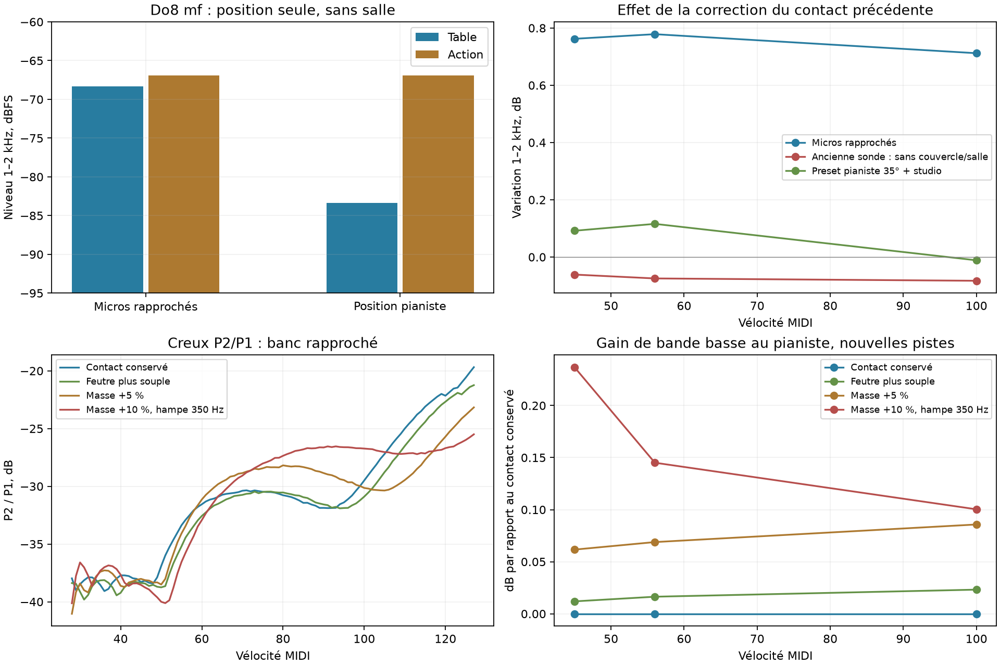

# Do8 au pianiste : pourquoi 1–2 kHz ne suit pas le contact

Étude terminée le 29 octobre 2026, après `3a6a3b0`, dans `codex/piano-main-revalidation`. **Le contact `recovered` de l’étude précédente est conservé. Aucun défaut, preset livré, réglage UI ou code du moteur n’est modifié.**

Le principal résultat n’est pas un nouveau réglage de marteau : au pianiste, la bande 1–2 kHz est dominée par le bruit d’action, dont l’excitation et la stéréo sont fixes. Le contact agit surtout sur une contribution de table devenue faible à cette position. Il n’y a donc pas de raison d’attendre la même récupération de bande qu’aux micros rapprochés. Le contrôle binaural local ajouté ici ne montre pas non plus de gros déficit propre à Do8 par rapport aux touches voisines.

## Correction du témoin spatial précédent

Les études précédentes réutilisaient `out/bridge-ear/presets/grid5.toml`, une **sonde sans couvercle et sans salle**, pour le contrôle appelé « joueur ». Elle reprend les coordonnées du pianiste, mais pas tout le preset livré. En particulier, `lid_angle=0` désactive le couvercle dans ce modèle ; ce n’est pas un couvercle fermé.

Le véritable `presets/listening/Microphones/player.toml` spécifie un couvercle à **35°**. Il ne désactive pas la salle. Cette étude distingue donc :

| Configuration | Couvercle | Gain micro | Directivité micro | Salle |
|---|---:|---:|---:|---|
| Banc rapproché historique | 35° | −9,6 dB | 0,5 | studio |
| Sonde joueur historique | absent | −6,1 dB | 1 | aucune |
| Preset micro pianiste + salle fixe | 35° | −6,1 dB | 1 | même studio |

Les coordonnées sont celles du preset pianiste : deux omnis espacés de 18 cm, 95 cm devant la table, 45 cm au-dessus, sans modèle de tête. La salle studio est un choix expérimental fixe, pas une lecture de l’état courant de l’UI.

Des témoins intermédiaires changent **la position seule**, puis le couvercle, le gain et la salle. Les forces au chevalet sont identiques octet par octet entre ces témoins. Les deux nouveaux noyaux gardent les mêmes modes, la quadrature à 5 mm et les délais suréchantillonnés 32 fois.

L’effet de la correction de contact précédente, mesuré dans le signal total, devient :

| Gain 1–2 kHz de `recovered` face au contact antérieur | pp | mf | forte |
|---|---:|---:|---:|
| Micros rapprochés + studio | +0,762 | +0,778 | +0,712 dB |
| Ancienne sonde joueur | −0,061 | −0,075 | −0,083 dB |
| Preset pianiste 35° + studio | **+0,092** | **+0,116** | **−0,011 dB** |

La petite baisse précédemment rapportée ne décrit donc pas tout le preset pianiste. La correction du témoin ne suffit toutefois pas à faire apparaître le gain de 0,7–0,8 dB des micros rapprochés.

## Chemins acoustiques isolés

À Do8 mf, à **gain, couvercle et absence de salle identiques**, déplacer seulement les micros change les niveaux isolés suivants, dans la même fenêtre de 60 ms ancrée au déclenchement :

| Composante 1–2 kHz | Micros rapprochés | Position pianiste |
|---|---:|---:|
| Table | −68,36 dBFS | **−83,37 dBFS** |
| Action | −66,94 dBFS | **−66,94 dBFS** |

La table perd environ **15 dB**, tandis que le son d’action reste inchangé. Avec le preset pianiste complet et la salle, l’action dépasse encore la table isolée d’environ **10 à 11 dB** ; sans salle, d’environ **13 dB**. Le contact peut changer le spectre de la table sans modifier beaucoup la bande totale.

Les chemins sont cohérents : leurs puissances ne s’additionnent pas simplement. Les interférences avec le résidu expliquent des variations faibles, parfois de signe opposé. Les mesures ancrées au déclenchement, à l’échantillon 80 et sur 200 ms accompagnent la métrique historique à détection d’attaque. Le signe d’un écart de quelques centièmes de dB ne constitue pas à lui seul une cible fiable de réglage.

L’ablation du bruit d’action laisse les forces au chevalet identiques. Le signal d’action isolé varie de moins de **−130 dB RMS relatifs** lorsqu’on change le contact ou passe des micros rapprochés aux coordonnées du pianiste, à salle désactivée. Cela correspond au code :

- `ActionNoise` reçoit la vélocité MIDI, un délai et un niveau ; il ne reçoit ni les forces calculées du contact, ni les positions des oreilles.
- Sa répartition gauche/droite dépend seulement de la touche. La tête, la distance et les chemins de propagation ne sont pas modélisés pour cette source.
- Le gain d’écoute `mic_gain_db` multiplie la table, le cadre et la ceinture dans `Instrument`. Il ne multiplie pas ce son d’action ajouté ensuite. Comparer deux gains micro change donc aussi l’équilibre entre ces sources ; ce n’est pas un gain uniforme de tout le signal.

Ces constats identifient une limite du modèle d’écoute. Ils ne démontrent pas qu’il faudrait augmenter le bruit d’action, ni imposer à la table le même gain de bande à toutes les positions.

## Références binaurales : contrôle complémentaire figé

Plath et BiVib grand contiennent bien des prises à la tête artificielle du pianiste. Un contrôle séparé mesure **la bande 1–2 kHz de Do8 relativement à la médiane de La7, Si♭7 et Si7, dans le même piano et à la même dynamique**. Aucun gain audio n’est ajusté. Cette différence élimine un gain global inconnu ; elle ne valide pas le niveau absolu de tout le clavier.

L’éligibilité est figée à partir des références seules, avant la comparaison des candidats : au moins 20 ms de bruit avant l’attaque, avec une garde de 5 ms, SNR de bande ≥12 dB et au moins deux voisines admissibles. Plath forte et BiVib mf/forte passent. BiVib Do8 pp n’a pas assez de pré-attaque avec ce détecteur et reste exclu pour tous les candidats. Cela **ne change aucune des 459 observations historiques** et ne réintroduit pas le P2 mf absent du suivi de partiels historique.

| Écart du contact conservé à la référence locale de bande | Valeur |
|---|---:|
| Plath forte, modèle sans salle | **−0,52 dB** |
| BiVib grand mf, modèle avec studio fixe | **+0,34 dB** |
| BiVib grand forte, même modèle | **−0,51 dB** |

Sur ce petit contrôle, Do8 n’a pas un déficit local de plusieurs dB. Augmenter la bande aide légèrement les deux observations forte, mais éloigne le mf de BiVib. La variante la plus énergique ci-dessous donne respectivement −0,42 / +0,49 / −0,41 dB.

Limites : seulement trois observations et deux pianos, aucune garde binaurale pp admissible ici ; les oreilles du modèle sont des points sans HRTF ; la salle de BiVib n’est pas celle du modèle. Le gain Plath reste celui du banc corrigé, 0,01/Pa. Ces contrastes locaux ne remplacent ni une calibration absolue ni des prises appariées du même piano à plusieurs positions.

## Pistes comparées à couverture constante

Vingt-cinq cas isolent les paramètres autour du contact conservé ; vingt combinaisons ciblées suivent. Trois pistes sont ensuite rendues sur les **100 vélocités entières 28–127**, avec des attaques longues, aux deux positions. Le rayonnement, les bruits et la salle restent fixes dans chaque comparaison de contacts.

- **Souple** : q passe de 0,3 à 0,25.
- **Masse +5 %** : q=0,25, masse de marteau ×1,05.
- **Masse +10 %, hampe 350 Hz** : q=0,25, masse ×1,1 et fréquence de hampe 350 Hz.

Les autres paramètres restent ceux de `recovered`. Aucun changement de gain, égalisation ou augmentation du bruit d’action.

| Mesure | Contact conservé | Souple | Masse +5 % | Masse +10 %, 350 Hz |
|---|---:|---:|---:|---:|
| Gain de bande au pianiste, mf | 0 | +0,016 | +0,069 | +0,145 dB |
| MAE P2 mf, banc rapproché | 2,60 | **1,83** | 2,33 | 1,59 dB |
| Volume mf rapproché relatif au contact conservé | 0 | **−0,77** | −1,12 | −1,36 dB |
| Creux P2/P1 rapproché, grille complète | **1,54** | 1,45 | 2,18 | 3,52 dB |
| Creux P2/P1 au pianiste | 2,31 | 2,17 | 2,83 | 1,25 dB |
| MAE Do8 globale, banc rapproché | 4,45 | 3,86 | 4,16 | 5,58 dB |

Les scores du mf rapproché s’améliorent, mais un meilleur score ne suffit pas : les gains de bande au pianiste restent faibles et coûtent du volume rapproché ou des creux. La dernière piste détériore aussi l’erreur forte rapprochée, de 5,11 à 7,18 dB. **Aucune piste n’est retenue à la place du contact précédent.**

Les **459 identités d’attaque et 71 de tenue**, et leur pondération par piano, sont conservées pour le banc historique à micros rapprochés. Au pianiste, les quatre profils couvrent exactement les mêmes **48 attaques et 400 rendus de grille dense** ; ce n’est pas un nouveau score de réalisme contre tout le corpus, dont les positions d’enregistrement sont diverses.

Pour chaque candidat et chaque position, **45 WAV d’attaque et 300 WAV de grille dense hors Do8 sont identiques bit à bit** au témoin correspondant. Fa♯7 conserve donc ses gains : MAE 7,64 dB au banc rapproché, P3 forte à −0,02 dB de la moyenne de référence et creux P2/P3 de 0,76/0,50 dB. Les 71 tenues sont inchangées ; aucune observation admissible de tenue Do8 n’existe dans cette couverture.

## Suite utile et reproduction

La prochaine modification structurelle à isoler concerne le **transport acoustique du son d’action** : coordonnées de source, distance, retard, directivité et traitement du gain cohérents avec les autres chemins. Il faudra conserver son niveau calibré dans une configuration de référence, puis vérifier tous les registres — dont Fa♯7 — au lieu de compenser seulement Do8. Une excitation liée à la mécanique demanderait en plus de distinguer le choc du clavier du retour du marteau ; la vélocité seule actuelle ne permet pas cette identification.

Côté mesure, conserver les contrastes binauraux déjà disponibles, ajouter les répétitions Plath pour leur dispersion, des fenêtres fixes 0–20 / 20–60 / 60–200 ms, et des captures appariées du même piano aux micros rapprochés et au pianiste. Cela permettrait de distinguer une source mécanique trop faible d’une propagation mal modélisée. Ne pas imposer un gain uniforme de 0,7 dB au pianiste à partir du seul résultat rapproché.

Scripts et mesures : `bench/rayleigh-c8-player/`. Noyaux, captures et WAV : `out/rayleigh-c8-player/`. Réutiliser les binaires figés de `out/rayleigh-audio/bin/` et les noyaux historiques. Ordre : `kernels.py`, `diagnose.py`, `screen.py close`, `screen.py player_actual`, `coupled.py` aux deux positions, `baseline.py`, `final_render.py` aux deux positions, `validate.py`, `spectral.py`, `binaural.py`, `present.py`, `audit.py`.

`decision.json` conserve exactement le profil précédent. `audit.json` archive les empreintes, les identités de référence, la conformité au preset micro pianiste, les reconstructions et les WAV inchangés. Les neuf tests Python du banc passent ; les scripts compilent. Aucun fichier source du moteur ou preset livré n’est modifié.

`out/rayleigh-c8-player/comparison.wav` contient Do8 **pp, mf, forte** au preset pianiste + studio. Dans chaque groupe : **contact conservé → souple → masse +10 % / hampe 350 Hz**. Un seul gain commun ; même fondu final de 20 ms uniquement dans le montage. Les candidats restent des comparaisons rejetées, pas des réglages recommandés.
