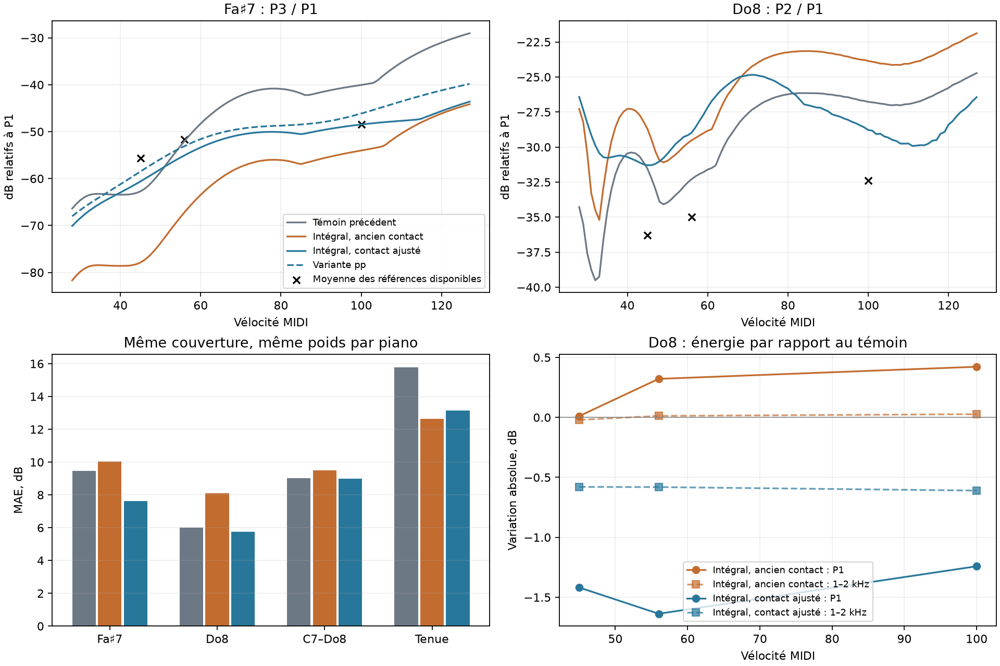

# Rayonnement intégral : contact, pp et Do8

Étude du 28 octobre 2026 dans `codex/piano-main-revalidation`, après `6343657`. Le prototype reste audio hors ligne, sur notes isolées. **Aucun défaut, moteur de production, preset livré ou réglage UI n’est modifié.** Les deux contacts expérimentaux améliorent les cibles locales et ne réintroduisent pas de creux sur Fa♯7/Do8, mais le passage intégral ne satisfait pas encore tous les garde-fous : niveau de Do8, équilibre au mf, autres touches et dépendance à la position d’écoute.

## Causes isolées

La substitution conserve les forces au chevalet et le retour mécanique aux cordes. Le changement initial est donc situé dans la transmission acoustique. La propagation linéaire n’a pas une correction propre au pp : elle s’applique à un spectre de contact déjà différent selon la dynamique.

- **Fa♯7 pp** : le passage intégral augmente P1 de **6,65 dB** et diminue P3 en valeur absolue de **8,51 dB**. Le rapport P3/P1 perd donc **15,16 dB**. Le contact précédent avait déjà P3 trop faible au pp ; le nouveau rayonnement amplifie ce défaut. Au forte, P1 gagne encore 6,64 dB et P3 perd 7,32 dB. Ce n’est pas seulement un effet de dénominateur.
- **Do8** : P1 varie de +0,01 à +0,42 dB, tandis que P2 gagne réellement **2,85 à 3,34 dB**. Sa dégradation vient surtout du chemin acoustique de P2 et de sa somme cohérente avec les sons résiduels du cadre/action. Additionner les puissances séparées de ces chemins serait faux.
- Les fenêtres de 60 ms, 120 ms et le corps entre 80 et 200 ms gardent les mêmes tendances. La bande absolue 1–2 kHz de Do8 est presque inchangée par le rayonnement seul, entre −0,02 et +0,03 dB : elle ne justifie pas d’assombrir globalement la sortie.

Les composantes, fenêtres et niveaux sont archivés dans `bench/rayleigh-contact/diagnostic.json`. Le rayonnement conserve les limitations géométriques du prototype précédent, notamment les modes supérieurs au raccord du contour réel ; cette expérience ne valide pas leur exactitude physique.

## Ajustement du contact, sans égalisation

Les paramètres sont fixes pour chaque touche ; leur réponse selon la vélocité vient du contact non linéaire, sans mélange audio conditionné par la vélocité. Les presets produits pour une touche sont des entrées de rendu isolé, pas des presets globaux à charger tels quels dans l’UI.

| Paramètre | Fa♯7 précédent | Fa♯7 `contact` | Do8 précédent | Do8 `contact` |
|---|---:|---:|---:|---:|
| Force du feutre à 0,2 mm, multiplicateur q | 0,25 | 1 | 0,45 | 0,4 |
| Décalage de l’exposant p | 0 | 0 | −1,25 | −1,5 |
| Hystérésis | 0,3 | 0,3 | 0,3 | 0,6 |
| Étendue des hauteurs de corde | 100 µm | 100 µm | 40 µm | 15 µm |
| Part de hampe | 0,45 | 0,45 | 0,3 | 0,45 |
| Fréquence de hampe | 150 Hz | 300 Hz | 300 Hz | 300 Hz |
| Pertes de hampe | 2 | 2 | 0,1 | 2 |

Fa♯7 conserve sa frappe à 0,105 de la longueur. Largeur de contact et masse restent inchangées. La variante `contact_pp` diminue uniquement l’hystérésis de Fa♯7 à 0,1.

L’ablation de Fa♯7 sépare les effets : changer seulement q ramène le résidu P3 pp de −22,24 à **−4,67 dB** ; doubler seulement la fréquence de hampe ne le ramène qu’à −18,84 dB. Les combiner donne −4,96 dB et améliore P2 pp de −6,43 à **−0,90 dB**. Le feutre restaure donc l’excitation de P3 ; la hampe améliore surtout le compromis entre partiels/dynamiques. La durée globale du contact pp reste proche de 0,95–0,97 ms : une simple règle « attaque plus courte » n’explique pas ce résultat.

Sur Do8, avec les autres paramètres fixés au nouveau contact, réduire les hauteurs de 25 à 10 µm améliore le score spectral mais augmente le creux maximal de **3,31 à 7,05 dB**. Le point à 15 µm conserve 5,08 dB de creux, contre 5,23 auparavant. Les hauteurs règlent le décalage des contacts entre cordes ; supprimer ce décalage n’est pas une solution universelle. Les courbes entières sont nécessaires pour choisir ce compromis.

Un candidat initial, `c025`, avait un meilleur score Do8 (5,19 dB), mais perdait **8,66 dB de P1 au pp** et détériorait nettement son équilibre de volume. Il est rejeté. Le candidat retenu pour comparaison, `height009`, limite la perte de P1 à 1,24–1,64 dB ; il ne supprime cependant pas toute régression énergétique.

## Comparaison à couverture constante

Même banc corrigé : puissance stéréo, gain Plath conservé à 0,01/Pa, aucune normalisation par note. **459 observations d’attaque** identiques (349 sur C7–Do8, 110 sur la transition), **71 de tenue**, huit pianos, mêmes identités source/note/vélocité/partiel et même pondération par piano. Aucun partiel devenu faible n’est écarté. Les références utilisées pour sélectionner sont aussi celles utilisées pour évaluer : ce sont des résultats exploratoires, pas une validation sur un jeu indépendant.

La grille dense contient les **100 vélocités entières 28–127**, sur Do♯7, Ré♯7, Fa♯7 et Do8. Les scores d’attaque utilisent v45/56/100, des fichiers de 1,2 s fraîchement rendus pour les contacts changés. Pour les niveaux, tous les signaux reçoivent le même pré-silence de 1024 échantillons : cela évite le biais de fenêtre tronquée au début de fichier. Les WAV de comparaison ne sont ni décalés ni renormalisés.

| MAE pondérée par piano, dB | Témoin précédent | Intégral, ancien contact | Intégral + contact | Variante pp |
|---|---:|---:|---:|---:|
| Fa♯7, 34 observations | 9,45 | 10,04 | **7,64** | 7,77 |
| Do8, 15 observations | 6,02 | 8,12 | **5,74** | 5,74 |
| C7–Do8, 349 observations | 9,01 | 9,50 | 9,00 | 8,98 |
| Transition, 110 observations | 7,72 | 8,05 | 8,05 | 8,05 |
| Tenue, 71 observations | 15,78 | **12,63** | 13,14 | 13,25 |

Le gain moyen sur toute l’étendue est minime face au témoin précédent. Le contact récupère l’attaque de Fa♯7 au prix d’une partie du gain du rayonnement sur sa tenue (MAE locale 5,81 → 8,97 dB, encore meilleure que 15,14). **Aucune observation de tenue Do8 n’est admissible dans ce corpus** ; aucune conclusion de tenue pour Do8.

| Résidu signé par rapport à la moyenne des sources disponibles | Témoin | Intégral seul | Contact | Variante pp |
|---|---:|---:|---:|---:|
| Fa♯7 P3 pp | −7,08 | −22,24 | −4,96 | **−2,85** |
| Fa♯7 P3 mf | −0,30 | −15,46 | −3,35 | −1,38 |
| Fa♯7 P3 forte | +8,40 | −5,56 | **−0,02** | +2,32 |
| Do8 P2 pp | +4,76 | +7,60 | +5,00 | +5,00 |
| Do8 P2 mf | +2,68 | +5,45 | +6,00 | +6,00 |
| Do8 P2 forte | +5,61 | +8,53 | **+3,61** | +3,61 |

Ce tableau n’est pas la MAE pondérée : il montre les compromis dynamiques que le score moyen masquerait.

| Recul maximal du rapport partiel/P1 sur 28–127, dB | Témoin | Intégral seul | Contact | Variante pp |
|---|---:|---:|---:|---:|
| Fa♯7 P2 | 1,28 | 1,64 | 0,76 | **0,04** |
| Fa♯7 P3 | 1,39 | 0,92 | 0,50 | **0,00** |
| Do8 P2 | 5,23 | 7,92 | **5,08** | 5,08 |

Aucun recul du niveau global sur les quatre touches contrôlées. Do8 garde un creux résiduel significatif : il est légèrement réduit, pas supprimé.



## Garde-fous qui restent ouverts

- **Énergie de Do8** : par rapport au témoin, P1 perd 1,42/1,64/1,24 dB et 1–2 kHz perd 0,58/0,58/0,61 dB au pp/mf/forte. Le niveau global perd 1,28/2,88/4,10 dB. Ce n’est donc pas une solution sans dégradation de Do8.
- Un nouveau contrôle compare chaque touche à la médiane des mêmes voisines disponibles, au sein de chaque piano réel, sans ajuster le gain de sortie. Fa♯7 se rapproche du niveau relatif des références. Do8 demeure trop faible : biais −2,15/−3,29/−5,44 dB pour le contact ajusté, contre +1,71/+2,93/+2,24 avec le témoin. Couverture faible pour Do8 pp/mf : deux/un pianos, cinq au forte. Ce garde-fou reste exploratoire.
- **Autres touches** : les contacts ne changent que sur 102/108. Pour chaque candidat, 42 WAV d’attaque et 200 de grille dense sont identiques bit à bit à l’intégral sans retouche. Cela n’efface pas les régressions dues au passage intégral lui-même : par exemple le creux P4 de Do♯7 reste à 5,39 dB contre 3,73 avec l’ancien rayonnement ; celui de P3 Ré♯7 reste à 1,86 contre 1,80. On ne peut pas déclarer une non-régression globale.
- **Position d’écoute** : la vérification séparée au pianiste montre l’inversion du comportement de Do8. Avec l’ancien contact, le passage intégral augmente P2/P1 d’environ 3 dB aux micros rapprochés, mais le réduit d’environ 12 dB au pianiste. Sur Fa♯7 forte, le nouveau contact porte P3/P1 de −46,75 à −41,14 dB au pianiste. Sans références réelles appariées à cette position, ces nombres mesurent une sensibilité, pas une amélioration du réalisme.

La suite utile est donc de contraindre ensemble l’énergie et les rapports spectraux de Do8, et de comparer la même frappe réelle à plusieurs positions de micro. Un contact optimisé sur une seule position peut compenser une erreur de directivité du modèle. Les paramètres actuels sont conservés comme deux points de comparaison ; aucun n’est promu au défaut.

## Contrôles et reproduction

Les états modaux de contact à 5 et 20 sous-pas diffèrent au plus de 0,13 dB sur les partiels évalués de Fa♯7 et de 0,41 dB sur P2 de Do8 ajusté. Cela est petit devant les effets étudiés, mais supérieur au petit gain de 0,16 dB du creux de Do8 : ce gain précis n’est pas un résultat robuste à lui seul. La trace de force échantillonnée au dernier sous-pas n’est pas utilisée comme critère de convergence, car sa décimation peut aliaser. Ce contrôle isolé ne remplace pas une comparaison audio complète à 20 sous-pas.

La reconstruction du rayonnement historique est vérifiée avant chaque substitution (seuil RMS −90 dB). Les neuf tests Python du banc passent. Le contrôle des identités de référence, des WAV inchangés, de finitude et des empreintes se trouve dans `audit.py` / `audit.json`. Le moteur de production et les défauts sont inchangés depuis le début de cette étude.

Scripts et mesures : `bench/rayleigh-contact/`. Captures et audio : `out/rayleigh-contact/`. Réutiliser les noyaux et binaires figés de `out/rayleigh-audio/` décrits dans [le prototype initial](rayleigh_audio_prototype.md). Le `contact_stages` supplémentaire est compilé en release/offline puis copié dans `out/rayleigh-contact/bin/`.

Ordre de reproduction : `diagnose.py`, `screen.py`, `refine.py`, `c8_refine.py`, `dense_screen.py`, `c8_dense.py`, `c8_energy.py`, `c8_height.py`, `validate.py`, `evenness.py`, `player.py`, `contact_checks.py`, `present.py`, `audit.py`. Les explorations intermédiaires restent archivées pour rendre visibles les candidats rejetés ; elles ne changent pas les références admissibles.

Rendu d’une note avec le nouveau contact et le rayonnement intégral :

```sh
python bench/rayleigh-contact/prototype.py --profile contact --note 102 --velocity 45 --out out/rayleigh-contact/fsharp-pp.wav
```

`out/rayleigh-contact/comparison.wav` : cinq groupes, Fa♯7 pp puis forte, Do8 pp puis mf puis forte. Dans chaque groupe : **témoin précédent, intégral sans retouche, intégral avec contact ajusté**. Un seul gain commun ; fondu de fin identique de 20 ms uniquement dans le montage. Détail des temps dans `listening.json`.
