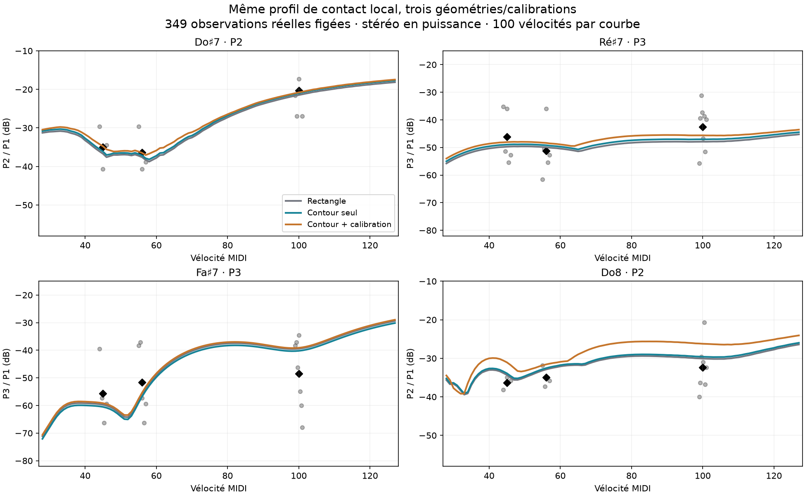

# Transfert des profils de contact au contour de piano à queue

28 octobre 2026 — worktree `piano-realism-audit`, branche
`codex/piano-realism-audit`. Suite de [contact_residuals.md](contact_residuals.md).

**Le contour est activé dans les presets expérimentaux et dans l'UI ouverte,
avec le candidat `outline_local`. Le défaut reste rectangulaire et inchangé.**
Les corrections ciblées tiennent. Le candidat local n'est toutefois pas un
vainqueur global : sur le contour seul, sa MAE d'attaque est de 8,469 dB,
contre 8,384 dB pour `outline_guarded`. Aucun réglage n'a été réajusté à la
nouvelle géométrie.

## Ce qui a été intégré

L'implémentation existante du commit `90bc8f9` a été reprise : contour normalisé
à dix points, modes de Rayleigh–Ritz jusqu'à `outline_below = 1500 Hz`,
rayonnement limité au contour, pertes de bord et forces transmises à la ceinture.
L'eigensolveur, ses contrôles physiques et l'aide des paramètres accompagnent
ce portage. Les changements ultérieurs de défaut n'ont pas été importés.

Le contour couvre environ 82 % du rectangle de 1,70 × 1,30 m. C'est un
**contour générique de piano à queue**, pas une géométrie mesurée d'un piano
particulier. Au-dessus de 1,5 kHz, les modes restent ceux du rectangle et seul
leur domaine rayonnant suit le contour. Les fondamentaux de notre suraigu
sont au-dessus de cette limite : ces résultats vérifient le transfert vers
ce modèle hybride, pas vers des modes réalistes de toute la table jusqu'à
12 kHz.

Le code du cadre (`FrameParams::plate`) hérite également du contour normalisé,
remis à ses dimensions de 1,75 × 1,30 m ; il reste une plaque isotrope
équivalente, sans maillage des ouvertures et des nervures de fonte. La
ceinture reste un anneau équivalent de périmètre rectangulaire, recevant
les réactions de la table découpée. Le couvercle reste rectangulaire.
Voir [outline.md](outline.md) pour les équations et limites du portage.

Pour que les profils précédemment rendus note par note puissent être joués
ensemble, `PianoModel` accepte maintenant `treble_contact`, une table
**optionnelle** de 16 contacts, MIDI 93–108. Absente par défaut et omise de sa
sérialisation, elle ne change aucun ancien preset. Elle contient les six
valeurs du contact par touche : raideur du feutre, exposant, hystérésis,
largeur, hauteur des cordes et point de frappe. Aucune égalisation ni
correction de gain n'a été ajoutée. Le contrôle musical Tone s'applique
également à ces contacts ; les six valeurs explicites remplacent les
réglages globaux correspondants sur ces touches. Leur édition détaillée
se fait dans le preset TOML, pas dans une nouvelle grille de l'interface.

## Plan de comparaison figé

Croisement de trois géométries/calibrations et trois profils de contact :

| Préfixe | Table et cadre | Autres paramètres |
|---|---|---|
| `rect` | Rectangle historique | Témoin exact |
| `outline` | Contour actif, limite 1,5 kHz | Identiques au témoin |
| `calibrated` | Même contour | Masse surfacique 8,4 ; rigidités 4590/2040 ; pentes d'impédance 0,0024/0,0076 |

La troisième ligne reprend les **cinq paramètres de calibration de table**
du commit `bf23502`. Elle ne reprend pas les autres évolutions de sa branche
(amortissement des modes bas, charge des cordes libres, sympathie, pertes des
cordes graves). Elle n'est donc pas une comparaison avec tout le nouveau
défaut de cette autre branche.

Les suffixes sont `base` (contact original), `guarded` (profil antérieur à la
correction des trois résidus) et `local` (candidat de la dernière étude).
Les neuf presets complets sont dans `presets/experiments/real-geometry/`.
Leurs lois de contact n'ont pas été optimisées sur les nouveaux résultats.

- Attaque : mêmes **349 observations**, huit pianos, touches 96–108,
  vélocités 45/56/100, fenêtre 0–60 ms, puissance stéréo et fréquences physiques.
- Son tenu : mêmes **71 observations**, huit pianos, fenêtre 0,5–1 s.
- Les clés `(piano, note, vélocité, partiel)` **et les valeurs cibles** sont
  identiques à l'étude précédente, vérifiées et hachées dans `coverage.json`.
- Aucune suppression selon le SNR des candidats : zéro observation faible
  en attaque ; la même observation faible conservée dans le son tenu.
- Les touches de transition 93–95 sont également rendues. Le balayage dense
  couvre chacune des 100 vélocités 28–127 sur Do♯7, Ré♯7, Fa♯7 et Do8,
  pour chacun des neuf presets.
- Cinq nouveaux bancs longs de **90 frappes identiques**, durée 20 s + 0,5 s,
  complètent ces comparaisons. Do♯7 n'appartient pas à cette grille tous les
  trois demi-tons ; il est bien présent dans les supports physiques figés.

## Les gains ciblés tiennent

Rapports à P1, en dB. La comparaison verticale des profils se fait à géométrie
constante ; la comparaison horizontale expose le transfert de géométrie.

| Cible | Rectangle `guarded` → `local` | Contour `guarded` → `local` | Contour calibré `guarded` → `local` | Moyenne réelle |
|---|---:|---:|---:|---:|
| Fa♯7 forte, P3 | −28,70 → −39,44 | **−29,47 → −40,21** | −28,19 → −39,11 | −48,44 |
| Ré♯7 pianissimo, P3 | −55,75 → −49,73 | **−55,03 → −48,97** | −53,40 → −48,06 | −46,15 |
| Do♯7 pianissimo, P2 | −42,83 → −36,71 | **−42,38 → −36,13** | −42,06 → −34,76 | −34,95 |

Sur le contour seul, les trois changements valent donc −10,74 dB, +6,06 dB
et +6,25 dB. Les écarts restants à la moyenne réelle sont environ +8,24,
−2,82 et −1,18 dB. Les dispersions entre pianos restent celles du rapport
précédent : il ne s'agit pas de trois cibles exactes universelles.

**Do8 n'est pas assombri par le contour seul.** Le profil local donne
−33,89 / −32,55 / −29,60 dB aux vélocités 45 / 56 / 100, soit +0,42 / +0,34 /
+0,48 dB par rapport au rectangle. Le plus grand changement sur les 100
vélocités est **0,502 dB**. Dans chaque géométrie, Do8 est identique entre
`guarded` et `local`, puisque son contact est inchangé.

La calibration de table est plus intrusive : Do8 gagne jusqu'à **3,870 dB**
de P2 relatif sur les 100 vélocités ; son recul maximal selon la vélocité
passe de 3,79 à 4,72 dB. Cela renforce le motif de distinguer le contour et
la calibration, et de commencer l'écoute avec `outline_local`.



Points gris : chaque piano disponible ; losanges noirs : moyenne réelle.
Courbes : même candidat local, sans retouche, sur les trois configurations.

## Scores et compromis

MAE en dB, chaque piano ayant le même poids. Un chiffre plus petit est meilleur.

| Configuration | Original | Profil `guarded` | Candidat `local` |
|---|---:|---:|---:|
| Attaque — rectangle | 12,226 | 8,691 | 8,514 |
| Attaque — contour seul | 12,037 | **8,384** | 8,469 |
| Attaque — contour calibré | 12,720 | **8,727** | 8,808 |
| Son tenu — rectangle | 16,223 | 14,976 | 14,593 |
| Son tenu — contour seul | 15,856 | 14,296 | **13,981** |
| Son tenu — contour calibré | 17,638 | 16,264 | **15,571** |

Le gain des profils de contact par rapport au contact original persiste.
**Le petit gain moyen supplémentaire de `local` sur `guarded` en attaque
sur le rectangle ne se transfère pas** : il devient une régression d'environ
0,09 dB sur le contour seul, 0,08 dB après calibration. Le son tenu conserve
une amélioration du candidat local. Les P4 qui régressaient et les creux
selon la vélocité ne sont donc pas effacés par le nouveau contour.

Avec le contour seul, les reculs maximaux de P2/P3 restent de 7,85/4,97 dB
sur Do♯7, 0,13/1,85 dB sur Ré♯7 et 5,99/5,11 dB sur Fa♯7 ; aucun recul de
niveau global n'est observé sur les quatre touches suivies. Do8 a un recul
maximal de P2 de 3,92 dB, proche de 3,79 dB sur le rectangle.

Iowa et Headroom, hors des objectifs d'ajustement des études antérieures,
donnent une MAE d'attaque de 7,872 → 7,205 dB (`guarded` → `local`) avec le
contour seul. Ces sources ont déjà été examinées : elles ne constituent
pas une nouvelle validation aveugle.

### Banc long général, indicateur secondaire

| Configuration | Score historique | Hors tolérance |
|---|---:|---:|
| Rectangle, contact original (banc corrigé antérieur) | 1,064 | 15 |
| Rectangle, candidat local (étude antérieure) | 1,066 | 10 |
| Contour, contact original | 1,177 | 18 |
| Contour, candidat local | 1,188 | 13 |
| Contour calibré, contact original | 1,123 | 15 |
| Contour calibré, profil `guarded` | 1,054 | 11 |
| Contour calibré, candidat local | 1,099 | 11 |

Les mêmes 90 frappes sont présentes. Cet indicateur n'a cependant **pas un
support de partiels strictement figé en interne** : sa recherche historique
peut inclure le faux P4 de Fa♯7 sous 12 kHz, comme démontré dans l'étude
précédente. Il reste utile pour observer les enveloppes et l'équilibre des
registres, mais ne remplace pas les supports physiques figés ci-dessus.
Le contour seul modifie aussi le médium et l'aigu ; les gains ciblés du
suraigu ne justifient donc pas de le promouvoir comme meilleur piano global.

## UI et vérifications

L'application du worktree est lancée avec :

```text
--ui
--preset presets/experiments/real-geometry/outline_local.toml
--presets presets/experiments/real-geometry
```

L'instance porte le nom « Piano — contour réel (contact local) », service
utilisateur `piano-real-geometry-ui.service`. SL STUDIO, canal 1, 48 kHz ;
la sortie enregistrée étant absente, connexion à la sortie par défaut
Omniphony Router. La configuration et le dernier son sont isolés sous
`/tmp/piano-real-geometry-ui/config`, sans remplacer la configuration habituelle.
Le modèle sauvegardé par l'UI a été relu : contour à dix sommets actif, masse
surfacique 7,0 et seize contacts, dont le point de frappe 0,105 de Fa♯7.

Pour comparer dans le sélecteur :

- `outline_local` : contour et candidat local, chargé au lancement ;
- `outline_guarded` : même contour, profil de contact précédent ;
- `outline_base` : même contour, contact original ;
- `rect_local` : témoin géométrique avec le même contact ;
- `calibrated_local` : contour et calibration de table, pour entendre son effet.

Les autres combinaisons sont également disponibles. Les écoutes préparées
`out/real-geometry/listen-*.wav` enchaînent Do♯7, Ré♯7, Fa♯7, Do8,
chacune à 45/56/100. Même gain, sans normalisation par frappe ou fichier.

**Validation technique :**

- 90 contrôles supplémentaires couvrent exactement les 200 premières
  millisecondes du banc corrigé original, sur tout le clavier.
- 144 contrôles sur rectangle reproduisent exactement les 200 premières
  millisecondes des rendus antérieurs (`base`, `guarded`, `local` × 16 touches
  × 3 nuances). Six contrôles préalables reproduisent aussi les WAV complets.
- 15 contrôles sur contour calibré vérifient que le preset jouable combiné
  reproduit exactement les presets de contact isolés, y compris les hauteurs
  des cordes. Soit 159 contrôles audio principaux exacts.
- Tests moteur/hôte : 81 tests, incluant l'eigensolveur, l'équivalence du
  rectangle, les modes d'un rectangle raccourci, les réactions de bord et
  les presets par touche.
- Tests paramètres/contrôle/UI : 45 tests. Le test de glyphes existant
  nécessitait de libérer les deltas de textures ; la correction d'une ligne
  reprend celle du commit `ab67b43`, sans changer le comportement de l'app.
- 15 tests Python du banc passent. `git diff --check` est propre.
- Les tests Rust utilisent `CARGO_PROFILE_RELEASE_DEBUG_ASSERTIONS=true` :
  les tests d'absence d'allocation du dépôt requièrent ces assertions,
  faute de quoi `AllocDisabler` est désactivé par la dépendance en release.

`presets/default.toml` conserve son SHA-256
`bb436748197dd524c62e966419b408fb1c2c1db29ccca87418f82d36f879057c`.
Le contour compilé par défaut reste nul, la table de contacts reste absente.
Ni `bench/baseline.json` ni les références n'ont été remplacés durant ce transfert.

## Reproduction

Les synthèses et scripts sont dans `bench/real-geometry/`, les rendus bruts
et presets effectifs dans `out/real-geometry/`. Les fichiers source des
pianos réels et les résultats précédents sont ceux déjà présents dans ce
worktree. Le répertoire de binaires est explicite pour éviter d'utiliser un
ancien moteur qui ignorerait silencieusement les nouveaux champs du preset.

```sh
CARGO_TARGET_DIR=/tmp/piano-real-geometry-target cargo build --offline --release -p piano-render --example contact_batch --example top_probe
python bench/real-geometry/run.py render
python bench/real-geometry/check.py
python bench/real-geometry/run.py score
python bench/real-geometry/run.py full
MPLCONFIGDIR=/tmp/piano-mpl python bench/real-geometry/present.py
```

`PIANO_GEOMETRY_BIN` permet de choisir un autre répertoire de binaires.
Le banc long réutilise le `piano-survey` du worktree, au protocole corrigé
`channel-power-v2`. Le manifeste fixe les empreintes des entrées, des scripts,
des exécutables et des presets lancés.
