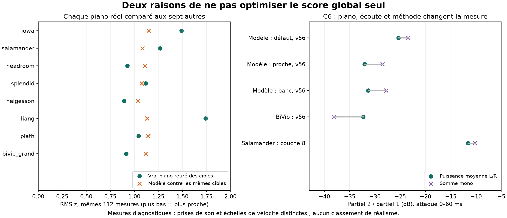

# Réalisme du piano : diagnostic et nouvelles comparaisons

Suite : les corrections du banc et leurs résultats sont dans [bench_bias_correction.md](bench_bias_correction.md). Les chiffres ci-dessous décrivent le protocole antérieur.

Audit du 28 octobre 2026. Branche `codex/piano-realism-audit`, base `934c88f`, avec copie des modifications locales du 27 octobre sur les contacts par corde, l’hystérésis à 0,6 et la baseline associée. Le moteur n’a pas été recalibré dans cet audit.

**Recommandation : investir d’abord dans des mesures qui séparent excitation, vibration et écoute.** Les réglages récents ont amélioré de vrais défauts, mais le score agrégé est devenu insuffisant pour choisir la prochaine modification. Les meilleures pistes physiques sont une table dont la réponse spatiale est mieux contrainte, puis un couplage cordes/table cohérent avec l’état des étouffoirs. Continuer à ajuster le feutre sur le spectre moyen seul risque de compenser les défauts de prise de son ou de table.

## Ce qui a été vérifié

- Compilation isolée du moteur actuel et de l’analyseur, hors ligne.
- Export de `PianoModel::default()` : égalité complète, après parsing TOML, avec `presets/default.toml` copié depuis le travail en cours.
- Nouveau banc complet : **90 notes, 189 mesures, score 1,0264, 70,9 % dans ±1 z, neuf au-delà de ±2 z**. Les mesures reproduisent exactement la baseline locale. Les familles les moins bonnes sont sustain (1,47) et brillance (1,21) ; le suraigu est le registre le moins bon (1,48).
- **60 rendus supplémentaires** : C4, C5, C6, C7 aux vélocités 30, 45, 56, 70, 100, dans trois configurations. Comparaison avec 28 fichiers réels : Salamander, BiVib et Plath.
- Vérification de 20 prises CSV brutes de Plath : cinq prises pour chacune de ces quatre notes.
- Trois tests de l’outil : conservation de puissance malgré opposition de phase, invariance au gain et à l’échange des canaux, exclusion d’une référence de sa propre cible.

Les résultats sont dans `bench/realism-audit/`, le script dans `tools/realism_audit.py`. Les fichiers audio sont des sorties locales ignorées par Git. Ces observations sont instrumentales ; elles ne constituent pas un nouveau test d’écoute humain.

## Le « défaut » et le banc ne rendent pas le même son

Le défaut compilé charge un grand de 2 m, le feutre gradué avec contact individuel des cordes, une hystérésis de 0,6, la courbe de vélocité 0,205–5,6 m/s / exposant 0,78, les résonances sympathiques et les non-linéarités. Les cordes alimentent la table modale, le cadre et la ceinture ; le rayonnement est entendu par deux micros à 1,5 m, couvercle à 0°, dans une salle de **40 × 28 × 16 m**. Le préréglage `player.toml` existe, mais ce n’est pas l’écoute compilée par défaut.

Le banc applique systématiquement trois surcharges : micros proches, studio, toucher `disklavier_playback` (0,26–4,4 m/s / 0,75). Même `--listening none` conserve ce toucher de playback. Son excellent score de dynamique (0,29) ne valide donc pas directement le toucher par défaut.

Autre distinction, déjà documentée dans `docs/limiter.md` : le lecteur et le plugin passent par `EngineSlot`, avec limiteur à −1 dBFS ; les commandes ordinaires `note` et `midi` du renderer appellent directement `Engine`, sans ce limiteur. `replay` utilise le chemin contrôlé. Le preset dit bien `limiter = 1`, mais cela ne suffit pas à garantir la même sortie dans tous les outils. Pour un test du son entendu, utiliser le replay ou une sortie équivalente à celle du lecteur. Pour un diagnostic physique, conserver une sortie brute identifiée comme telle. Le limiteur peut infléchir attaque, dynamique et modulation lorsqu’il intervient ; les notes douces ne sont pas automatiquement concernées.

Enfin, le lecteur peut restaurer `last.toml`. Cet audit porte sur le défaut du dépôt et le moteur courant, pas sur une session live dont les réglages n’ont pas été capturés.

## Sur quoi les essais récents ont buté

| Problème | Résultat récent | Pourquoi le prochain réglage seul semble insuffisant |
|---|---|---|
| Attaque creuse de C6 vers v45–55 | Contacts individuels : creux moyen C5–C7 réduit d’environ 10,2 à 5,2 dB ; C7 reste problématique | Déplacer les zéros du spectre avec la dureté ou l’hystérésis ne garantit pas une évolution régulière sur tout le clavier (`docs/strike_shape.md`) |
| Écarts entre touches voisines | Charge des cordes étouffées et partage des régions sous 400 Hz améliorent l’homogénéité | Plus d’amortissement, de densité modale ou de dispersion dégrade d’autres mesures ; le pilotage exact sous 1 kHz reste optionnel (`docs/evenness.md`) |
| Brillance et dynamique du marteau | Le feutre gradué corrige les effets de seuil de l’ancien feutre à deux couches | Les compensations entre feutre, vélocité, table et micros restent difficiles à identifier (`docs/felt.md`, `docs/middle_highs.md`) |
| Décroissance en musique | Les diagnostics antérieurs trouvaient des fondamentales graves trop lentes dans la première seconde malgré un banc long acceptable | Une pente moyenne sur une longue note n’exprime pas le mouvement du son pendant une phrase (`docs/pieces.md`) |
| Pédale et résonances | Gros progrès après correction du contexte d’écoute et du gain sympathique | La salle avait été prise pour de la sympathie ; la charge de la table varie avec la pédale, mais le couplage des cordes est précalculé (`docs/evenness.md`) |

Les chiffres de cette table sont des résultats historiques des notes de développement, pas des mesures toutes répétées aujourd’hui. Les neuf écarts actuels comprennent encore les bandes basses de l’attaque suraiguë, son partiel 4 en sustain, son partiel 2 à mf, et le T60 des partiels hauts du grave. La persistance de ces familles justifie des diagnostics ciblés, pas une réouverture indifférenciée de tous les paramètres.

## Trois angles morts confirmés

### 1. La normalisation de Plath efface des différences réelles entre touches

`tools/plath_set.py` sélectionne une prise médiane puis applique, **note par note**, `e / max(abs(e)) * 0.5`. Sur les CSV bruts, les crêtes des prises retenues pour C4/C5/C6/C7 sont 1,116 / 1,667 / 1,867 / 2,719 Pa. L’import les ramène toutes à 0,5 : il supprime notamment **7,73 dB** de différence entre C4 et C7.

Les mesures `balance` et `evenness` de cette source ne peuvent plus être interprétées comme celles d’un piano dont le niveau relatif a été conservé. Les rapports de partiels dans une note et les décroissances relatives ne souffrent pas directement de ce gain constant. Correction prioritaire : réimporter avec une conversion Pa→échelle numérique fixe pour tout le corpus, conserver les cinq prises et les gains ; jusque-là, exclure explicitement Plath des mesures entre notes. Vérifier aussi les banques normalisées par couche et les gains SFZ, au-delà du seul drapeau `nodyn`.

### 2. Le mono mélange réponse du piano et interférences entre micros

`bench.load()` fait convertir le son en mono par SoX. Une moyenne de pressions `(L+R)/2` peut annuler une composante que chaque oreille entend bien. Pour le spectre énergétique, calculer plutôt `(abs(FFT(L))² + abs(FFT(R))²)/2`, tout en gardant L/R séparés pour la spatialisation.

Sur les quatre notes et cinq vélocités testées, le rapport d’attaque p2/p1 change jusqu’à **9,33 dB** entre ces deux calculs avec l’écoute par défaut. Sur les références sondées : jusqu’à 11,64 dB pour Salamander, 7,57 dB pour BiVib et 8,74 dB pour Plath. Ce n’est pas une preuve de mauvaise stéréo : c’est une preuve que la mesure mono est sensible au dispositif d’écoute.

Exemple C6, rapport énergétique p2/p1 pendant les 60 premières ms :

| Source/configuration | v56 ou couche mf | v100 ou couche ff |
|---|---:|---:|
| Moteur, écoute par défaut, toucher par défaut | −25,3 dB | −16,8 dB |
| Moteur, micros proches/studio, toucher par défaut | −32,0 dB | −23,3 dB |
| Moteur, configuration du banc avec playback | −31,3 dB | −23,3 dB |
| BiVib, vélocités mesurées 56 / 100 | −32,3 dB | −19,4 dB |
| Salamander, couches 8 / 13 | −11,6 dB | −6,2 dB |

Ainsi, « C6 manque de 15–20 dB » dépend fortement de la référence. À mf, les deux pianos réels diffèrent eux-mêmes d’environ 21 dB dans ces prises. Les couches de Salamander ne constituent pas la même échelle physique que le playback BiVib ; les micros diffèrent aussi. Les valeurs de ce diagnostic utilisent une recherche de pic sans filtre de qualité SNR : elles servent à localiser les ambiguïtés, pas encore à établir une cible. Il faut suivre les partiels ajustés en fréquence et rapporter leur confiance avant toute optimisation.

### 3. Un score proche de 1 n’est pas un indice de réalisme

Pour chaque vrai piano, on retire ce piano des cibles puis on le score contre les autres. Sur les **112 composantes disponibles chez tous**, on obtient :

| Iowa | Salamander | Headroom | Splendid | Helgesson | Liang | Plath | BiVib |
|---:|---:|---:|---:|---:|---:|---:|---:|
| 1,49 | 1,27 | 0,93 | 1,12 | 0,89 | 1,74 | 1,04 | 0,91 |

Le modèle vaut 1,08 sur ces mêmes composantes face aux huit cibles. Les cibles ne sont donc pas identiques aux huit expériences à sept pianos ; le JSON fournit aussi le score du modèle contre chacun des mêmes groupes de sept. Ces résultats sont descriptifs, affectés notamment par l’import Plath et les différences d’écoute. Ils montrent que viser mécaniquement zéro pousse vers un piano moyen, sans démontrer que ce piano serait plus crédible.

Le score agrège des mesures déjà moyennées par registre : C5 trop brillant et C6 trop sombre peuvent se compenser. Les familles n’ont pas non plus le même nombre de composantes. Garder le score pour les régressions globales, mais ajouter les cartes par touche, les pires écarts, la couverture des mesures et une validation sur des instruments laissés hors réglage.



## Les nouveaux axes de comparaison, par priorité

### P0 — Rendre le protocole identifiable

Archiver pour chaque rendu : commit **et empreinte des modifications locales**, preset effectif après surcharges, fréquence d’échantillonnage, qualité, microphones, pièce, état de sortie brute/limitée, références et gains. Comparer les mêmes touches, mêmes fenêtres et mêmes événements ; séparer instruments, positions d’écoute et modes de capture MIDI. Un étage d’analyse doit signaler les valeurs absentes et les niveaux sous le bruit, jamais les remplacer par des zéros silencieux.

Conserver une cible par instrument/prise, puis une distribution entre instruments. Faire une validation en retirant un piano entier, avec bootstrap par piano et par prise plutôt que par partiel corrélé. Les seuils d’acceptation doivent venir de la répétabilité des vraies prises. Geler un petit jeu de morceaux hors calibration et un protocole A/B aveugle à niveau égal, portant séparément sur attaque, corps, évolution, extinction et espace.

### P1 — Mesurer la surface touche × vélocité × temps

**Question :** le défaut est-il une rupture locale, un spectre globalement trop sombre, ou une mauvaise évolution après l’attaque ?

Utiliser les 88 touches et dix vélocités de [BiVib](https://zenodo.org/records/2537335), ainsi que les couches de Salamander comme seconde famille de timbres. Le banc actuel rend une touche sur trois à trois vélocités ; il manque précisément les transitions et les creux intermédiaires.

Produire des cartes de p2–p8, énergie par bande, temps de montée et dérivée du timbre avec la vélocité. Rapporter les chutes depuis un maximum précédent, les sauts entre demi-tons et les quantiles 95 %, sans imposer artificiellement que chaque partiel réel soit monotone. Distinguer 0–20, 20–60, 60–200 ms puis 0,2–0,5 et 0,5–1,5 s. Adapter la longueur de fenêtre à la fréquence : 20 ms ne résolvent pas les partiels graves. Une extraction démodulée ou multi-résolution est préférable à une FFT courte universelle.

**Décision moteur :** ne retoucher le contact ou le feutre que si les anomalies suivent la force/les cordes et persistent avec plusieurs écoutes ; ne pas compenser une encoche de radiation par une dureté locale.

### P1 — Séparer vibration et rayonnement avec Plath

Le corpus [Plath](https://zenodo.org/records/3271370) contient des canaux synchrones de pression binaurale, accélération au chevalet et force sur la touche, pour deux états du même instrument. Les données brutes sont déjà présentes localement.

Comparer les enveloppes de l’accélération et du son, leurs retards, leurs trajectoires spectrales, puis le rapport pression/accélération et sa cohérence aux fréquences excitées. Exporter du moteur une accélération au point correspondant du chevalet, avant micros et salle. Un écart dans les deux signaux suggère une cause en amont ; un écart principalement acoustique oriente vers le rayonnement et l’écoute.

**Limite essentielle :** la force enregistrée est celle de la touche/du fond de touche, pas celle du marteau sur la corde ni celle appliquée au chevalet. On ne peut pas en déduire directement une mobilité `v_chevalet/F_chevalet`, ni identifier une loi de feutre. Le rapport pression/accélération locale n’est pas non plus une fonction de transfert complète d’une table excitée en plusieurs points. Les cinq prises et les deux états servent d’abord à quantifier la reproductibilité, pas à compter deux pianos indépendants.

### P1 — Comparer l’espace avec le même piano et la même prise

[3D-MARCo](https://zenodo.org/records/3477602) fournit des performances simultanées sur 71 microphones et des réponses de salle ; les deux solos et les données de salle sont déjà présents localement. Exploiter les rapports entre spots, tête artificielle et micros de salle, la cohérence par bande, les différences interaurales, et l’évolution de la largeur attaque→sustain. Les mesures entre dispositifs d’une même prise évitent de confondre changement de piano et changement de micros.

Il n’y a pas de MIDI pour un rendu note à note identique : commencer par des descripteurs spatiaux sur les mêmes passages réels, puis des stimuli contrôlés du modèle. Une réponse de salle mesurée avec une autre source ne reproduit pas à elle seule la directivité du piano. BiVib apporte une autre écoute binaurale, mais sa réverbération de grand n’est pas une réponse de salle disponible à soustraire automatiquement.

**Décision moteur :** tester séparément géométrie des micros, couvercle, rayonnement et pièce. Notre preset `player` est une paire d’omnis espacés, pas un modèle complet de tête/torse ; la tête artificielle des références nécessite de contrôler cet écart avant d’en déduire une table incorrecte.

### P2 — Mesurer le mouvement du sustain, pas seulement son T60

Réutiliser ESPRIT et les outils d’aftersound existants, mais faire entrer dans le suivi continu : fréquence et profondeur des battements, évolution de chaque partiel, temps de croisement entre décroissance rapide et lente, flux spectral normalisé par l’énergie, et déviation de fréquence après une frappe forte. Examiner séparément la première seconde et la fin de note.

Le travail de [Plath et Bader](https://arxiv.org/abs/2112.03214) trouve une discrimination des deux états d’un même piano avec le flux spectral ; c’est une motivation pour tester cette famille, pas une preuve qu’elle définit universellement le réalisme. Estimer les modulations assez longtemps pour les résoudre ; séparer bruit, battement et réverbération, avec intervalles de confiance et tests de récupération sur signaux synthétiques connus.

**Décision moteur :** distinguer pertes propres des cordes, accord des unissons, polarisations et pertes par le chevalet. Le T60 agrégé peut rester inchangé alors que cette articulation du sustain est fausse.

### P2 — Comparer des changements d’état : répétition, pédale, touches tenues

Exploiter les fichiers locaux Liang de notes répétées, trilles, accords, arpèges et notes isolées avec pédale. Mesurer l’incrément d’énergie et de spectre à chaque refrappe, la récupération suivant l’intervalle, les extinctions par bande et la prise/reprise de résonance selon le délai de pédale. Réutiliser les véritables événements MIDI et leur ordre ; aligner l’audio localement.

Pour un futur enregistrement ciblé, tenir silencieusement une touche puis frapper une autre : comparer l’énergie reçue, l’effet réciproque et la décroissance de la touche excitatrice. Cela teste mieux le couplage que le seul « halo » intégré d’un accord. Faire des comparaisons relatives dans une même installation, en gardant à l’esprit qu’une différence spectrale n’annule pas exactement la réverbération et les interférences.

**Décision moteur :** le moteur utilise une sympathie à sens unique ; la charge de table suit globalement la pédale, les touches seules ne retirent pas leur charge, et les modes couplés restent calculés à la construction. Tester d’abord ces incohérences avec des situations qui les isolent, puis comparer une approximation d’ordre supérieur ou un couplage réciproque passif sur un sous-ensemble de notes.

### P2 — Séparer le toucher enregistré du toucher de playback

Le [sous-ensemble MAESTRO réenregistré à JKU](https://zenodo.org/records/13897703), déjà extrait localement, permet de comparer une performance originale à sa reproduction acoustique via le même MIDI. Il ne faut pas attribuer tout leur écart au toucher : piano et pièce changent aussi. Ajuster ces effets sur un sous-ensemble et mesurer sur des passages tenus hors réglage ; privilégier les variations de niveau/timbre à l’intérieur d’un registre.

**Décision moteur :** vérifier si deux cartes de vélocité suffisent ou si le résidu dépend de la touche et du régime de jeu. Éviter de régler la loi globale de feutre pour corriger une différence de codage MIDI.

## Les pistes physiques que ces comparaisons pourront départager

1. **Table modale mieux structurée spatialement.** Passer du réglage de densité/amortissement d’une plaque régulière à des modes bas contraints par la géométrie et des modes hauts localisés entre raidisseurs. Les modèles réduits de [Boutillon et Ege](https://arxiv.org/abs/1305.3057) motivent cette séparation ; leur fréquence de transition dépend de l’instrument et ne doit pas être copiée comme une constante universelle. Un calcul hors ligne de formes modales mesurées ou issues d’un modèle éléments finis peut conserver le moteur modal temps réel. Valider mobilité, continuité touche à touche et rayonnement séparément.
2. **Même état physique vu par les cordes et la table.** Revoir la charge des cordes lorsque touches et pédales changent, puis la rétroaction sympathique, en contrôlant passivité et coût. Priorité si les contrastes d’état de Liang ou les essais de touches silencieusement tenues révèlent un écart.
3. **Contact et mécanique ciblés.** Conserver le progrès des contacts individuels. Examiner ensuite les creux résiduels sur une grille dense, les trajectoires de frappe/refrappe et les composantes non tonales du suraigu. Tester flexibilité, interaction avec les cordes déjà vibrantes et dispersion du contact en changeant une cause à la fois.
4. **Duplex et autres ajouts : après identification.** Leur absence n’est pas à elle seule une preuve qu’ils expliquent le défaut dominant. Il faut d’abord localiser une énergie ou une modulation réelle que les étages actuels ne reproduisent pas.

Ordre proposé : fiabiliser import/gains/stéréo et provenance ; cartographier C5–C7 et le milieu chromatique ; exploiter les canaux mécaniques Plath et les contrastes spatiaux ; seulement ensuite prototyper la table ou le couplage. Chaque prototype doit apporter un gain sur la mesure qui l’a motivé, tenir sur un piano laissé hors réglage, et être confirmé par une écoute aveugle avec niveau et contexte maîtrisés.

## Reproduction

Depuis ce worktree, avec Rust, Python, NumPy, pandas et SoX :

```sh
cargo build --offline --release -p piano-render -p piano-analysis
python3 tools/bench.py run --no-build --name realism-current
python3 tools/realism_audit.py \
  --model-result out/bench/realism-current/result.json \
  --out out/realism-audit \
  --renderer target/release/unsampled-piano-render \
  --reference salamander=/home/user/dev/piano/data/salamander/Samples \
  --reference bivib=/home/user/dev/piano/out/bench/sets/bivib_grand \
  --reference plath=/home/user/dev/piano/out/bench/sets/plath
python3 -m unittest discover -s tools -p test_realism_audit.py
```

Les arguments `--reference` sont facultatifs et leurs chemins sont propres à cette machine. Le script ne modifie ni les références ni la baseline. Il produit une analyse du score et, avec `--renderer`, les 60 sondes. Le manifeste sauvegardé indique la compilation isolée effectivement employée lors de cet audit. Les résultats et figures n’impliquent pas qu’un gain de réalisme a déjà été validé : ils définissent les expériences susceptibles de le démontrer.
