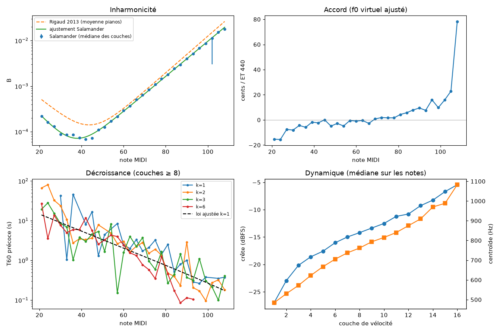
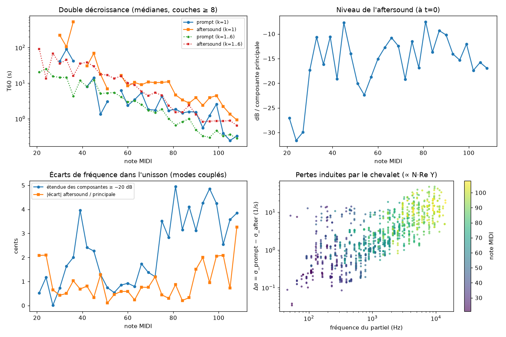

# Analysis of Salamander Grand Piano V3

Source: [sfzinstruments/SalamanderGrandPiano](https://github.com/sfzinstruments/SalamanderGrandPiano), Yamaha C5, CC-BY 3.0 Unported licence (checked in the repository's LICENSE file), 48 kHz / 24 bit, stereo (analysed in mono: average of the channels). Local clone in `data/salamander/`, ignored by git.

Contents: 30 notes (A0 to C8 in minor thirds) × 16 velocity layers = 480 notes held until they die out (25 s at A0, 3.6 s at C8). In addition there are release noises (`rel1..88`), harmonic resonances (`harmL/S/V3*`) and pedal noises (`pedalD/U*`), useful for phases 3 and 5.

Layer → MIDI velocity mapping (from `Data/notes.txt`): 1: 1–26, 2: 27–34, 3: 35–36, 4: 37–43, 5: 44–46, 6: 47–50, 7: 51–56, 8: 57–64, 9: 65–72, 10: 73–80, 11: 81–88, 12: 89–96, 13: 97–104, 14: 105–112, 15: 113–120, 16: 121–127.

To reproduce:

```bash
cargo run --release -p piano-analysis --bin piano-survey -- data/salamander/Samples --out out/salamander/survey.csv
python3 -I tools/survey_summary.py out/salamander/survey.csv
```

Outputs: `out/salamander/survey.csv` (one row per file and per partial), `summary.md` (full tables), `fitted.json` (fitted laws), `summary.png`.



## What we learn from it

**Inharmonicity: a reliable measurement, the first real law.**
- B does not depend on velocity (median coefficient of variation of 1.7 % across layers), which is consistent with a linear string and validates the estimator.
- Rigaud's bi-exponential form describes this piano very well (rms deviation of 0.07 in log B). Refitted parameters: aB = −0.1117, bB = −6.107, aT = 0.0886, bT = −13.495.
- This Yamaha C5 is 10 to 25 % less inharmonic than Rigaud's average in the middle and treble, and up to 2.3× less in the bass (A0: 2.2e-4 versus 5.1e-4). The minimum lies around F#2–A2 (≈ 7e-5), where the wound strings give way to plain strings.
- Consequence: B must be a per-instrument parameter, not a constant from the literature.

**Stretched tuning: the Railsback curve recovered.**
- From −15 cents at A0 to +23 cents at A7, passing through about 0 in the middle. This agrees with the corrections the bank's author applies in his SFZ (F#7: +25 cents measured versus −27 of correction, A7: +37 versus −38).
- Anomaly: C8 sounds around 4,410 Hz (≈ +90 cents) from the attack onwards, whereas the SFZ correction is only −38 cents. Either the sample or the string is out of tune: we exclude it from the tuning law.

**Decays: double decay dominates, and a single loss law is not enough.**
- The late decay is, in median, 4.5 times slower than the early one (interquartile 2.4–8.1). This is Weinreich's “prompt sound” and “aftersound”, caused by the coupling of the unison strings at the bridge.
- The envelopes are strongly modulated by unison beating (median deviation from a straight line: 5 dB). A loss law σ_k = b1 + b2·f_k² fitted on the early slopes explains only a small part of the variance (R² < 0.5 for almost all notes).
- A usable trend, for lack of anything better: log b1 = 0.0493·midi − 1.737 (b1 ≈ 0.5 s⁻¹ at A0, 3.4 at C4, 36 at C8).
- The bi-exponential model passes the quality filter for only 351 partial rows out of 4,631: when it passes, the slow component is ≈ 30 dB below the fast one (interquartile −38 to −23 dB). The rest of the time, beating prevents the fit.
- Direct consequence for the plan: the components of each partial (2 to 3 slightly detuned strings) must be separated by a high-resolution method (ESPRIT) to measure the unison detunings and individual dampings. The FFT is not enough for this. It is also proof that phase 2 (coupled unisons) is essential to realism.

**Velocity.**
- 21.6 dB peak difference between layers 1 and 16 (median over notes). This is the range of this bank; the manual of a commercial modelled piano cites ≈ 50 dB for a real piano, and layer 1 already covers velocities 1 to 26.
- The attack centroid (first 50 ms) goes from 484 Hz to 1,083 Hz (×2.3). This is the brightness target for the phase 1 hammer model (felt stiffening with speed, exponent p).

## Limitations

- Mono (average of two microphones): comb filtering may bias partial levels, not frequencies.
- The T60 values include the room and the recording setup.
- Very high notes (A7, C8) have only 3 measurable partials, so their B is poorly constrained.
- A single piano: a second instrument (Iowa MIS, Steinway) will be needed to separate what belongs to the model from what belongs to the regulation.

## High-resolution analysis (sub-band ESPRIT)

Implementation: `crates/piano-analysis/src/esprit.rs`. For each partial, the neighbouring band (±min(0.4·spacing, max(5 Hz, 7 cents))) is cut out of a long FFT and shifted to baseband. ESPRIT (Hankel, SVD, shift invariance) is then applied for up to 6 damped components, after which the amplitudes are computed by least squares.

Validation on synthetic signals (unit tests): a bichord 0.6 Hz apart, a trichord 0.45 Hz apart, and two decays at the same frequency (3 and 0.3 s⁻¹, at −28 dB). All are recovered to within 0.01 Hz in frequency, 5 % in σ and 0.5 dB in amplitude.

```bash
cargo run --release -p piano-analysis --bin piano-survey -- data/salamander/Samples \
    --out out/salamander/survey.csv --esprit out/salamander/components.csv
python3 -I tools/esprit_summary.py out/salamander/components.csv
cargo run --release -p piano-analysis --bin piano-analyze -- data/salamander/Samples/C4v12.flac --note 60 --esprit 6
```



For each partial, we call “prompt” the strongest component at t = 0, and “aftersound” the strongest of the components at least 1.5 times slower (following Weinreich's model: in-phase and anti-phase modes of the unison coupled at the bridge). Full tables: `out/salamander/esprit_summary.md`.

**Double decay is the rule.**
- An aftersound is found for 86 % of partials (layers ≥ 8).
- In the middle (C3–C6): it starts at −14 dB (median) below the prompt and lasts 2.6 times longer.
- In the bass (A0–D#1): it is weaker (−27 to −32 dB).
- It is highly reproducible. Example of C4, partial 1, in layers 8 to 16: the aftersound is at 261.48 Hz, T60 ≈ 33 s, −22 dB every time. The fast component is about 1 cent lower, as coupled-string theory predicts.
- Across the whole keyboard, the relative interquartile range of the aftersound T60 across layers is 33 % in median.

**Frequency differences within the unison are small.**
- The spread of components above −20 dB ranges from 0.5 to 2 cents in the middle (median 1.3) and from 3 to 5 cents in the treble (median 4.0).
- Caution: these are the frequencies of the **coupled modes**, not the raw detuning of the strings. The raw detuning will be obtained by inverting the phase 2 bridge coupling model. These differences will serve as a target.

**Separating the string's own losses from losses through the bridge.**
- The antisymmetric mode (aftersound) loads the bridge very little. Its σ therefore approximates the string's own losses (air, viscoelasticity).
- Δσ = σ_prompt − σ_after approximates the losses through the bridge, proportional to N·Re(Y_bridge).
- Δσ grows from about 0.2 s⁻¹ around 100 Hz to about 10 s⁻¹ around 5–10 kHz (cloud at the bottom right of the figure). This is an indirect trace of the soundboard conductance, the quantity missing from the literature in numerical form.
- Trend of the string's own losses: b1 ≈ exp(0.059·midi − 3.98) s⁻¹ (0.15 at A0, 0.5 at D#3, 3.5 at A5, 6.8 at A7); b2 ≈ 7e-8 s (median, notes ≥ A2).
- The b1 + b2·f² law remains a poor fit partial by partial (median R² 0.31 for the string, 0.14 for the bridge). Real losses are not a smooth function of frequency: the soundboard resonances modulate Re(Y). The model will need to take the bridge conductance as a function of frequency rather than an f² law. This is a direct argument for the phase 4 modal soundboard, coupled from phase 2 onwards.

**Limitations of this analysis.** The number of strings per note is not known, so N is not separated out in Δσ. In the bass, the fundamental is too weak to be analysed (A0–D#1). Components beyond 3 per partial (polarisations, soundboard modes) are present but not interpreted.
