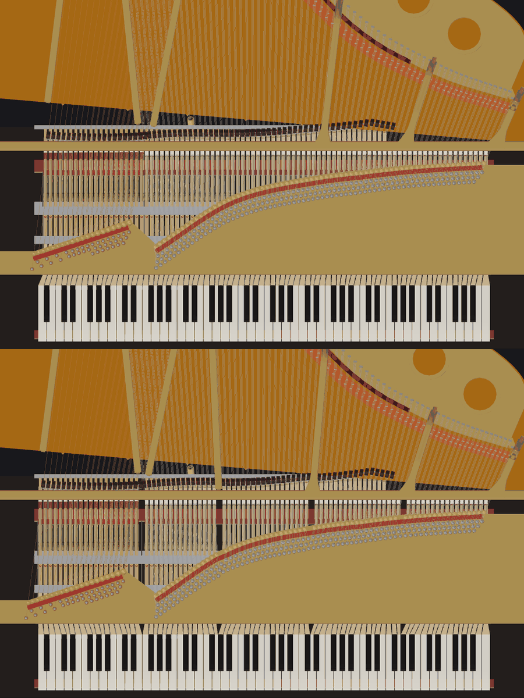

# The strings in sections

Status as of 2026-11-24. Code: `SoundboardParams::string_sections`, `bridge_place`, `bridge_curve_at` (`soundboard.rs`); the Model page's `key_across` (`model/scene.rs`) and the plate's struts (`model/scene/plate.rs`). Analysis: `piano-render`'s examples `string_sections` and `bridge_mobility_keys`.

On a real grand the strings do not run evenly from A0 to C8: they stand in blocks, with a gap between two blocks where a bar of the iron frame passes, and the hammers and the dampers are grouped the same way. The model set only the bass apart (its own bridge). It can now place the strings in sections; on the Concert grand that is right for the Model page and **neutral for the sound, by measure**. The Concert grand's preset has them since 2026-11-15, at the user's word; the measures below compare the preset before ("preset") with them.

## The real layout

| Section | Keys | Notes | Count | How it is known |
|---|---|---|---|---|
| Bass, overstrung, wound, on its own bridge | 1–20 | A0–E2 | 20 | documented: the 1884 scale's 20-note bass; plain wire from F2 (docs/steinway_d.md) |
| Tenor | 21–35 | F2–G3 | 15 | counted on a photograph; follows from the others |
| | 36–53 | G♯3–C♯5 | 18 | counted on a photograph (dampers); its upper end documented |
| | 54–71 | D5–G6 | 18 | counted on a photograph (dampers); its lower end documented |
| Top | 72–88 | G♯6–C8 | 17 | follows from the others |

Sources and their weight:

- **Two photographs from above** (a D with its lid off; a grand's action out of the piano, its hammers in five groups), found by the user, who counted 20, 15, 18, 18 and 17. Measured again on the first: the dampers' heads stand at a pitch of 12.8 to 13.1 pixels, and the two blocks between the bars span 235 and 236 pixels: 18 and 18 keys. The tenor's block is half hidden by the diagonal bar (15 or 16 by the same count). The photographs are not in the repository.
- **Steinway's service manual** (Worldwide Technical Reference Guide, chap. 5, https://indyptg.org/PTG/SteinwayServiceManuals/Chp5.pdf): the sostenuto tab at "note #54" must clear the plate's bar: the break between keys 53 and 54. The strongest written source found.
- A technicians' forum describes the earlier Centennial D (a 17-note bass) as 17-18-18-18-17; three keys moved from the tenor to the bass give 20-15-18-18-17. Secondhand, and the step is an inference.
- No hammer maker's or manufacturer's table giving the five counts was found.

What else the sources say, and what they do not:

- **The gaps' width** is published nowhere. Read off the photograph, at the dampers' line: the space between the last head of a block and the first of the next is 12 to 15 pixels wider than between two neighbours, at 1.1 mm a pixel (the keyboard's 88 keys over 1114 pixels): **13 to 16 mm, ± 4 mm**, at each of the four breaks, the bass's included. The model takes 14 mm for all four. The same gap at the agraffes and at the bridge is an assumption (a bar of constant width along the strings); the photograph is too coarse to measure it there.
- **The bars.** Seen from the keyboard: one each side of the bass strings, a short one that stops at the front bar between keys 35 and 36 (on the 1884 D it does not run to the back of the plate), a full one between 53 and 54, another between 71 and 72, and the removable diagonal bar across the tenor.
- **The bridge under the bars.** The D's dimensioned drawing (Boutillon, Ege and Paulello 2012, arXiv 1210.3948, fig. 2) shows the long bridge with two small steps in its line in the treble, where the two full bars cross it, and none in the tenor. Their size is not dimensioned. Not modelled: the bridge's line is unchanged.
- **Agraffes and capo bar.** Agraffes up to key 53, the capo bar on the two top sections (secondary sources). The model does not tell them apart.
- **Dampers.** One source gives 71 dampers on a D (the first four sections); docs/release.md reads a real concert grand ringing free from F6. Not settled here, and not touched.
- **Hammers.** Bored at an angle in the bass and the low tenor, straight in the treble (Steinway's manual, chap. 4). Drawn since 2026-11-24: each head turned to its strings' direction on a shank square to the keyboard (`bore`, `model/scene/action.rs`), and the head as a real one is made (`head_profiles`: a molding the shank goes through, its nose a wedge in the felt, its tail 22 mm below the shank; the felt an egg, 6 mm on the crown at C8 to 20 mm at A0, its ends cut square on the molding). The engine's hammers have no angle.
- **The strings' directions** per section: not found. RT-425's bridge points and string lengths (docs/steinway_d.md) are rounded to the centimetre and smooth: they do not show the gaps (the step from key to key along the bridge falls evenly from 92 mm at F♯2 to 10 mm at the top). Plath's fifteen measured bridge points (± 2.5 mm) are too few to show them.
- **Measured tone across the bars**: nothing published was found. The technicians' lore is that the audible breaks sit at the bars because the scale changes there (bridge, wound to plain wire, string count), not because of the bars.

## What the model had

Every string's place comes from one function, `SoundboardParams::bridge_point`: the key's point on its bridge. The long bridge is a smooth curve through five points (RT-425's on the Concert grand, the strings' real ends, no slant added), its keys at equal steps of the curve's parameter from the lowest (F2) to C8; the bass bridge an arc, its keys at equal steps. That point feeds:

- the board: where the key's strings drive its modes (each key at its own point up to 6 kHz on the Concert grand), where they hold the bridge and grip its top (`soundboard.structure.strings`, `strings_grip`), and the sympathetic strings' regions;
- the frame: each key's agraffe faces its bridge point across (`key_across`);
- the Model page and the plan sketches: strings from the bridge point through the hammers' line to the agraffe; hammers at an even pitch across, the bass's beyond; dampers on the strings; the plate's struts either side of the bass, beside the tenor's lowest string, and two among the treble's strings at a third and two thirds of the way, over a unison's gap.

The microphones see the board, not the strings: the strings' places reach them only through the bridge points. The hammers' strike points are a share of each string's length and do not depend on the layout.

## What was changed

`soundboard.string_sections`: up to four pairs of a section's lowest key (MIDI) and the gap below it, in metres across the strings. The Concert grand's are

    string_sections = [[41.0, 0.014], [56.0, 0.014], [74.0, 0.014], [92.0, 0.014]]

- **On the long bridge** the gaps come out of the keys' spacing (`bridge_place`): the two end keys stay where the measured layout has them, each gap counts as its width over the keys' spacing across the strings there (the bridge runs at an angle to the strings: 14 mm across is 33 mm along it at G♯3, 19 mm at D5, 15 mm at G♯6), and each section's keys draw 3 to 4 % closer. The bridge itself does not move: its line, its beam in the board's modes and its heights are built along `bridge_curve_at`, the curve at equal steps.
- **The break from the bass** (the pair at `main_bridge_from`) parts the hammers only: the two bridges are apart already.
- **The frame's agraffes** follow the keys.
- **The Model page**: the hammers' line takes the same gaps out of its pitch (C8 and F2 stay in line with their strings; since the keyboard side was redrawn, below, a grand's action wider than its keys keeps its pitch within a section and the gaps come on top), the bass's block stands its gap further; keys, action and dampers follow their hammers and strings; the plate's struts among the main strings stand in the gaps instead of at the thirds. Static, live, 3D and editor draw the same scene.

No sections (the default, and any preset saved before): every key where it was, bit for bit (test `the_sections_part_the_strings_along_the_bridge`; the 88-key renders of the preset reproduce the distance read on main, 8.06).

Where the keys go on the Concert grand (`cargo run --release -p piano-render --example string_sections -- <preset>`): the 20 bass keys, F2 and C8 do not move; the others by 7 mm on average along the bridge, the most just under the first break:

| Key | G3 (35) | G♯3 (36) | C♯5 (53) | D5 (54) | G6 (71) | G♯6 (72) |
|---|---|---|---|---|---|---|
| Moved along the bridge (mm) | 28.0 | 4.8 | 11.8 | 6.4 | 5.4 | 9.0 |
| Across the strings (mm, + towards the bass) | +10.9 | −2.0 | +8.4 | −4.5 | +4.8 | −8.1 |
| Step from the key below, along the bridge (mm; before) | 56.0 (56.7) | 86.4 (53.6) | 22.2 (23.0) | 41.4 (23.1) | 15.7 (16.3) | 30.4 (16.1) |

## Does a real grand show the breaks?

Plath's Steinway concert grand (bridge acceleration and dummy head at the player's seat, anechoic, lid off, every key, one dynamic; the median take of five). Per key: the level of the first 0.2 s and of 0.5–1.5 s, the fundamental's level and partials 2–6 against it (0.02–0.52 s), the attack's spectral centroid (semitones over the fundamental), and the decay rate. Then the step from each key to the next; each break's step is given with the share of the 83 other steps that are smaller.

At the bridge:

| | attack (dB) | 0.5–1.5 s (dB) | partial 1 (dB) | partials 2–6 re 1 (dB) | centroid (semitones) | decay (dB/s) |
|---|---|---|---|---|---|---|
| The 83 other steps, rms | 2.1 | 4.2 | 5.2 | 6.2 | 3.1 | 12.2 |
| The three breaks of the long bridge, rms | 2.1 | 2.4 | 1.0 | 3.9 | 0.9 | 3.7 |
| E2→F2 (20→21, the bass's break) | +2.6 (78 %) | −1.2 (23 %) | +10.9 (96 %) | −8.2 (88 %) | −0.3 (8 %) | +1.1 (45 %) |
| G3→G♯3 (35→36) | +0.7 (27 %) | +1.2 (23 %) | −1.5 (19 %) | +1.8 (25 %) | +1.6 (39 %) | −1.0 (42 %) |
| C♯5→D5 (53→54) | +2.3 (76 %) | +3.9 (65 %) | +0.6 (12 %) | +4.0 (54 %) | +0.2 (7 %) | −2.9 (61 %) |
| G6→G♯6 (71→72) | −2.6 (80 %) | −1.1 (23 %) | −0.5 (11 %) | −5.1 (58 %) | −0.2 (6 %) | +5.5 (69 %) |

At the bridge the three breaks under the bars are ordinary steps, if anything smaller than the others. The bass's break is the one that shows: the fundamental 11 dB up from E2 to F2, the change of bridge and from wound to plain wire, which the model already has. At the ears the same holds for the first two (G3→G♯3: no step above the 53rd percentile; C♯5→D5: attack +4.7 dB, 88 %), the bass's break shows in the centroid (+12 semitones, the largest step of the keyboard), and G6→G♯6 shows a step in the sustain (−13 dB at 0.5–1.5 s, 99 %; decay +23 dB/s, 89 %) that the bridge does not have: something between the bridge and the ears or at the key's release, where the dampers end, not the strings' place. The decay columns are noisy (a line fitted on the first 25 dB) and carry little.

So on this real grand **the bars leave no mark on the tone from key to key**; what marks a break is what the scale changes there.

## The cheap test

Before the Model page was touched: the remap alone, and the board's driving-point mobility at every key's bridge point in octave bands (`bridge_mobility_keys`), with and without the sections.

| Octave band (Hz) | 125 | 250 | 500 | 1000 | 2000 | 4000 | 8000 |
|---|---|---|---|---|---|---|---|
| Change with the sections, 68 keys of the long bridge, rms (dB) | 0.16 | 0.15 | 0.13 | 0.17 | 0.32 | 0.68 | 0.15 |
| Step from key to key, the 64 ordinary ones, rms: before | 0.56 | 0.53 | 0.49 | 0.71 | 1.27 | 2.33 | 0.40 |
| the same with the sections | 0.56 | 0.53 | 0.47 | 0.69 | 1.25 | 2.39 | 0.41 |
| Step at the three breaks, rms: before | 0.42 | 0.37 | 0.62 | 0.21 | 0.77 | 3.28 | 0.53 |
| the same with the sections | 0.63 | 0.66 | 1.03 | 0.39 | 0.66 | 3.89 | 0.57 |

The mobility a key sees moves by a tenth to a third of the ordinary step to its neighbour (0.7 dB at 4 kHz, where the board's wavelength nears the moves). At the breaks the step grows by 0.2 to 0.4 dB below 1 kHz, to the size of an ordinary one. The bass bridge's keys move by 0.05 dB at most: the strings' hold on the long bridge sits elsewhere, which shifts the board's lowest modes by next to nothing.

## Measured beside the preset

Both from the full preset, one line apart; 88 keys at velocities 60 and 100, close microphones, no room, held 3.5 s.

**Key by key** (velocity 100; the same measures as on the real grand):

| With the sections − before, rms over the keys | n | moved (mm) | attack | 0.5–1.5 s | partial 1 | partials 2–6 re 1 | centroid | decay |
|---|---|---|---|---|---|---|---|---|
| Bass bridge | 20 | 0 | 0.08 | 0.11 | 0.08 | 0.23 | 0.30 | 0.04 |
| Long bridge, moved under 3 mm | 22 | 1.5 | 0.37 | 0.54 | 0.57 | 3.20 | 0.31 | 0.72 |
| 3–8 mm | 27 | 5.2 | 1.13 | 1.23 | 1.32 | 1.34 | 0.26 | 3.14 |
| 8–15 mm | 11 | 10.3 | 0.55 | 1.51 | 0.81 | 1.51 | 0.49 | 1.84 |
| over 15 mm | 8 | 23.4 | 0.54 | 0.73 | 0.46 | 0.55 | 0.52 | 1.27 |
| The six keys beside the three breaks | 6 | 10.9 | 0.83 | 2.00 | 0.97 | 1.88 | 0.23 | 2.81 |
| Mean change, long bridge (signed) | 68 | 7.0 | +0.03 | +0.09 | −0.03 | −0.14 | −0.03 | −0.28 |

A key's level changes by about 1 dB rms, its partials by 1 to 3 dB, with no mean shift in any register (under 0.4 dB) and no relation to how far the key moved: the keys that moved most (the low tenor, where the board's waves are long) changed least. That is the redraw of each partial's level by the board, as any change of the bridge points gives (docs/steinway_d.md), not an effect of the sections.

**Evenness** (each key against the median of the three keys either side, rms; velocity 100):

| | attack (dB) | 0.5–1.5 s (dB) | partial 1 (dB) | partials 2–6 re 1 (dB) | centroid (semitones) |
|---|---|---|---|---|---|
| Preset, 88 keys | 2.54 | 3.23 | 5.77 | 4.29 | 2.22 |
| With the sections, 88 keys | 2.51 | 3.26 | 5.80 | 5.46 | 2.30 |
| Preset, the 8 keys beside the breaks | 2.96 | 3.16 | 5.64 | 5.31 | 3.54 |
| With the sections, the same 8 | 3.37 | 4.16 | 6.03 | 5.11 | 3.70 |
| Real grand at the ears, 88 keys | 2.56 | 3.21 | 4.52 | 5.00 | 3.63 |
| Real grand at the ears, the 8 beside the breaks | 2.67 | 3.85 | 3.97 | 3.63 | 5.40 |
| Real grand at the bridge, 88 keys | 1.74 | 3.23 | 4.48 | 5.12 | 2.37 |
| Real grand at the bridge, the 8 beside the breaks | 1.63 | 2.02 | 3.95 | 4.04 | 2.34 |

Over the keyboard the levels do not move; partials 2–6 against the fundamental are 1.2 dB less even (4.29 to 5.46, the real grand's 5.0), from a few keys that moved under 3 mm: a redraw again. The eight keys beside the breaks are 0.4 dB less even at the attack and 1 dB in the sustain with the sections; on eight keys that is one step's redraw (G6 to G♯6 in the sustain, 5.5 dB), and the real grand's are not less even there than elsewhere. The model's steps at the breaks, before and with the sections: E2→F2 the same within 0.2 dB; G3→G♯3 attack +2.8 → +3.8 dB; C♯5→D5 the same within 1.2 dB; G6→G♯6 sustain +2.2 → +7.7 dB.

A step of the model's own, there before the sections and not theirs: from C♯5 to D5 the fundamental falls by 12 dB (larger than 98 % of the other steps) and the attack by 5.6 dB, where the real grand has +0.6 and +2.3 at the bridge. Not looked into here.

**Distance to the commercial D** (88 keys, `KEYSTEP=1`):

| | Overall | Bass | Middle | Treble | Top |
|---|---|---|---|---|---|
| Preset | 8.06 | 8.40 | 9.21 | 8.37 | 5.86 |
| With the sections | 8.01 | 8.25 | 9.39 | 8.14 | 5.87 |

Within ± 0.25 per register, with both signs: under what a redraw gives (docs/steinway_d.md: less than 0.5 in a register says nothing).

**Bench of the real grands**:

| | Score | Bass | Middle | Treble | Top | attack | brightness | dynamics | sustain | resonance | decay | tuning |
|---|---|---|---|---|---|---|---|---|---|---|---|---|
| Preset | 1.44 | 1.21 | 1.21 | 1.44 | 1.91 | 1.23 | 1.73 | 1.66 | 1.68 | 2.70 | 1.00 | 0.70 |
| With the sections | 1.44 | 1.19 | 1.26 | 1.41 | 1.88 | 1.25 | 1.75 | 1.61 | 1.62 | 2.65 | 1.00 | 0.71 |

58 and 59 % of the measures within the real pianos, 25 and 26 off.

**Bass tables** (`tools/bass_gaps.py d`, A0–B2 against the commercial D): the partials' decay rates agree within 0.1 dB/s in every group but two (C2–B2, partials 5–8 and 9–16: 0.3 and 0.2), the levels within 0.5 dB once the set's gain is taken out (it is set on the peaks of A2–A5 and moved by 0.4 dB).

## On the board's new outline

Main took the board's outline on the inner rim's face on the same day (docs/outline.md), after the measures above. Measured again on it, the preset with and without its `string_sections` line, nothing else changed:

| | Without the sections | With them |
|---|---|---|
| Distance to the commercial D, 88 keys | 8.40 | 8.21 |
| by register (bass, middle, treble, top) | 7.22 / 9.28 / 10.07 / 6.55 | 7.22 / 8.96 / 9.87 / 6.33 |
| Bench of the real grands | 1.45 | 1.46 |
| by register | 1.10 / 1.21 / 1.60 / 1.88 | 1.06 / 1.27 / 1.55 / 1.91 |
| Evenness over 88 keys: attack, 0.5–1.5 s, partial 1 (dB) | 3.12, 3.45, 5.24 | 3.16, 3.56, 5.20 |
| the 8 keys beside the breaks | 2.35, 2.11, 4.28 | 2.20, 1.82, 4.50 |
| Mobility at the bridge: change with the sections, octave bands 125 Hz to 4 kHz, rms (dB) | | 0.2 to 0.7 |

The same verdict: within the redraw, with both signs. The keys move as before (the bridge is the same). The step at each break stays an ordinary one (attack: −2.2, −3.9, −3.7 and −2.0 dB against 3.3 rms for the others).

One place moves more than a redraw's decibel, and it is the new outline's, not the sections': from G5 to A5 the close microphones now hear a hole (attack −32 to −35 dB where the neighbours stand near −26; the old outline had −21 to −24 there; G♯5's fundamental 15 dB under its neighbours'). The sections move that hole by two keys without filling it (A5 back up by 7.6 dB, C6 down by 4.9), though these keys' bridge points move by less than 1.2 mm: a narrow feature of the board near 800–1000 Hz, on which a small change of where the strings hold the bridge is enough.

Looked into (`bridge_signal` on E5–D6, the old outline, the new one, the new one with the sections): the hole is not at the bridge. The fundamental's acceleration there is level from key to key (25.6 to 29.4 dB on the new outline, 22.0 to 30.6 on the old); what falls is the board's transfer from that bridge region (the keys E5–A5 share one) to both close microphones: −22 dB at 780–860 Hz on the old outline, −38 on the new, and −28 against −19 at 700–780 Hz. Neither of the two changes made that day does it alone: the old outline with the new ribs gives −27.5 at 780–860 Hz, the new outline with the old ribs −31. The old board had a hump there (6 dB over the bands around it), the new one a hole: one more redraw of a transfer that swings by ± 8 dB from one 80 Hz band to the next, at its unlucky end on three neighbouring keys.

It is no deeper than what the other boards and a real grand have (C3–C7, each key against the median of the three either side, velocity 100):

| | Attack: rms, deepest | Fundamental: rms, keys under −6 dB, under −9 dB, deepest |
|---|---|---|
| Old outline | 2.78, D5 −6.9 | 3.62, 4, 1, D5 −14.5 |
| New outline | 2.72, G♯5 −7.0 | 4.16, 6, 3, D3 −11.3 |
| New outline with the sections | 2.85, C6 −6.3 | 4.09, 7, 2, D5 −11.3 |
| Real grand at the ears | 2.99, G5 −8.3 | 4.49, 5, 2, G5 −14.2 |
| Real grand at the bridge | 1.70, D♯6 −3.8 | 4.27, 6, 2, E3 −10.5 |
| Commercial D | 1.18, C♯5 −3.0 | 2.65, 1, 0, B3 −7.9 |

So it is not a fault of the outline: the old board had its own at D5, and the real grand has one of the same depth at the player's ears, at G5 as it happens. Only the commercial D is that much more even. Whether three weak keys in a row are heard as such is for the keyboard to say.

## The keyboard side

2026-11-15, after the sections. Code: `string_ends`, `drawn_share`, `tuning_pins`, `duplex_group`, `hammer_line` (`model/scene.rs`), the plate's bar, noses and ridges (`model/scene/plate.rs`), `damper_at` (`model/scene/action.rs`); `FrameParams::capo_bar`, `DamperLaw::dodge` and `place_of` in the core.

What lies between the keyboard and the dampers was drawn from the model's own rules; it is now placed as on the D. The source is the photograph from above (lid off, 1.10 mm a pixel on the keyboard's 1.227 m and on the case's 1.57 m alike, so the view is near enough a plan), read part by part, and the scale's own lengths. Nothing here is published in millimetres: each place below is a reading, with its precision.

| Part | On the D (photograph) | Read to | In the model |
|---|---|---|---|
| Hammers' line | straight across; the hammers show under the strings in the top section, 5 to 12 mm behind the bar's back edge | ± 1 cm | straight, as before (`hammer_x`) |
| Hammers across | 14.35 mm apart within a section (18 dampers over 235 pixels) for keys 13.77 mm apart, the sections' gaps on top: F2 to C8 over 1.02 m, the strings from wall to wall and nearly square to the keyboard in the treble | ± 0.3 mm a key | `HAMMER_FAN` 1.042 on a grand whose strings ask for more than its keys' pitch, the keys cranked to it, the keyboard in the middle of its hammers; C8 and A0 2.5 cm clear of the case's sides |
| Agraffes | bass, tenor and third section (keys 1–53): on a line 20 cm in front of the hammers at A0 coming up to 4 cm at C♯5, steep through the tenor | ± 1 cm | each key's agraffe at its strike point's share of the scale's speaking length in front of its hammer, along its string (`string_ends`): the engine's own distance, which lands on the photograph's line within its reading (A0 24 cm for 20 to 23 read, G3 10 cm, C♯5 4 cm) |
| Capo bar | the two top sections (keys 54–88): no agraffes, the strings end under the plate's front bar | the part is plain to see; its bearing edge within the bar's 2.2 cm | `frame.capo_bar`, `frame.capo_from` (D5): the bar's nose on the strings where the scale ends them |
| Bearing bars | in front of the capo bar, three to each section: straight, slanted (the treble end nearer the capo), stepping back from one to the next; six unisons to each (6, 6, 6 and 6, 6, 5); 48 mm in front of the capo at a bar's bass end, 34 mm at its treble end; a red felt 16 mm further front, 18 mm wide | ± 5 mm | `duplex_group`, `DUPLEX_BAR`: groups of six from each section's lowest key, the same sizes; the strings rise 2 mm over them |
| Felts | agraffe sections: one band some 35 mm wide from just in front of the agraffes to the pins, one per section | ± 5 mm | 30 mm wide, 26 mm in front of the agraffes |
| Tuning pins | a quincunx: the unisons side by side, each one's three pins one behind the other two rows apart, the next unison's a row further, so that a row's pins stand two keys apart; six rows 16 to 17 mm apart; each string comes to the right side of its pin (the treble's) and winds on from there, as on any grand; the first row 5 to 6 cm in front of the agraffes, 9 to 10 cm in front of the capo bar; rows level across each section of the long bridge's strings, the field bounded behind by the felt's slanted line (the pins fill the plate from the felt down); along the agraffes' line in the bass | ± 1 cm (rows); the pattern, the strings' side of the pins and the level rows by the user's word, who corrected a first reading (every other unison three rows behind its neighbour, the string to the pin's axis) | the same quincunx per section, rows 1.7 cm apart; each pin on its own string's line carried straight on through the agraffe, the string at a tangent to its right side, the unison's leftmost string to the nearest pin so that the others pass on its right; the long bridge's rows level across each section, each unison taking the first rows of its own that lie 4.8 cm in front of its agraffe (9 cm in front of the capo bar) or more; the bass's first row 4.8 cm from its agraffes, along them. Where the unisons stand too close square to their strings for a string to pass the next unison's pin (under 14 mm for three plain strings), the pins give way to the right and the strings turn a little at the agraffe; where that is not enough (the Concert grand's tenor, whose agraffes stand on a steep line; the default grand's bass and tenor, where a string grazes a pin by up to 0.27 mm), they are spread across the unison's share of the keys' pitch and the strings turn at the agraffe. Bichords in four rows, single strings in two |
| Front bar | one beam: straight from the bass wall, 11.5 cm in front of the hammers, to the first key under the capo, 4 cm in front, then the capo bar, level, to the treble wall; over the strings between their agraffes and their strike points | ± 1 cm | the same line; 1 cm over the strings it crosses, its top level |
| Struts in front of the bar | each strut goes on across the pin block to the plate's front edge, parting the pins into the sections' fields; the one between keys 35 and 36 is short and has no strut behind the bar; the two either side of the bass's break leave the bar in a V | positions ± 1 cm | ridges along the strings' dead lengths from the bar to the plate's front; a short one where the bass strings cross the gap behind (no strut there); the struts in the sections' gaps run low beside the dampers, the others rise over them behind the hammers |
| Dampers' line | straight at the heads' fronts, 1 to 2 cm behind the hammers | ± 1 cm | the pads' front edges in one line 2 cm behind the strike points, along each string, the engine's distance (`drawn_share`, `DamperLaw::place_of`) |
| Dampers' heads | black, long in the bass and shorter up the keyboard, their backs stepping towards the keyboard from section to section: some 10 cm in the bass, 8 in the tenor, 6.5 in the third section, 4.5 to 5 in the fourth (the dark band's extent along the strings, section by section) | ± 1 cm | `damper.width_bass` 0.10 at A0, evenly key by key down to `damper.width` 0.045 at the last damper; the head as long as the engine's pad |
| Last damper | the whole fourth section has dampers, the fifth none: G6, 71 dampers | plain to see | `damper.highest_note` 91 |
| Dampers 19 to 22 | the two last of the bass and the two first of the tenor rest 12 to 18 pixels nearer the keyboard, either side of the two struts that leave the bar in a V at the bass's break: nearer the bar the V is narrower | 15 mm ± 5 | `damper.dodge`, keys 39 to 42, `dodge_by` 0.015 |

What the engine uses of it:

- **The agraffes' and the capo's places: drawing only.** The engine has each string's speaking length and strike share from the scale, and drives the frame at `frame.agraffe_x` (docs/frame_rim.md); it does not tell an agraffe from the capo bar. Renders of D♭2 to A♭2 with `capo_bar` on and off are the same files, bit for bit. Since then `frame.duplex` makes the lengths in front of the bar sound, and the bearing bars' places are parameters (`frame.duplex_group`, `duplex_far`, `duplex_near`): docs/capo_duplex.md.
- **The dampers' length, place and number: engine too**, changed at the user's word that the heads be the real ones' whatever it does to the sound; measured below.
- **The dampers set forward: engine too.** The pad's place on the string enters every partial's damping (`DamperLaw::place_of`). Measured on the 2 cm pads, before the long ones: the eight keys round the break, velocity 100, held 1 s (close microphones, no room), with against without: the held note is the same sample for sample; after the key-up the level differs by 0.3 dB at most in the first 0.3 s (D♯2 −0.3, E2 −0.1, F2 0.0, F♯2 +0.1) and by 0.7 dB at most in the tail 50 dB down; the time to −20 dB is the same within the 5 ms read (160, 170, 160, 145 ms). The neighbours C♯2, D2, G2 and G♯2 are the same files.
- **Pins, felts, bearing bars, bar, ridges, the hammers' pitch across: drawing only.** No duplex is modelled (docs/steinway_d_gaps.md, item 12); the engine has no place across for the hammers.
- Other presets: `capo_bar` and `dodge` are off and `width_bass` is 0 by default and in any preset saved before them; `place_of` is then `place` and every pad `width` long (test `the_dampers_rest_a_fixed_distance_behind_the_strike`).

What changed for every grand on the Model page, not only the Concert grand: a string is drawn with the engine's length from its agraffe to its hammer (it kept the strike's share of the string as drawn, which put the D's treble agraffes 2 cm in front of the hammers for 4 mm); the dampers stand the engine's distance behind the hammers; the plate's bar lies in front of the hammers, where it was drawn between the hammers and the dampers; pins, felt and ridges as above. An upright's are as they were.

### The dampers as long as the D's

The preset had felts 2 cm long, their middle 6 cm behind the strike point, on every key, and 68 dampers. It now has the lengths above, the front edges 2 cm behind the strike points (`behind_strike` 0.0425 is the shortest pad's middle; a longer pad's middle lies further back by half of what it has more), and 71 dampers. In the engine a pad's length is the stretch of string over which each partial's motion is averaged (`DamperLaw::shape_of`): a long pad leaves no partial with a node under it, it does not damp harder.

Sixteen keys, velocity 100, held 1 s, close microphones, no room; the release after the key-up, new against old:

| Key | A0 | E1 | A1 | C2 | E2 | A2 | E3 | A3 | E4 | A4 | E5 | A5 | D6 | E6 | F6 | G6 |
|---|---|---|---|---|---|---|---|---|---|---|---|---|---|---|---|---|
| Time to −20 dB (ms), old | 235 | 220 | 195 | 180 | 150 | 120 | 140 | 230 | 120 | 95 | 200 | 80 | 60 | 140 | 1055 | 340 |
| new | 235 | 220 | 200 | 190 | 160 | 130 | 125 | 140 | 115 | 90 | 115 | 90 | 55 | 140 | 65 | 75 |
| Level 0.3–1 s after the key-up, re the held note (dB), old | −39 | −42 | −45 | −47 | −53 | −57 | −52 | −44 | −61 | −51 | −59 | −66 | −61 | −56 | −18 | −26 |
| new | −39 | −42 | −43 | −45 | −48 | −56 | −61 | −57 | −63 | −58 | −72 | −67 | −71 | −73 | −73 | −64 |

- Under the wedges (A0 to B1, every partial at one rate) nothing moves; where the wedge fades into the flat felt (C2 to A2) the release is 5 to 10 ms slower and its tail up to 4.5 dB higher.
- From E3 up the keys that stopped late (A3 230 ms, E5 200 ms, a partial with a node under the short pad) stop with the others: 90 to 140 ms from E3 to A5, where the 2 cm pads gave 80 to 230. The tail left after 0.3 s is 6 to 13 dB lower on those keys.
- F6 and G6 have their dampers back and stop in 65 and 75 ms.
- The held notes are not the same samples: with F6 to G6 damped, three strings fewer answer every blow.

Not measured: the bench of the real grands and the distance to the commercial D on the new dampers. With the last damper at E6 the bench's 1 kHz band in the treble's sustain had come to the real grands' (docs/release.md, "Where the dampers end"); at G6 it is back where it was. And a real concert grand's recording shows F6 to G6 ringing as free strings do (the same section): the photograph and the written sources say 71 dampers on a D, that recording says its top three do little. Not heard at the keyboard.

### The strings' lengths

Code: `SoundboardParams::bridge_keys`, `measured_point_at`, `bridge_place` (`soundboard.rs`); `hammer_x` (`model/scene.rs`). Analysis: `out/kb/strike*.txt`, `out/kb/bridge_keys.py` of the worktree.

The strings were drawn too long behind their hammers: C8 14.4 cm for the engine's 4.9, G6 23.8 for 12.4, D5 0.43 m for 0.31, F2 1.97 for 1.83. The engine has two sets of measures of the D, the scale's speaking lengths and the bridge points on the board, and the drawing joined them with a line of hammers 4.5 cm in front of the board's foremost point. Which of the two is off was looked into by asking of every key where its hammer must be, along the strings, for its own length behind the strike point to reach its bridge point.

- **RT-425's two tables agree.** Its 84 bridge points and its lengths put the hammers of the long bridge's keys on one straight line within 2.5 cm (its points are rounded to the centimetre): 7.5 cm behind the board's foremost point in the model's coordinates (x = +0.075), from 9.8 cm at F2 to 4.9 at C8. The bass bridge's keys agree less well with it (0 to 7 cm at C1 to E2). The photograph agrees with the lengths: C8's bridge lies some 4 cm behind its hammer.
- **The model's bridges put the keys elsewhere.** A bridge was a curve through five points (two and a bow in the bass) with its keys at equal steps along it: right at its points, up to 10 cm from RT-425's own places between them in the tenor (A2 8 cm, C3 10 cm towards the tail) and 5 to 6 cm in the bass (C1 to A1, towards the keyboard).
- **The hammers' line was drawn 12 cm too far forward**, since the board's outline took its slanted front edge: 4.5 cm in front of the treble corner, the foremost point.

What was changed:

- **Engine.** `soundboard.bridge_keys`: up to 24 measured points, a key and its place on the board; a bridge with two or more runs through them, a cubic by key, and its keys sit where that has them. The Concert grand has 21 of RT-425's 84 (6 on the bass bridge, 15 on the long one); the other 63 lie within 1 cm of the curve (rms 4 to 5 mm), the rounding. On such a bridge the sections' gaps no longer move the keys along it (`bridge_place`): the measured places have them. None, the default and any preset saved before: the bridges as they were.
- **Drawing.** A grand's hammers stand where its main strings' lengths and bridge points meet (`hammers`): on a measured bridge, the straight line that fits best the place each key's length asks of its hammer, which may slant against the board's axis (3° at the most), 1 cm in front of the board's front edge at the least; C8's hammer in line with its strings (`hammer_line`). On the Concert grand the line slants by 2.0° (the treble's hammers nearer the keyboard: x = 0.054 at C8, 0.089 at F2, 0.100 at A0), and the photograph shows the same: the bar's back edge and the dampers' fronts, just behind the hammers, run at 1.6° to the keys' front edge (0.0°), the plate's front edge at 0.7°. Each key's action stands on its own place of the line, the action's rails slanted with it (and the key frame's with them, which a real one's are not). The strings are then drawn as long as the engine has them, within a centimetre: A0 2.03 m for 2.01, E2 1.338 for 1.378, F2 1.842 for 1.832, G3 0.854 for 0.861, C♯5 0.321 for 0.326, G6 13.1 cm for 12.4, C8 4.0 for 4.9.
- **The board's front edge** (engine), at the user's word that what is measured goes in and the fine settings come after: the outline's front treble corner 3 cm further back (x = 0.070 for 0.040), the edge then 1.6 cm behind the top hammers and C8's bridge point 2.4 cm inside it, as the photograph has them (below). Measured below.

Measured, the measured bridge points against the five-point bridges, 88 keys at velocities 60 and 100, close microphones, no room:

| | Overall | Bass | Middle | Treble | Top |
|---|---|---|---|---|---|
| Distance to the commercial D, before | 8.22 | 7.21 | 8.97 | 9.90 | 6.32 |
| with the measured points | 8.27 | 7.03 | 9.24 | 9.93 | 6.33 |

| With the measured points − before, mean / rms over the keys (dB) | attack | 0.5–1.5 s | partial 1 | partials 2–6 re 1 |
|---|---|---|---|---|
| Bass bridge (20 keys) | −0.1 / 0.8 | −0.1 / 0.7 | −0.7 / 1.1 | +0.9 / 1.4 |
| Tenor (15) | −1.0 / 2.1 | −0.7 / 1.9 | −0.2 / 0.8 | −0.7 / 1.5 |
| Third section (18) | −0.4 / 1.9 | −0.6 / 2.9 | −0.6 / 2.9 | +1.0 / 3.5 |
| Fourth (18) | +0.2 / 3.7 | +0.1 / 3.8 | +0.3 / 4.3 | −0.1 / 4.4 |
| Top (17) | +2.4 / 3.4 | +2.3 / 3.3 | +2.5 / 3.4 | −1.0 / 2.8 |

Evenness over 88 keys (each key against the median of the six around it, rms): attack 3.15 to 3.23 dB, sustain 3.54 to 3.44, fundamental 5.19 and 5.19, partials 2–6 against it 4.42 to 3.94 (a real grand at the ears 2.56, 3.21, 4.52, 5.00). Within the redraw any move of the bridge points gives (docs/steinway_d.md), register by register, but for the top section, 2.4 dB louder on average. The bench of the real grands was not run.

What still keeps the drawn strings from the engine's lengths: **the board's front edge.** With the hammers where the strings ask (x = +0.075) they would stand 3.5 cm behind the outline's treble corner, in the board. On the photograph the top section shows what is there: the hammers, a strip 1.3 cm wide just behind them (the belly rail's top, with its screws), then the board, and C8's bridge against that strip: the board's free edge some 2.5 cm behind the hammers, level across the section. The outline (the inner rim's face read off the D's drawing, docs/outline.md) has it 4 to 6 cm further forward in the treble, and RT-425's top bridge points lie 1 to 2.5 cm nearer the keyboard than a straight line of hammers asks. Moving the board's edge back there is a change of the board in the top octave, where its level was tuned (docs/top_treble.md). A first trial moved the top bridge points too, by inference, and was not kept (`out/bridge/edge.toml` of the worktree: the outline's front treble corner 6 cm further back, at x = 0.10, and the bridge points of F7, B7 and C7's neighbours 0.5 to 2.4 cm further back so that their hammers come on the line): the top section's fundamentals fall by 7 dB on average (G♯6 to G7 by 7 to 14 dB) and its sustain by 6 dB, the fourth section's attack rises by 2.7 dB; the bass and the tenor do not move (0.2 dB). The distance to the commercial D reads 8.10 for 8.27 (top 5.87 for 6.33, middle 8.48 for 9.24, treble 10.18 for 9.93), which the fundamentals' fall does not show. The evidence for the edge's place is one section of one photograph, read to 1.5 cm.

What went in, in two steps (2026-11-15). First the corner at x = 0.085, 1 cm behind a line of hammers square to the board: the top section's fundamentals fell by 8 dB on average (G♯6 to D♯7 11 dB, some keys 19). Then, the hammers' line being found slanted, trials of what the top needs, each 88 keys at two velocities; the fundamental's level from C6 up, each set's own middle (C4 to B5) taken as 0 dB:

| | C6–G6 | G♯6–D♯7 | E7–C8 | rms to the commercial D, G♯6–C8 | to the real grand at the ears | Distance to the commercial D (all, top) |
|---|---|---|---|---|---|---|
| Measured bridges, the old edge (x 0.040) | −5.2 | −7.0 | −19.2 | 9.8 | 9.8 | 8.27, 6.33 |
| A: edge at x 0.085 | −10.8 | −19.1 | −25.9 | 14.2 | 15.4 | 8.19, 6.30 |
| B: A, the top bridge points 0.6 to 2 cm back | −11.4 | −19.6 | −22.9 | 9.1 | 10.4 | 8.57, 6.89 |
| C: B, edge at x 0.100 | −13.1 | −18.3 | −25.9 | 10.6 | 11.8 | 8.10, 6.24 |
| **D: edge at x 0.070, RT-425's points as they are** | −4.4 | −14.5 | −23.5 | 8.8 | 9.8 | 8.00, 6.10 |
| Commercial D | −6.4 | −13.5 | −21.4 | | | |
| Real grand at the ears | −6.7 | −11.5 | −20.1 | | | |

D is what the slanted line of hammers asks (1.6 cm behind C8's hammer) and what went in: its fundamentals lie within 1 to 3 dB of both references in the three ranges, where the old edge had the middle one 5 to 6 dB too strong and A 5 to 6 dB too weak throughout; the distance is the lowest of the trials, though within what a redraw gives. Moving RT-425's top bridge points (B, C) is not called for: the slanted line gives the top strings their lengths without it. Key by key the top's fundamentals stay uneven in every trial (8 dB rms about their trend, the references 3): the top octave is still to be set (docs/top_treble.md). The bench of the real grands was not run. What would settle the edge's place: the board's front edge from the third section up seen from above with the dampers out of the way, or the action cavity seen from the keyboard with the action out (the belly rail's face and its cut in the treble), or a dimensioned drawing of the belly rail.

### The top strings square to the hammers' line

2026-11-24, at the user's word (a pianist's eye: on every grand the top section's strings run nearly straight back, and on a C. Bechstein the hammers stand at one pitch from end to end). The drawing had the short strings in a fan: from the hammers' line each ran to RT-425's bridge point, and those stand 2 to 4.4 cm nearer the treble side than hammers 14.35 mm apart (C8's in line with its strings) from D5 up. Against the keyboard's normal: 0° at D4, −6° at C♯5, −10 to −21° from C6 to G6, −16 to −26° in the top section and back to 0° at C8, on strings 4 to 15 cm long. The engine itself takes these strings as square (`main_string_slant` 0).

No source was found for hammers closer together in the treble: Wessell, Nickel & Gross's guide to scale sticks has the spacing measured section by section at the strike line (and refuses sections under 12.2 mm a note), and says the high treble's hammers are usually bored with no angle. So the hammers keep their pitch and the bridge points moved (preset, `bridge_keys`): from G♯5 (68) up each lies square to the hammers' line behind its hammer, at RT-425's distance along (u unchanged), C8 where it was; the sections' gaps are now on the bridge too (points at 73 and 74, 91 and 92; 90 gave its place, C8 has its own). D♯5 (63) and below are RT-425's.

- **Drawing.** Against the normal to the hammers' line: 7.4° at F2, 4.2° at G♯3, 2.1° at D4, under 0.8° from F♯5 to G6 but for 1.4° around F6, 0.8 to 2.2° in the top section (C8's hammer stays in line with its bridge point across, `hammer_line`: its string is square to the keyboard). The hammers' line now slants by 2.2° for 1.9° (the top strings no longer lose length sideways). Drawn lengths: G6 12.8 cm for the engine's 12.4, C7 9.4 for 9.4, C8 4.2 for 4.9.
- **Sound** (every other key from E5 to C8, velocity 90, close microphones, new − old): E5 and F♯5, not moved, within 0.6 dB; G♯5 to C♯6 +0.9 dB on the fundamental (rms 1.9); D6 to G6 +2.3 (rms 5.4), G♯6 to C8 +2.2 (rms 6.9), single keys by −10 to +14 dB (C7 +14, E7 −8, F♯6 −7). The keys are dealt again, as with any move of the bridge points there: the fundamental's evenness from key to key reads 4.9 dB for 4.9 (G♯5 to G6) and 5.0 for 5.5 (top). The bench of the real grands was not run; not heard at the keyboard.

Still not like the photograph:

- **Behind the hammers.** Settled ("The strings' lengths", above): the strings are drawn within a centimetre of the engine's lengths. The board's front edge in the treble is read off one photograph; the key frame's rails are drawn slanted with the action's.
- **The plate's front.** The pins stand in level rows from the felt down to the plate's front edge, which ends just in front of the last; on the D the bare plate in front of the pins is some 12 cm deep.
- The dampers' heads are black lacquer since the user's word; their wood's shape is the drawing's own.
- The removable diagonal bar across the tenor, the nose bolts and the plate's screws, the plaque between the bass and the tenor (drawn as the bare plate between two ridges), the raised ledge the agraffes stand on.
- The gap at the bass's break is the 14 mm of the others; on the photograph the dampers either side stand some 2 cm further apart than that.
- The agraffes' line, the bar's and the hammers' are read to a centimetre; the bearing bars to 5 mm. A second photograph square to the plate, or a technician's drawing, would settle them.

## Verdict

The sections are the instrument's real geometry, and the Model page is truer with them. For the sound they are neutral by measure: the mobility at the bridge, the levels and decays key by key, the evenness over 88 keys, the distance, the bench and the bass tables all stay within what moving the bridge points by a centimetre redraws, and the real grand shows no mark of the bars either.

## Not verified

- The hole at G5–A5 on the new outline (above): whether it is heard; and it was read at the close microphones only, not at the player's place.
- **Not heard and not played.** Listening page: `out/ab_sections/index.html` (the keys either side of each break and six keys in a row across it; preset, candidate, commercial D, real grand). Keyboard: `out/keyboard/instruments/String sections trial/`, with this branch's player (another build does not know the parameter). The sections went into the preset without a listening remark.
- The counts 15 and 17 of the tenor and the top section rest on the photograph and on the three others; the breaks 35|36 and 71|72 have no written source.
- The gap's width, 14 mm, is read off one photograph at the dampers' line, ± 4 mm; taken the same at the bridge and the agraffes, and the same at all four breaks.
- The GPU's 3D view was not opened in a window: the scene is the same one, checked through the software drawing (`PIANO_SHOTS`).
- Not modelled: the bridge's steps under the two full bars, agraffes against capo bar (drawn since, above; the engine still does not tell them apart), the hammers' boring angle, the strings' direction per section (the main strings still run from the hammers' line to the bridge as before), the bars themselves in the frame's plate (a plate of uniform mass and stiffness, docs/frame_rim.md), and the sympathetic strings' regions, which still follow the bridge.
- The plan sketch of the parameter pages draws the bridge points, which follow; it has no struts.
