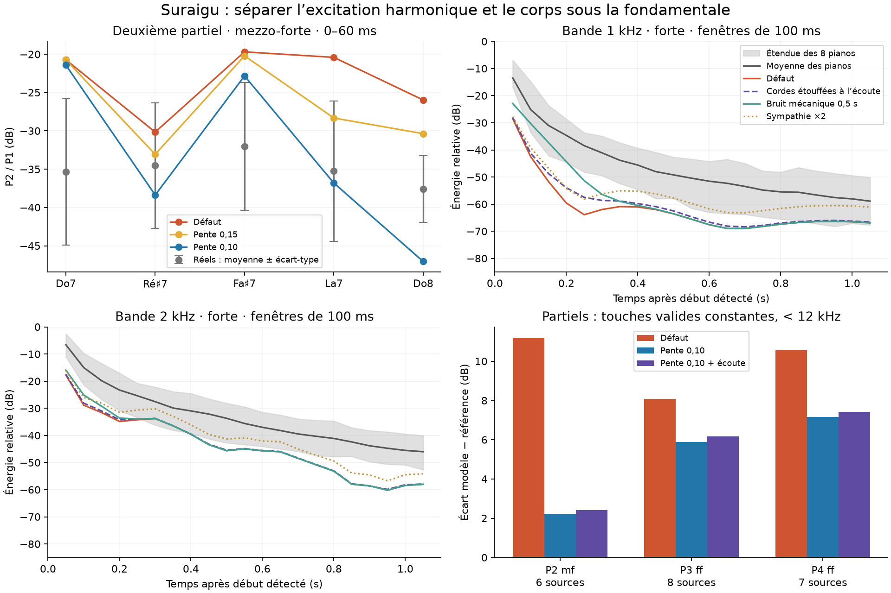

# Suraigu : excitation harmonique et corps sous la fondamentale

28 octobre 2026 — branche `codex/piano-realism-audit`. Suite de la [correction du banc](bench_bias_correction.md).

Les deux défauts sont distincts. L’excès de partiels vient principalement de l’excitation marteau-cordes du modèle actuel. Le manque à 1–2 kHz concerne surtout le corps sonore sous la fondamentale, avec une contribution manquante des cordes étouffées et des résonances encore insuffisantes. Les ablations identifient les voies qui produisent ces bandes dans le modèle ; les enregistrements ne permettent pas encore d’attribuer tout l’écart à un composant physique précis du piano réel.

**Aucun réglage de production ni code du moteur n’a été modifié dans cette étape.** Les variantes sont des expériences séparées. Le meilleur score global ne suffit pas à choisir un nouveau défaut.



## Protocole

- Références `channel-power-v2` : Plath à gain fixe, énergie des canaux séparés, huit sources cibles. Ni références ni baseline modifiées ici.
- Même instrument que l’audit précédent, incluant le contact par corde et l’hystérésis 0,6 hérités du travail en cours ; microphones proches, studio et toucher Disklavier du banc.
- 210 rendus courts : Do7, Ré♯7, Fa♯7, La7, Do8, vélocités 56 et 100, 21 conditions. Ablations à une cause, puis essais de paramètres. Le début détecté du rendu témoin fixe les fenêtres des mesures énergétiques d’ablation.
- Sept candidats complets : **630 nouveaux rendus**, 90 notes par candidat, tenues 20 s + 0,5 s de relâchement. Analyse Python et suivi Rust des partiels en énergie stéréo.
- 40 diagnostics de contact, force mesurée séparément dans chaque corde du modèle. L’énergie des spectres des cordes est additionnée ; les forces ne sont pas moyennées avant analyse.
- Contrôle de l’outil de rendu : A0 ff, C4 mf et C8 ff identiques octet pour octet aux WAV de la baseline. Les onze tests Python passent, dont trois contrôles de la nouvelle mesure énergétique.

Les courbes ajoutées utilisent des fenêtres de 100 ms et une normalisation énergétique indépendante de leur longueur. Elles sont relatives à la bande d’octave la plus forte des 100 premières ms de chaque prise. Leur échelle n’est donc pas directement celle de `bands_att`, dont le calcul historique compare des sommes spectrales de fenêtres de longueurs différentes. La mesure historique reste identique pour le modèle et les références et n’a pas été changée dans cette expérience.

## 1. Le mot « attaque » recouvrait deux instants différents

`attack_mf/ff` mesure les partiels sur **0–60 ms**, relativement à P1. `bands_att` mesure les bandes sur **50–450 ms**, relativement à la bande la plus forte des 100 premières ms. `bands_sus` couvre 600–1000 ms.

Dans le suraigu, la bande de 1 kHz est entièrement sous la fondamentale. Celle de 2 kHz contient encore la fondamentale de Do7 et Ré♯7, mais plus celles de Fa♯7 à Do8. Il faut donc distinguer ces groupes au lieu d’assimiler toute l’énergie à 2 kHz à un manque de partiels.

À touches communes entre modèle et chaque piano, les écarts restent : **+11,3 dB pour P2 mf**, **−22,5 dB à 1 kHz** et **−9,9 dB à 2 kHz** dans la fenêtre 50–450 ms. Chaque piano compte une fois ; les prises sans partiel valide sont exclues avec leur contrepartie modèle. Le manque à 2 kHz est concentré sur les trois touches les plus hautes : environ 13,0 / 17,6 / 25,0 dB pour Fa♯7 / La7 / Do8 ; Do7 et Ré♯7 ont au contraire un léger excès.

## 2. Ablations : ce que chaque voie explique

Variations moyennes en dB par rapport au témoin. Les bandes sont ici mesurées à référence temporelle et gain identiques, sans renormaliser chaque ablation. Bandes : cinq notes ff ; partiels : notes mf et ff valides.

| Contribution retirée | Δ P2 attaque | Δ 1 kHz, 0–60 ms | Δ 1 kHz, 50–450 ms | Δ 2 kHz, 50–450 ms |
|---|---:|---:|---:|---:|
| Bruit mécanique direct `action` | ≈ 0 | −6,34 | −0,82 | −0,01 |
| Choc du clavier `keybed` | ≈ 0 | ≈ 0 | −0,01 | ≈ 0 |
| Cadre | +0,30 | −0,18 | −0,03 | −0,03 |
| Ceinture | ≈ 0 | −0,01 | ≈ 0 | ≈ 0 |
| Résonance sympathique | +0,16 | −0,10 | **−9,35** | **−11,91** |
| Salle | +0,28 | −0,53 | −0,46 | −0,30 |

Le bruit mécanique fournit une bonne part du 1 kHz initial, mais presque plus rien dans la fenêtre tardive. Les résonances sympathiques dominent ce qui subsiste sous la fondamentale. Ni le cadre, ni la ceinture, ni le choc du clavier actuels ne portent l’énergie manquante. Cela ne prouve pas que ces éléments soient négligeables sur un piano réel : leur excitation ou leur rayonnement modélisé peuvent justement être insuffisants.

La sortie de force au chevalet, sans rayonnement, conserve un P2 mf plus élevé que la sortie acoustique de **2,4 à 12,6 dB**, selon la touche. Ce contrôle utilise une autre unité : seules les proportions P2/P1 sont comparées. Il supprime aussi salle, bruits directs et écoute sympathique. Avec les ablations précédentes, il indique que le rayonnement actuel atténue déjà P2 ; une égalisation globale de la table n’est pas la première piste pour corriger son excès.

### Le mode Overkill isolé

Le gain de 3,6 dB à 1 kHz en Overkill semblait pouvoir révéler un problème numérique. Des contrôles séparés montrent :

- doubler seulement les sous-pas du contact : effet moyen sur P2 inférieur à 0,02 dB, presque aucun effet sur les bandes basses ;
- lever les plafonds de modes : aucun changement sur ces notes ;
- abaisser les seuils de silence : effet négligeable ;
- autoriser la non-linéarité dans le suraigu, avec ses autres limites actuelles : effet négligeable ;
- **laisser les cordes étouffées écouter la table** : +3,64 dB à 1 kHz sur 50–450 ms, +0,15 dB à 2 kHz ; cela reproduit l’essentiel du gain observé en Overkill.

Le raccourci est dans `Engine::add_listeners` et la condition `engagement < deaf_above`. La variante laisse tous les étouffoirs en place, avec leur amortissement : elle ne simule pas la pédale enfoncée. C’est une contribution physique négligée par le mode Full, mais **elle ne comble qu’une petite partie des 22 dB manquants**. Son coût sur la polyphonie et les autres raccourcis n’a pas été validé pour un changement en production.

## 3. Le contact explique une grande partie de l’excès harmonique

La pente `hardness_slope_top` entre exponentiellement dans la raideur du feutre au-dessus de MIDI 84. Passer de 0,20 à 0,10 divise cette raideur par environ 3,3 à Do7 et 11 à Do8 ; ce n’est pas un petit ajustement uniforme.

À Do8 mf, la durée du contact passe de **0,542 à 0,696 ms**. Le rapport spectral P2/P1 de la force par corde passe de −24,4 à −47,1 dB ; le P2/P1 acoustique passe de −26,0 à −47,0 dB. Le changement de forme/durée de la force agit fortement sur les fréquences excitées. Retirer la souplesse de la tige produit au contraire davantage de partiels en moyenne : elle aide déjà le modèle.

La pente 0,10 rapproche la moyenne de P2 mf des références, mais laisse Do7 et Fa♯7 trop riches et assombrit excessivement Do8 : −47,0 dB contre −37,6 ± 4,3 dB dans les prises disponibles. Elle baisse aussi le niveau relatif du suraigu mf d’environ 3,8 dB. La pente 0,15 est plus prudente, mais laisse P2 mf à z = +2,81.

L’ancienne [étude de niveau du suraigu](top_level.md) avait retenu 0,20 comme compromis de niveau et de timbre. Avec le contact actuel, il faut maintenant vérifier la forme de force et les ratios **touche par touche et dynamique par dynamique**, plutôt que retoucher une seule pente à partir d’une moyenne de registre.

## 4. Comparaison complète avec le banc corrigé

191 composantes communes dans tous les essais ; score = RMS des z, plus petit = plus proche des références. Ce score est une distance descriptive, pas un test perceptif ni une validation statistique indépendante.

| Variante | Score global | Score suraigu | Alertes \|z\| > 2 | z P2 mf | z bande 1 kHz attaque | z bande 2 kHz attaque |
|---|---:|---:|---:|---:|---:|---:|
| Défaut | 1,064 | 1,633 | 15 | +3,86 | −4,31 | −2,74 |
| Pente 0,15 | 1,025 | 1,533 | 11 | +2,81 | −4,15 | −2,62 |
| Pente 0,10 | 1,012 | 1,480 | 10 | +0,56 | −3,97 | −2,47 |
| Bruit mécanique 0,05 au lieu de 0,02102 | 1,053 | 1,600 | 15 | +3,86 | −3,92 | −2,73 |
| Durée mécanique 0,5 s au lieu de 0,2 s | 1,020 | 1,504 | 14 | +3,86 | −1,77 | −2,41 |
| Gain sympathique ×2 | 1,021 | 1,508 | 12 | +3,77 | −3,33 | −1,76 |
| Cordes étouffées à l’écoute | 1,046 | 1,598 | 14 | +3,92 | −3,56 | −2,63 |
| Pente 0,10 + écoute | **0,993** | **1,443** | 10 | +0,62 | −3,22 | −2,37 |

Le bruit mécanique plus fort ne résout aucun des deux défauts. Le prolonger améliore surtout la fenêtre 50–450 ms à 1 kHz (+13,1 dB), sans apporter la même correction à 2 kHz ni au sustain : c’est une hypothèse de compensation, pas une identification de la source absente.

Doubler le gain sympathique améliore les bandes tardives, mais laisse presque intact l’excès harmonique initial. Son meilleur score ne justifie pas de multiplier globalement une interaction physique encore mal attribuée.

La combinaison pente 0,10 + écoute est la meilleure des variantes testées, mais conserve les déficits sous la fondamentale, les inégalités par touche et une baisse du niveau mf. L’écoute des cordes étouffées améliore le médium mais éloigne légèrement le grave. Aucune variante n’est promue au défaut.

### Une autre limite de mesure à ne pas confondre avec une régression

Sur Fa♯7, P4 réel du modèle est à environ **13,02 kHz**. La recherche approximative de `partials()` utilise une inharmonicité générique : sa fenêtre se termine avant cette fréquence, tandis que son critère d’admission nominal est encore sous 12 kHz. Elle peut donc retenir une fuite spectrale très faible, étiquetée P4. Cette valeur passe de −95,7 dB à « non mesurable » en adoucissant le feutre.

La moyenne du registre change alors de population. Le score historique de P4 mf semble empirer avec la pente 0,10 (z +0,85 → +3,69), alors que les P4 des touches encore valides ont diminué. Inversement, le P4 ff semble entièrement corrigé dans la moyenne globale alors qu’il reste trop fort à touches constantes.

La comparaison supplémentaire impose les mêmes touches pour tous les candidats, exige un partiel suivi dans la référence et exclut les fréquences physiques ≥ 12 kHz. Écarts moyens modèle − référence, un poids par piano :

| Partiel / dynamique | Sources | Défaut | Pente 0,10 | Pente 0,10 + écoute |
|---|---:|---:|---:|---:|
| P2 mf | 6 | +11,19 dB | +2,22 dB | +2,42 dB |
| P3 ff | 8 | +8,08 dB | +5,88 dB | +6,16 dB |
| P4 ff | 7 | +10,57 dB | +7,15 dB | +7,43 dB |
| P4 mf | 3 | +23,00 dB | +15,50 dB | +15,87 dB |

P4 ne dispose que de Do7/Ré♯7, parfois d’une seule touche par source ; sa conclusion est donc plus fragile. Les forces du contact montrent un mécanisme crédible et P2 s’améliore nettement, mais **« tous les partiels sont corrigés » serait faux**. Exiger un partiel suivi peut aussi exclure un partiel d’attaque qui décroît très vite : ce contrôle ne remplace pas une future mesure des fréquences d’attaque. Les JSON conservent les touches et nombres de sources. Ce diagnostic de sensibilité est séparé du protocole v2 : ses références historiques n’ont pas été réécrites silencieusement.

## 5. Axes prioritaires avant de changer le défaut

1. **Excitation et voicing par touche.** Suivre P2/P1, P3/P1 et P4/P1 à fréquences réellement identifiées, avec masques de validité constants, ainsi que le niveau absolu relatif au médium. Examiner ensemble durée/forme du contact, raideur et hystérésis. Éviter de gagner sur Do8 en conservant un Do7 excessif. La pente 0,15 fournit un contrôle prudent ; 0,10 montre la sensibilité, pas une solution finale.
2. **Corps sous la fondamentale, séparé en temps et en nature spectrale.** Comparer 0–60, 50–150, 150–350 et 600–1000 ms, avec énergie normalisée par durée. Distinguer les raies de cordes non frappées du fond diffus/transitoire ; traiter Do7/Ré♯7 séparément de Fa♯7–Do8 pour la bande de 2 kHz. C’est le déficit majeur encore ouvert.
3. **Interaction des cordes étouffées avec la table.** Conserver le test `listen_all` comme référence physique et chercher ensuite une approximation moins coûteuse si son intérêt se confirme sur des séquences. Comparer pédale haute/basse et relâchement sur un même piano réel pour identifier cette contribution sans changer simultanément micros, niveau et instrument.
4. **Excitation et rayonnement mécaniques.** Les ablations actuelles ne désignent pas encore ce qui manque dans le piano réel. La force au chevalet, les réponses table/cadre/ceinture et le bruit direct doivent être comparés séparément. En particulier, le gain micro de −9,6 dB du banc s’applique aux banques rayonnantes mais pas au bruit `action`, ajouté ensuite : celui-ci est déjà relativement favorisé. Un simple gain de mécanisme ne serait pas une calibration transportable entre écoutes.

Les prises existantes suffisent pour confirmer ces écarts spectraux et temporels, pas pour identifier à elles seules une erreur unique de feutre, de mobilité du chevalet ou de rayonnement. Aucun jugement d’écoute à l’aveugle ni mesure de polyphonie temps réel n’a été effectué ici.

## Reproduction et résultats

```sh
CARGO_TARGET_DIR=/tmp/piano-realism-target cargo build --offline --release -p piano-render -p piano-analysis
CARGO_TARGET_DIR=/tmp/piano-realism-target cargo build --offline --release -p piano-render --example top_probe
python3 tools/top_register_audit.py screen --out out/top-register
python3 tools/top_register_audit.py compare --out out/top-register
PYTHONDONTWRITEBYTECODE=1 python3 -m unittest discover -s tools -p 'test_*.py'
```

Le worktree dispose d’un lien `target` vers ce répertoire de compilation. `--measure-only` permet de remesurer des rendus existants ; il faut conserver leurs paramètres et leur manifeste.

- [Comparaisons complètes et écarts déplacés](../bench/top-register/comparison.json), [manifeste et empreintes des WAV](../bench/top-register/manifest.json).
- [Ablations](../bench/top-register/diagnostics.json), [raccourcis isolés](../bench/top-register/probes.json), [contact](../bench/top-register/contact.json).
- [Comparaisons à couverture constante](../bench/top-register/paired-candidates.json), [courbes temporelles](../bench/top-register/curves.json).
- [Script reproductible](../tools/top_register_audit.py), [rendu de diagnostic](../crates/piano-render/examples/top_probe.rs).
- WAV, presets expérimentaux, suivis et journaux complets dans `out/top-register/` du worktree ; résultats compacts et scorecards versionnables dans `bench/top-register/`.
