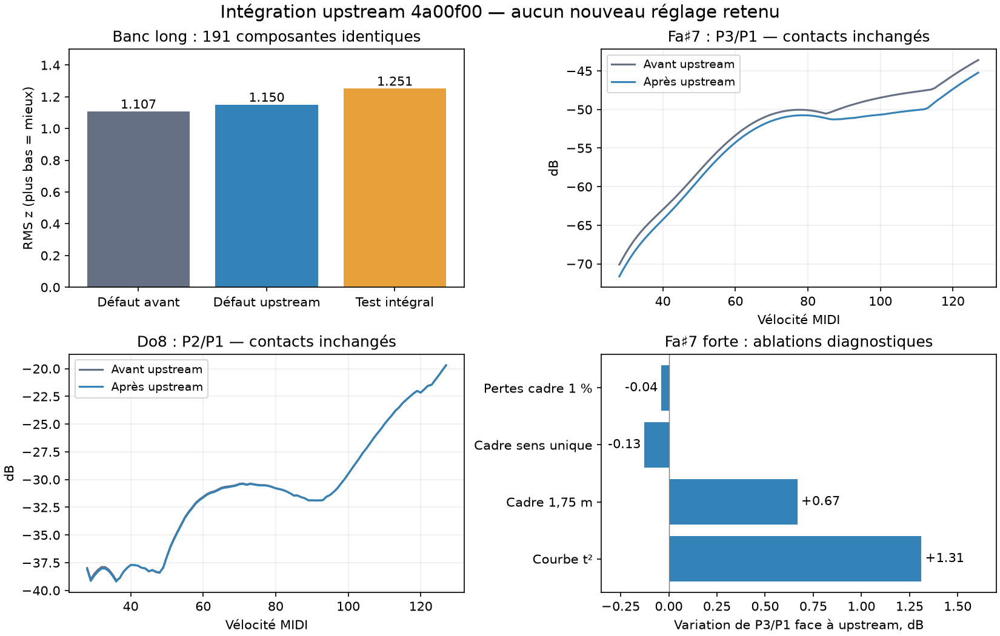

# Intégration upstream et nouveau banc

29 octobre 2026. `origin/main` intégré jusqu’à **4a00f00**, dans `codex/piano-main-revalidation`, par la fusion **cdbc3a6**. Le banc corrigé reste stéréo en puissance, avec Plath à gain fixe 0,01/Pa. Aucun contact n’est recalibré ; le mode Rayleigh reste explicite et expérimental. Les changements du défaut viennent uniquement d’upstream.

## Changements examinés et intégrés

Huit commits séparaient le moteur de recherche de main :

- cadre au contour du piano, longueur 1,9 m, modes propres au contour jusqu’à 3 kHz ;
- retour de l’admittance du cadre dans les modes des cordes, activé par `frame.coupling=1` ; pertes du cadre portées de 1 à 2 % ;
- courbe des écarts d’accord des unissons portée de t² à t⁴ : resserrement dans l’aigu, largeur de Do8 inchangée ;
- chevalet des basses remis dans l’ordre des cordes réelles ;
- modèle 3D de la ceinture et des chevalets repris ;
- options de diffusion, nervures régulières/irrégulières et chevalets-poutres ajoutées, **toujours désactivées par défaut** ;
- `presets/default.toml` régénéré. Il correspond maintenant au défaut compilé : aucune différence dans l’export contrôlé.

La seule collision de fusion concernait `bench/baseline.json`. La baseline du banc corrigé a été conservée ; celle d’upstream, sans identifiant de version d’analyse, est archivée sous `bench/upstream-4a00f00/upstream-baseline-unversioned.json`. Ses valeurs ne sont pas mélangées à celles du banc stéréo corrigé.

## Portage de l’UI expérimentale

Une simple fusion aurait laissé deux erreurs silencieuses :

1. Les notes expérimentales sont reconstruites individuellement. Elles reçoivent désormais **la même admittance du cadre** que les notes normales ; passer `None` aurait neutralisé le nouveau couplage sur les touches justement surveillées.
2. Les anciens presets complets auraient conservé l’ancienne longueur et les anciennes pertes du cadre. Les presets sont repartis du **nouveau défaut compilé**, puis des mêmes écoute, toucher et modifications de contact. Les noyaux des deux écoutes ont été régénérés à 5 mm et suréchantillonnage de délai 32.

Le bundle contient maintenant une empreinte des sources physiques compilées. Une ancienne version, ou un bundle d’une autre révision, est refusé. Le radiateur causal refuse aussi `scatter != 0` : l’option upstream est intégrée au moteur normal, mais sa diffusion n’est pas silencieusement ignorée par le radiateur expérimental. Sa version causale reste à développer avant de l’essayer dans ce mode.

## Couverture et protocole

Trois profils ont été entièrement rejoués aux micros proches et au point d’écoute du pianiste :

- **défaut upstream** ;
- **contacts retenus**, avec le calcul modal de rayonnement normal ;
- **intégral**, mêmes contacts et nouveau rayonnement complet.

Chaque profil et chaque écoute comprend **48 attaques longues** (notes 93–108, vélocités 45/56/100) et **400 frappes de balayage** (Do♯7, Ré♯7, Fa♯7, Do8 ; toutes les vélocités 28–127), soit **2 688 WAV**. Les **459 observations d’attaque** et **71 de tenue** sont exactement celles de l’étude précédente. Aucun candidat ne peut gagner en supprimant un partiel faible. Le retard commun connu de 128 échantillons du mode intégral est compensé, sans normalisation des fichiers.

Le banc long a aussi été rejoué pour le défaut upstream et le mode intégral : **90 frappes par profil**, de La0 à Do8 par tiers d’octave, chacune tenue 20 s plus 0,5 s de queue. Les **191 composantes** du score précédent sont toutes conservées ; aucune disparue ni ajoutée.

## Résultats du banc long

| Profil | RMS z, plus bas = mieux | Composantes hors tolérance |
|---|---:|---:|
| Ancien défaut, banc corrigé | 1,107 | 14 |
| Défaut upstream | 1,150 | 15 |
| Contacts retenus + intégral après upstream | 1,251 | 12 |

Upstream raccourcit bien les queues de l’aigu : en forte, l’enveloppe moyenne à 1 s passe de −26,18 à −29,49 dB et à 2 s de −35,20 à −38,59 dB. L’écart en z à 1 s passe de +1,4 à +0,5 en forte, +0,8 à environ 0 au mf, +0,7 à +0,1 au pp.

Cela ne constitue pas une amélioration globale du banc corrigé : les partiels élevés de tenue de l’aigu et certaines bandes du suraigu reculent. La bande d’attaque autour de 2 kHz du registre supérieur passe notamment de z −3,2 à −4,4. La queue mf/pp à 2 s devient un peu trop faible. Les scores publiés dans les notes upstream ne sont pas directement substituables à ces mesures stéréo corrigées.

Le mode intégral conserve moins de composantes hors tolérance que le défaut, mais les écarts restants sont plus grands en moyenne. Il reste donc une version de test, pas une proposition de nouveau défaut.

## Touches surveillées, contacts inchangés

Mesures aux micros rapprochés, moyenne des erreurs absolues par piano puis entre pianos :

| Mesure | Intégral avant upstream | Intégral après upstream |
|---|---:|---:|
| MAE Do7–Do8 | 8,915 dB | 8,814 dB |
| MAE Fa♯7 | 7,637 dB | 7,611 dB |
| MAE Do8 | 4,449 dB | 4,441 dB |
| MAE Do8 mf | 2,601 dB | 2,559 dB |
| Écart moyen signé P3 Fa♯7 forte | −0,025 dB | **−2,227 dB** |
| Creux maximal Fa♯7 P2 | 0,762 dB | 0,408 dB |
| Creux maximal Fa♯7 P3 | 0,500 dB | 0,536 dB |
| Creux maximal Do8 P2 | 1,537 dB | 1,491 dB |

L’amélioration légère des MAE globales masque donc un recul spécifique : **P3 de Fa♯7 forte devient trop faible**. Les creux ne reviennent pas à leur ampleur ancienne, mais P3 de Fa♯7 se dégrade légèrement : +0,036 dB aux micros proches, et de 0,865 à 1,023 dB au pianiste. Do8 au pianiste passe de 2,309 à 2,240 dB de creux P2.

Le volume de Do8 au pianiste varie de moins de 0,008 dB sur pp/mf/forte ; sa bande 1–2 kHz de moins de 0,012 dB. Le diagnostic de domination par l’action demeure donc pertinent. Aux micros proches, le volume mf perd **0,36 dB** ; la bande 1–2 kHz perd 0,42/0,46 dB au pp/forte et gagne 0,075 dB au mf. Les gains antérieurs ne sont pas entièrement inchangés.

### Pourquoi P3 forte de Fa♯7 a bougé

Ablations indépendantes du profil upstream, sans sélection d’un nouveau contact :

| Modification temporaire | Variation de P3/P1 forte |
|---|---:|
| Revenir à la courbe d’unisson t² | +1,312 dB |
| Revenir à la longueur de cadre 1,75 m | +0,668 dB |
| Désactiver le retour du cadre vers les cordes | −0,126 dB |
| Revenir aux pertes du cadre à 1 % | −0,038 dB |
| Revenir à l’ensemble de ces valeurs numériques antérieures | +2,209 dB |

La courbe d’unisson et la longueur du cadre expliquent l’essentiel du déplacement dans ces essais. Les effets isolés ne sont pas strictement additifs. Le dernier essai conserve encore le nouveau code de contour du cadre ; il ne prétend pas restaurer tout l’ancien moteur. **Aucune de ces variantes n’a été chargée dans l’UI ou promue.**



## Vérifications et version laissée ouverte

- 24 comparaisons indépendantes, quatre touches × trois dynamiques × deux écoutes : reconstruction hors ligne à partir des forces contre le moteur live, erreur RMS au pire **−140,89 dB**. Les nouveaux résultats ne viennent pas d’un ancien noyau réutilisé.
- 12 WAV normaux identiques bit à bit entre la compilation avec et sans feature expérimentale, pour le **nouveau** moteur.
- 101 tests Rust réussis ; un test de changement de périphérique audio reste ignoré par la suite automatique. Neuf tests Python du banc réussis.
- Stress polyphonique et pédales à 48 kHz, deux threads et 512 échantillons : charge moyenne 16,8 %, percentile 99 35,5 %, maximum 39,4 %, aucun dépassement. Aucune allocation/libération pendant les callbacks contrôlés. Ce résultat décrit cette machine et cette séquence.
- Vue 3D et bandeau de test contrôlés visuellement. L’UI laissée ouverte utilise `out/upstream-4a00f00/bin/unsampled-piano` et le bundle `player_actual/bundle.toml`, SL STUDIO canal 1 et Omniphony Router. Paramètres acoustiques figés, clavier et pédales actifs, configuration séparée sous `/tmp/piano-rayleigh-ui/config`.

Les résultats sont sous `bench/upstream-4a00f00/`, les sons et filtres sous `out/upstream-4a00f00/`. Le [lanceur](../bench/rayleigh-ui/launch.sh) vérifie l’empreinte et régénère un bundle incompatible ; le premier exporteur historique indique désormais la procédure à jour.

```sh
cargo build --release --offline -p piano-play -p piano-render -p piano-analysis \
  --features piano-play/experimental-rayleigh,piano-render/experimental-rayleigh --bins --examples
OPENBLAS_NUM_THREADS=1 python bench/upstream-4a00f00/prepare.py
OPENBLAS_NUM_THREADS=1 python bench/upstream-4a00f00/bench.py
OPENBLAS_NUM_THREADS=1 python bench/upstream-4a00f00/full.py
OPENBLAS_NUM_THREADS=1 python bench/upstream-4a00f00/check.py
OPENBLAS_NUM_THREADS=1 python bench/upstream-4a00f00/ablate.py
```

La suite logique est de reprendre P3 forte de Fa♯7 sous la nouvelle courbe d’unisson, avec les mêmes gardes Do8 et de vélocité. Cette intégration ne le retouche pas.
