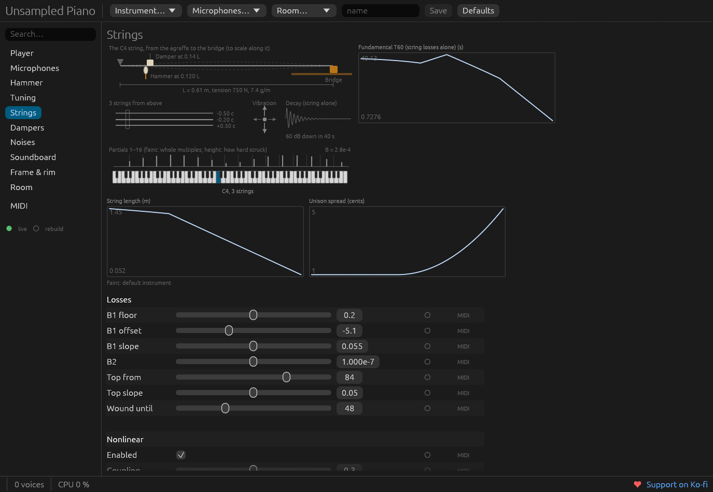

L’interface est la même dans l’application autonome (`--ui`) et dans l’éditeur du plugin. Elle
montre **tous les paramètres** de l’instrument — pas de façade simplifiée qui cacherait le
modèle — rangés comme un piano est construit.

## Disposition

- **En haut** — le nom de l’instrument et les menus de presets : *Instrument* (classés par
  famille) et *Listening* (écoute : microphones, salle). Charger un preset d’écoute conserve
  l’instrument ; charger un instrument conserve le dispositif d’écoute. *Save* enregistre les
  vôtres.
- **À gauche** — les pages : Player (jeu), Microphones, Hammer (marteau), Tuning (accord),
  Strings (cordes), Dampers (étouffoirs), Noises (bruits), Soundboard (table d’harmonie),
  Frame & rim (cadre et ceinture), Room (salle) et MIDI. Un champ de recherche filtre tous les
  paramètres par nom ou par chemin.
- **Au centre** — la page : un **croquis** de la partie du piano qu’elle couvre, dessiné d’après
  les réglages en cours (la profondeur du feutre, la courbe de la pédale, le point de frappe et
  l’écart du chœur suivent les curseurs), les **courbes** de ses lois touche par touche, puis
  ses paramètres.
- **En bas** — l’état : reconstruction en cours, durée de la dernière, nombre de voix et charge
  CPU du thread audio (pic de la dernière seconde).

Chaque page de cette documentation correspond à une page de l’interface — voir la
[référence des paramètres](/fr/docs/parameters/).

## En direct et à reconstruction

Une marque verte à côté d’un paramètre signifie **en direct** : le moteur l’applique pendant que
vous jouez. Les autres façonnent l’instrument précalculé ; en modifier un lance une
**reconstruction** en arrière-plan — environ un dixième de seconde — et le nouvel instrument
prend la place de l’ancien sans couper les notes que vous tenez. Faites glisser un curseur à
reconstruction tout en jouant : vous entendez le piano changer sous vos doigts.

## Une aide sur chaque réglage

Cliquez sur le nom d’un paramètre : un panneau latéral vous explique **ce que c’est sur un vrai
piano**, en termes simples, et **comment le modèle s’y prend** — l’équation, l’origine de la
valeur par défaut, le document qui l’a mesurée. Survolez un paramètre : la partie du croquis
sur laquelle il agit s’éclaire.

## Apprentissage MIDI

N’importe quel paramètre peut suivre un contrôleur de votre clavier. Cliquez sur la case du
contrôleur au bout de la ligne d’un paramètre, bougez un bouton ou un fader sur une partie de sa
course : il est assigné sur toute la plage du paramètre (cliquez à nouveau pour en apprendre un
autre, clic droit pour le retirer ; Échap annule). Les paramètres en direct sont alors pilotés à
l’échantillon près sur le thread audio, même fenêtre fermée ; les paramètres à reconstruction
reconstruisent l’instrument à mesure que vous tournez. La page **MIDI** liste les assignations.
Cette table appartient à vos contrôleurs, pas à l’instrument : elle est enregistrée à part des
presets (`midi.toml` dans le dossier de configuration). Voir [MIDI et automation](/fr/docs/midi/).
